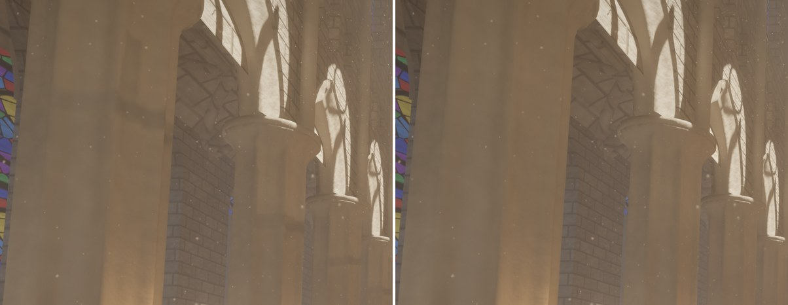
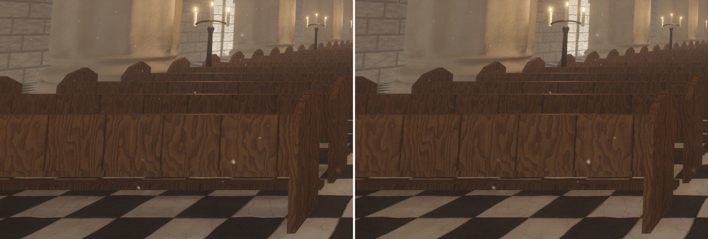

# Round-4 performance regressions (agent `perf-regressions`)

Round 4 made the default demo views slower than round 3 (2560×1440, RTX 3090): valley 8.2 → 9.0 ms, cathedral
10.9 → 15.1 ms, forest 14.7 → 18.5 ms. This note records where the time went, what was fixed and what is the cost of
new, visible features.

**Method.** A release build of round 3 (6527455) and of every first-parent merge on `main` since (`git log
--first-parent 6527455..main`), headless at 2560×1440, 150 frames, the HUD's GPU frame and per-pass timestamps;
interleaved A/B runs, minimum of 2–3 (the RTX 3090 was shared with another agent's renders, so single runs are
sometimes 2–3× slower; minima and per-pass minima are stable to ±0.05 ms). Experiments used environment switches in
throw-away builds (moving lights without shadow maps, move footprints off for local lights / the sun, the campfire
light without shadows).

## Findings

### Cathedral: the swinging chandeliers' lights (−4.6 ms)

Per pass (100 %): `vsm raster` 3.23 ms, `vsm expand` 0.70, `cull` 0.59 (0.28 paused), `vsm resolve` 0.15 with the
chandeliers swinging; the sun's share of it is 0.2 ms (local light shadow maps off: 9.67 moving vs 9.53 paused). Two
causes, measured separately:

1. **Moving lights' shadow maps — 3.5 ms.** In the classic light loop a light that moved within 30 frames still took a
   shadow-map slot when static lights left one (`moving_shadow_maps = !mega_lights`): 10 of the 11 chandelier lights
   got slots, and since a moving light's cached pages are stale every frame, their cube maps were re-rendered in full
   every frame (~80 full pages, 130 k (cluster, page) draws). Options evaluated:
   * (a) no slot while moving: distance-field soft shadows, as for lights beyond the 32-slot budget and under
     MegaLights — 14.71 → 11.25 ms; the lighting pass even gets cheaper (2.13 → 1.87 ms: four traced lights per pixel
     cost less than the mask's filtered taps of ten more mapped lights), and the page pool is no longer full (78
     requested pages went unallocated every frame, static lights' shadows included; now none).
   * (b) shadow maps refreshed at a reduced rate from a held origin (re-render once the light moved a fraction of its
     source radius) would keep the VSM look between refreshes, but the chandelier's own ring and candles move with the
     light: a held map shows them where they were, a few centimetres off at 0.35–1.4 m from the light, i.e. self-shadow
     acne and light leaks on the fixture itself that pop at every refresh; refreshes also come in bursts of whole cube
     maps (0.3–0.4 ms each).
   * (c) caching static casters in light space: a different cache structure (UE re-renders moving local lights too).
   (a) was chosen: the chandelier lights have a 1.4 m source radius, so their shadows are very soft and the
   distance-field version is close (image below); `RenderSettings::moving_light_shadow_maps` /
   `--moving-light-maps` restores the old behaviour for comparisons.
2. **Move footprints of the chandeliers in other lights' pages — 0.8 ms.** Each chandelier's iron mesh is a 2.8 m ring
   on a 12 m chain; local lights tested its bounding sphere (6.3 m radius) and every move refreshed every page under
   it at once, so the 22 static candle lights refreshed ~820 pages a frame (dynamic casters only, but `vsm expand`
   loops over each cluster's covered pages: 0.68 ms, plus culling). Now (`vsm_motion.rs`) a long box is cut into
   slices along its longest axis (up to 8, roughly cubic: the chandelier's iron gets five of 2.4 m), each slice has
   its own footprint, and a movable caster's footprint carries a speed bound per slice (its largest corner
   displacement per frame, held with a 0.95 decay per frame) instead of "unbounded": as for the wind, a page is
   refreshed once the slice may have moved 2 of its texels since the page was rendered. The slices next to the pivot
   barely move, the ring's slice refreshes fine pages every frame and coarse mips every few. A skipped page may show the
   caster up to 2 texels off, so the GPU pads move footprints by that much (`vsm_invalidate.wgsl`), and a caster that
   stops gets one last footprint at rest that refreshes everything under it. 822 → 25 pages a frame, 4.4 k → 0.2 k
   draws, `vsm expand` 0.68 → 0.23 ms.

With both, the swinging cathedral costs less than the paused one did (the paused cathedral still shadow-maps all 32
lights). Images: see *Image checks*.

### All scenes: debug-view colouring in the G-buffer resolve (−0.3 ms cathedral, −0.15 ms forest)

`material classify + resolve` went 0.73 → 1.01 ms (cathedral) and 0.79 → 0.94–0.99 ms (forest) with the dynamic-world
merge (f2ed688), with identical work (same visible clusters, images equal to 59.8 dB). Neither parent was slower;
the merge added one more case to the resolve's `switch frame.debug_view` (movable instances tinted for debug view 16),
and reverting just that case at f2ed688 restored 0.46 ms (1080p) from 0.61. The switch sits after the material
evaluation and keeps its inputs (cluster, triangle, instance record, corners, barycentrics, ...) alive across it: with a
dozen debug colourings the compiler spills or lowers occupancy for every lit pixel. Removing that one case on today's
`main` changed nothing (other cases keep the same values alive), so the fix compiles the whole switch out of the lit
pipelines: a `DEBUG_VIEWS` override in `gbuffer.wgsl` (and the voxel resolve's switch in `voxel_resolve.wgsl`), a fourth
resolve permutation bit in `passes/material.rs` (like `SKINNING` and `TESSELLATION`), on only while a debug view is
shown. Cathedral 1.01 → 0.73 ms, forest 0.99 → 0.85 ms at 1440p; debug views render as before.

### Forest: what is left is new features' cost

Bisect over the merges (forest, 100 %, minima of 2; per pass):

| merge | GPU | vsm raster | raster sw + merge | cull (+ late) | lumen surface cache | material | notes |
|---|---|---|---|---|---|---|---|
| round 3 (6527455) | 14.62 | 2.06 | 1.91 | 0.61 | 1.43 | 0.78 | |
| editor (a2c5f1f) | 14.70 | 2.22 | 1.92 | 0.61 | 1.44 | 0.78 | |
| skeletal (c473387) | 14.67 | 1.99 | 1.96 | 0.61 | 1.43 | 0.78 | |
| Lumen Lite (650f415) | 13.77 | 2.10 | 1.99 | 0.62 | 0.25 | 0.79 | surface cache −1.2 ms |
| dynamic world (f2ed688) | 14.07 | 2.21 | 1.99 | 0.62 | 0.25 | 0.94 | resolve +0.15 (fixed) |
| MegaLights (01ce9ac) | 13.88 | 2.24 | 1.98 | 0.62 | 0.25 | 0.93 | |
| volumes (fb1c769) | 17.06 | 4.53 | 1.99 | 0.72 | 0.26 | 0.93 | campfire light + effects |
| foliage (fa59fa0) | 18.10 | 4.01 | 3.01 | 1.37 | 0.25 | 0.99 | assemblies, voxels |
| assembly culling (0a55714) | 18.07 | 3.56 | 3.02 | 1.35 | 0.26 | 0.98 | |
| materials (378d8ff) | 18.00 | 3.75 | 3.01 | 1.33 | 0.25 | 0.99 | |
| tessellation (3bdd6c2) | 18.59 | 3.76 | 3.04 | 1.36 | 0.25 | 0.98 | noise (17.98 with `'`+`Insert`) |

* **The campfire's light (volumes merge): +2.0–2.3 ms**, not counted in the volumes feature's own measurement (it
  compared `'` off/on, and the light stays with `'` off). The fire got an 18 m shadow-casting point light 0.8 m above
  the teepee, in a clearing of wind-swayed ferns, grass and bushes: every frame ~120 more cube-map pages refresh their
  swaying casters (wind invalidation, as the round-3 lantern's ~65), 65 k more page draws; `vsm raster` 2.2 → 4.5 ms,
  `local light shadows` +0.09 ms. With its shadows off (experiment) the forest drops 18.4 → 16.6 ms. It is what makes
  the logs stripe the clearing, so it stays; the cost is now documented (README, *Volumes and particles*).
* **Nanite Foliage (foliage merge): +1.0 ms** (+2.0 with voxels off): the conifers' ≈ 26 k assembly part instances
  (culling 0.61 → 1.37 ms with the late pass) and their finer triangles (`raster sw + merge` 1.99 → 3.01), partly
  offset by voxel shadows (`vsm raster` −0.5). That is the feature's documented cost (`nanite-foliage.md`).
* The volumes' own passes (simulation, march, OIT) +0.4 ms; Lumen Lite's surface cache saves 1.2 ms of it all.
* Nothing in the VSM shaders' new skin / movable / tessellation code paths, the 255-light froxels or the larger
  cull uniform shows up: `cull`, `vsm expand`, `vsm mark`, `light culling` and `vsm invalidate` are unchanged
  outside the merges above.

## Results

GPU frame, 2560×1440, screen percentage 100 % / 67 %, minimum of 3 interleaved runs (medians within 0.1 ms of
them):

| scene | round 3 (6527455) | before (06023b6) | after | after vs before |
|---|---|---|---|---|
| valley | 8.09 / 5.61 | 8.92 / 5.63 | 8.65 / 5.43 | −0.27 / −0.20 |
| cathedral | 10.90 / 6.88 | 14.86 / 10.03 | 10.17 / 6.36 | −4.69 / −3.67 |
| forest | 14.53 / 11.01 | 18.42 / 12.07 | 17.94 / 12.05 | −0.48 / −0.02 |

The cathedral is now below round 3 (Lumen Lite's surface cache and the moving lights' freed slots); the paused
cathedral costs 10.5–10.7 ms (all 32 lights shadow-mapped). The valley's remaining +0.6 ms over round 3 are the lake
mist (volume march 1.0 ms at 100 %); the forest's +3.4 / +1.0 ms the campfire light and Nanite Foliage (above).

Per pass, 100 % (ms; minima of 3):

| cathedral | round 3 | before | after |
|---|---|---|---|
| vsm raster | 0.02 | 3.10 | 0.02 |
| vsm expand | 0.11 | 0.67 | 0.23 |
| cull | 0.27 | 0.58 | 0.31 |
| vsm resolve | 0.01 | 0.15 | 0.01 |
| vsm mark local | 0.15 | 0.16 | 0.09 |
| lighting | 2.15 | 2.14 | 1.88 |
| volumetric fog | 0.25 | 0.25 | 0.21 |
| material classify + resolve | 0.72 | 1.01 | 0.73 |
| lumen surface + radiance cache | 1.49 | 0.35 | 0.35 |
| shadow pages rendered / frame | 3 | 841 (756 dynamic-only) | 25 (dynamic-only) |

| forest | round 3 | before | after |
|---|---|---|---|
| vsm raster | 2.00 | 3.74 | 3.75 |
| raster sw + merge | 1.92 | 3.03 | 3.03 |
| cull + cull (late) | 0.61 | 1.37 | 1.35 |
| material classify + resolve | 0.77 | 0.99 | 0.85 |
| local light shadows | 0.09 | 0.18 | 0.18 |
| volume march + simulation | — | 0.32 | 0.32 |
| lumen surface + radiance cache | 1.43 | 0.26 | 0.26 |

| valley | round 3 | before | after |
|---|---|---|---|
| material classify + resolve | 0.76 | 0.88 | 0.84 |
| cull | 0.20 | 0.27 | 0.21 |
| vsm expand | 0.08 | 0.13 | 0.09 |
| volume march | — | 1.01 | 1.00 |
| shadow pages rendered / frame | 0 | 38 | 15 |

(The valley's sculpture and raft refresh 15 instead of 38 sun pages a frame with the speed-bounded footprints.)

## Image checks

2560×1440, frame 150 (the demo motion is deterministic), PSNR / largest difference / pixels changing by more than
24/255; "noise" = two runs of the same build:

| comparison | result | noise |
|---|---|---|
| valley before → after | 55.7 dB, max 62, 0.001 % | 56.1 dB, max 46, 0.001 % |
| forest before → after | 43.6 dB, max 178, 0.105 % | 41.9 dB, max 189, 0.141 % (wind, fire) |
| cathedral paused before → after | 58.7 dB, max 37, 0.001 % | 60.2 dB, max 31, 0.000 % |
| cathedral, old vs new move footprints (both with distance-field moving lights) | 61.2 dB, max 27, 0.000 % | |
| cathedral before → after with `--moving-light-maps` (only the footprints differ) | 58.8 dB, max 34, 0.001 % | |
| **cathedral before → after (moving lights' shadows)** | **42.2 dB, max 30, 0.020 %** | |

So the footprint slicing / speed bounds and the resolve permutation leave images at noise level; the only intended
change is the chandelier lights' shadows while they swing. Before (left, shadow-mapped) and after (right, distance
fields):

The soft band the capitals' shadows draw on the piers below them is fainter (the distance-field cone keeps less of
the capital's thin overhang), and the near floor differs by a few 1/255 steps; the pews, the candelabra and the
floor pattern are unchanged, and nothing flickers: static camera, 16 frames, 0.0063 % of pixels change by more than
24/255 per frame before and after. Judged acceptable for lights with a 1.4 m source radius that swing; at rest
(30 frames after `0` pauses the motion) they get their shadow maps back.

Browser (headless Chromium, WebGPU, `./build-web.ps1`): cathedral and forest render without WGSL or validation errors;
the cathedral shows 22 shadow-mapped lights and 23 dynamic-only pages a frame while the chandeliers swing.
Tests: `cargo test --workspace` green (new: slices near a pivot move slowly, speed bounds decay and stopped casters
settle, rectangles per slice).

## Remaining

* The campfire light's shadow refreshes (≈ 2 ms in the default forest view) stay: it is a new, visible feature. Local
  light pages refresh under swaying foliage whenever it may have moved 2 texels at the nearest depth of its bounding
  sphere, so big trees near a light refresh fine pages every frame (as the round-3 lantern did).
* Nanite Foliage's assemblies cost ≈ 0.75 ms of culling and ≈ 1 ms of finer triangles in the forest (documented by
  that feature).
* Moving lights in the classic loop keep distance-field shadows while they move: soft-light shadows match closely,
  sharp lights' contact detail under small occluders is coarser than a shadow map's until the light rests 30 frames.
* A move's speed bound is a heuristic (current displacement, decaying peak): a caster that slows down sharply may
  leave a page up to a few texels stale until it moves on or stops (then it is refreshed at rest).
