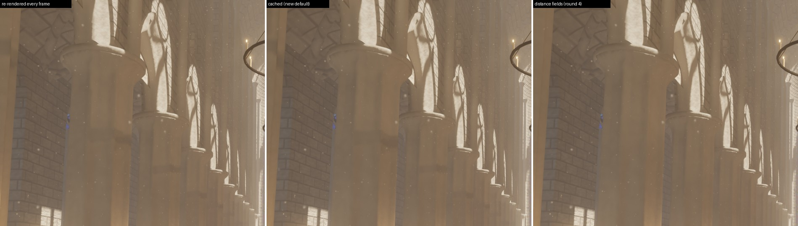
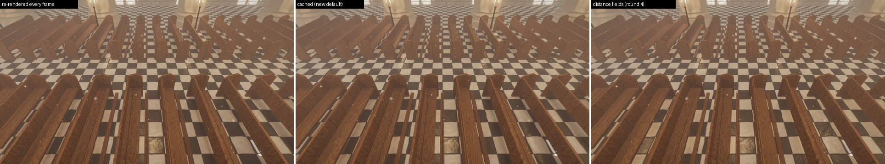
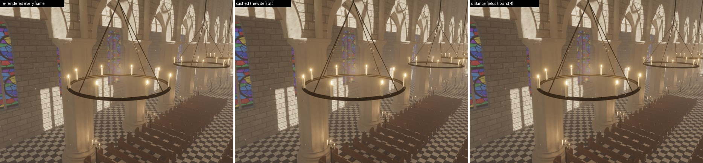
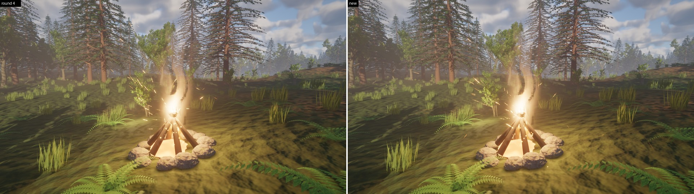
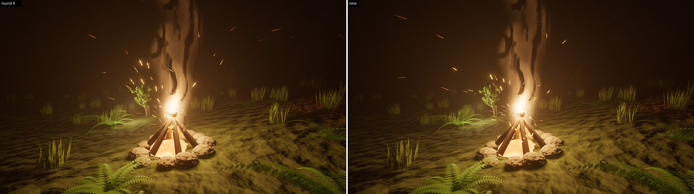

# Cached shadow maps for moving local lights; cheaper wind refreshes of local light pages (agent `local-shadow-cache`)

Two leftovers of the round-4 performance pass ([`perf-regressions.md`](../round4/perf-regressions.md)): a local light
that moves had distance-field shadows only (its virtual shadow map would re-render in full every frame: 3.5 ms for the
cathedral's eleven chandelier lights), and the forest's campfire light refreshed every one of its shadow pages every
frame (≈ 2 ms).

## README text

### Architecture: moving lights (`vsm_anchor.rs`, `vsm_local.rs`, `vsm_local_sample.wgsl`)

* **Cached shadow maps for moving lights.** A shadow map is a view from one point, so moving the point makes every
  cached page stale. But a light is not a point: it has a source radius, and its penumbra spans the shadows cast from
  every point of the source. A moving light's map therefore keeps the **origin** it was rendered from while the light
  stays within a tenth of its source radius of it (at least 1 cm), and three things make that look like a light that
  moves:
  * *Static casters stay cached, dynamic ones are redrawn.* The pages keep their static layer; the casters that move
    with the light (a chandelier's ring, candles and chain are `Movable`) are redrawn into them at their current pose
    from the held origin, by the same move footprints that refresh a resting light's pages. A fixture is never
    compared against a stale image of itself: no self-shadow acne or popping on the ring and candles (the objection
    to a held origin in round 4 was a held *map*, fixture included).
  * *Receivers correct the parallax.* An occluder at 1 / t of the receiver's distance casts its shadow
    (t − 1) · (light − origin) away from where the held map has it — nothing at contact, more the nearer the occluder
    is to the light. The PCSS filter knows t from its blocker search, so it moves its taps by as much, slid along the
    light direction onto the receiver's plane like the taps themselves (`local_filter_follow`; the marking requests
    twice the filter footprint for such lights). Shadows follow the light every frame instead of standing still
    between two renders, and a re-render moves nothing visible. Not corrected: what the origin cannot see (a sliver
    (t − 1) · offset wide next to silhouettes, at most 5 % of the penumbra there), occluders further off than the
    blocker search reaches (the shift fades out between one and two search radii: shadows of things right next to a
    large light, which the 10-texel filter cap draws far sharper than their real penumbra anyway), and the single-tap
    lookups of fog, translucent volumes and lights beyond a pixel's four filtered ones.
  * *Re-anchoring.* When the light leaves the tolerance, its requested pages are rendered in full from a new origin
    placed 0.75 tolerances **ahead** on its path, so it crosses the whole tolerance sphere before the next render
    (a chandelier light: every ~60 frames on average, from its speed). Renders are budgeted (`RenderSettings::moving_light_renders`, 1 per
    frame, `--moving-light-renders N`), the light furthest out of tolerance first; a light at rest for 30 frames is
    re-anchored once more at its own position. A moving light only *gets* a map if the budget can keep up with it
    (its recent top speed / the distance per origin, summed over the lights holding maps, ≤ the budget), and one
    that outruns it all the same (two tolerances out) gives its map up until it rests — so fast, sharp lights keep
    distance-field shadows instead of flipping between the two kinds (a 15 cm candle flame swinging at a chandelier's
    top speed needs a new origin every 3 frames: one render per frame sustains three of them).
  While it moves, a light's map is one mip coarser (UE's `r.Shadow.Virtual.ResolutionLodBiasLocalMoving`): a quarter
  of the pages for the per-frame redraws and the re-anchoring. Options evaluated: a static / dynamic page split alone
  cannot survive a moving origin (the static depth is a view from the old one); round-robin face refreshes and
  reprojecting depth leave holes at disocclusions and a stale fixture; "only pages visible receivers request" and
  "coarser mips" were already what the every-frame path rendered (80 pages, 130 k draws: the cathedral's instance
  count per page, not resolution, sets the cost). Holding the origin inside the source and correcting the parallax
  at the receiver is the only one that renders nothing for static casters.
  `RenderSettings::moving_light_shadows` (`MovingLightShadows::{Cached, DistanceFields, EveryFrame}`); MegaLights
  still traces moving lights.
  **Cost** (cathedral, default view, 2560×1440, eleven swinging chandelier lights, minimum of 3 interleaved runs on a
  shared RTX 3090): GPU frame 10.27 ms with distance fields (round 4) → **10.77 ms** cached, against 13.75 ms
  re-rendered every frame in round 4's build; at 67 % 6.26 → 6.52 ms. Of the +0.5 ms, 0.22 is the lighting (ten more
  shadow-mapped lights), 0.08 the marking, 0.06 page raster (re-anchoring and the fixtures' redraws: ~42 pages a
  frame, dynamic-only except in the frames that re-anchor a light), 0.10 culling and expansion. In the new build
  itself (the tighter face rectangles below also help the other two modes): distance fields 10.05 ms, cached
  10.77 ms, every frame 12.82 ms, paused (all 32 lights mapped, at rest) 10.43 ms.
  **Image** against the every-frame reference: 51.6 dB, 48.9 dB with the coarser mip (distance fields:
  42.2 dB), no pixel off by more than 24/255 (distance fields 0.02 %); from under a chandelier towards the pews
  42.9 dB (distance fields 34.4 dB, 1.2 % of pixels off by more than 24/255, now 0.07 %); chandelier close-up 49.7 dB
  (45.0). Static camera, 16 frames: 0.0063 % of pixels change by more than 24/255 per frame in all three modes.

  

  

  

### Architecture: wind and local light pages (`vsm_local_common.wgsl`, `vsm_expand.wgsl`, `vsm_invalidate.wgsl`)

* **Spheres across a cube face's near plane.** A cluster's bounding sphere that reaches a face's near plane cannot be
  projected, so it was given the whole face: every cluster in the slab around the plane through the light — most of
  what surrounds a light, for each of its six faces — was drawn into *every* dirty page of that face (and by the
  hardware path, which clips). `local_sphere_rect` now bounds the part in front of the plane: a sphere wholly to one
  side of the face axis projects beyond x / (its far depth) there, which is outside the face for most of them, and a
  band along one edge for the rest. It also returns a lower bound of the depth of the sphere's points *inside* the
  face (|x| ≤ w there, so a sphere off to the side is at least that far along the axis), which the invalidation uses
  for its texel thresholds instead of the near plane. Forest, default view: 198 k → 137 k page draws a frame
  (local lights' share 86 k → 20 k); cathedral with distance-field moving lights: 34 → 11 pages refreshed a frame
  under the chandeliers, GPU frame 10.27 → 10.05 ms.
* **Refreshes scheduled by what a page holds.** The wind's footprints are instance bounding spheres. A campfire among
  trees sits inside or next to a dozen of them, so every page of its light was refreshed every frame, at the crowns'
  speed — and the intensity flicker of the fire has nothing to do with it (the flicker scales the uploaded light's
  colour on the GPU, and `same_shadow` ignores colour and intensity: the slot never goes stale). Local pages now
  ignore the wind's footprints. Instead, whenever a page is
  rendered, its expansion records how fast (texels / s) and how far (texels) the wind can move the clusters actually
  drawn into it — cluster-level bounds at the scene's full wind strength, in the page's texels at the cluster's
  depth in the face (`INFO_PAGE_MOTION`, two words per physical page, `atomicMax`) — and the invalidation refreshes
  the page once they may have moved 2 texels since it was rendered. A page under a caster that enters or leaves the
  wind (the camera's fade distance) is refreshed once and measures again; a change of the wind's strength, gusts or
  turbulence makes every local page measure again. Moves and skins keep their footprints.
  **Cost** (forest, default view with the campfire, 2560×1440, minima of 3 interleaved runs, shared GPU): GPU frame
  18.4–18.5 → 16.7–17.6 ms (two batches; −0.9 to −1.65 ms), per pass `vsm raster` 3.55–3.85 → 2.22–2.25 ms,
  `vsm raster sw` 0.50 → 0.78 ms (clusters that no longer cross a near plane may take the software path), at 67 %
  12.05 → 11.33 ms; 424 → 391 pages and 198 k → 137–148 k draws a frame. Campfire close-up (1600×900): 242 → 191
  pages, 135 k → 81 k draws; at night 245 → 194 pages, 111 k → 58 k draws. The shadows of the ferns, grass and
  branches around the fire move as before: static camera, 16 frames, 0.36 → 0.33 % of pixels change by more than
  24/255 per frame (flames, sparks and swaying shadows), mean frame-to-frame difference 1.25 → 1.22.

  

  

### Flags

`--moving-light-maps` (moving lights' shadow maps re-rendered every frame: the reference), `--moving-light-fields`
(distance-field shadows while they move: round 4's default), `--moving-light-renders N` (moving lights' maps rendered
in full per frame, default 1). HUD: `local lights with shadow maps: 32 (10 moving, cached)`.

### Status vs. Unreal Engine 5

* Local lights (item 4): a moving light's shadow map is not re-rendered every frame as UE's is, but held at an
  origin within 0.1 source radii of the light and parallax-corrected in the filter. Exact at contact and for
  occluders the blocker search finds; shadows of occluders right next to a large moving light (beyond the search
  radius after the shift) stay where the origin casts them, up to (t − 1) · 0.1 radii off, and single-tap lookups
  (fog, further lights) are uncorrected. Sharp, fast lights beyond the render budget keep distance-field shadows
  until they rest. The page pool (1024 pages) is full in the cathedral with all 32 lights mapped: ~58 requested pages
  a frame fall back to a coarser mip (78 in the paused cathedral before; moving lights' maps are a mip coarser).
* Dynamic world (item 9): a fixture around its own moving light redraws that light's pages every frame (its
  footprint spheres enclose the light), 42 dynamic-only pages a frame in the cathedral.
* Wind: a local page's motion bounds are cluster bounding spheres, not vertices: a page that holds one coarse
  cluster of a near tree is still refreshed as often as the cluster's fastest point would need. About 190 of the
  forest's local pages still refresh per frame (ferns and grass within a few metres of the fire do move 2 texels a
  frame). The sun's pages keep the instance footprints.

## Measurements

GPU frame, 2560×1440, 100 % / 67 % screen percentage, minimum of 3 interleaved runs (base = main 3f70511), RTX 3090
shared with another agent's builds and renders (medians within 0.1 ms of the minima except where noted):

| scene | before | after |
|---|---|---|
| valley | 8.74 / 5.46 | 8.69 / 5.52 (unchanged) |
| cathedral (chandeliers swinging) | 10.27 / 6.26 | 10.77 / 6.52 (shadow maps instead of distance fields for 10 lights) |
| forest | 18.50 / 12.05 (18.39 in a second batch) | 17.58 / 11.33 (16.74 in the second batch) |
| gallery | 7.84 / 4.89 | 7.91 / 4.88 (unchanged) |

Per pass, 100 % (ms, minima):

| cathedral | distance fields (before) | cached (after) | every frame (`--moving-light-maps`) |
|---|---|---|---|
| GPU frame | 10.27 (10.05 in the new build) | 10.77 | 13.75 (12.82 in the new build) |
| vsm raster | 0.02 | 0.08 | 2.83 |
| cull | 0.31 | 0.38 | 0.51 |
| vsm expand | 0.22 | 0.25 | 0.30 |
| vsm mark local | 0.09 | 0.17 | 0.16 |
| lighting | 1.90 | 2.12 | 2.20 |
| pages rendered / frame (full) | 34 (0) | 42 (0–11 when a light is re-anchored) | 108–117 (≈ 85) |

| forest | before | after |
|---|---|---|
| vsm raster | 3.55–3.85 | 2.22–2.25 |
| vsm raster sw | 0.50–0.53 | 0.76–0.80 |
| vsm resolve | 0.09 | 0.08 |
| cull | 1.12 | 1.12 |
| page draws / frame | 178–198 k | 137–148 k |

Images, 2560×1440, frame 150, PSNR / pixels differing by more than 24/255 ("noise": two runs of the base build):
valley after vs before 57.2 dB, 0.002 % (noise 57.9 dB, 0.002 %); gallery 66.1 dB, 0.0001 % (noise 65.0 dB, 0 %);
forest 40.7 dB, 0.17 % (noise in round 4: 41.9 dB, 0.14 % — wind and fire); campfire close-up 34.2 dB, 0.74 % (noise
33.4 dB, 0.87 %: the flames and sparks fill the view).

Tests: `cargo test --workspace --release` green. New: the anchor policy (`vsm_anchor.rs`: origin held within the
tolerance and placed ahead; rest; budget order, runaways dropped until they rest; only lights the budget can follow
get maps; modes) and a Rust mirror of `local_sphere_rect` checked against sampled points of 400 spheres around a
light on all six faces (every visible point inside the rectangle and no nearer than the depth bound; spheres beside
a face across its near plane are culled). Browser (headless Chromium, WebGPU, `./build-web.ps1`): cathedral and
forest render without WGSL or validation errors; the cathedral's HUD shows `32 (10 moving, cached)` and dynamic-only
page refreshes.

Not done: the optional reduction of Nanite Foliage's assembly culling cost (no measured idea within the time).
