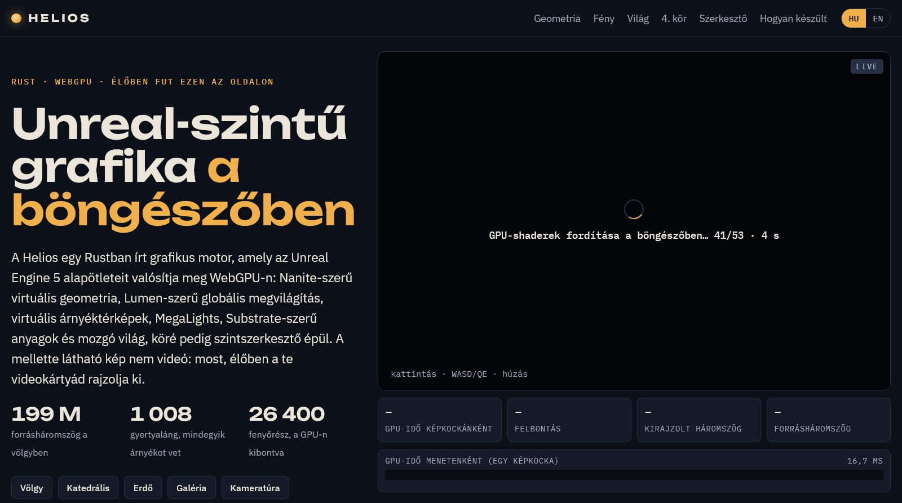
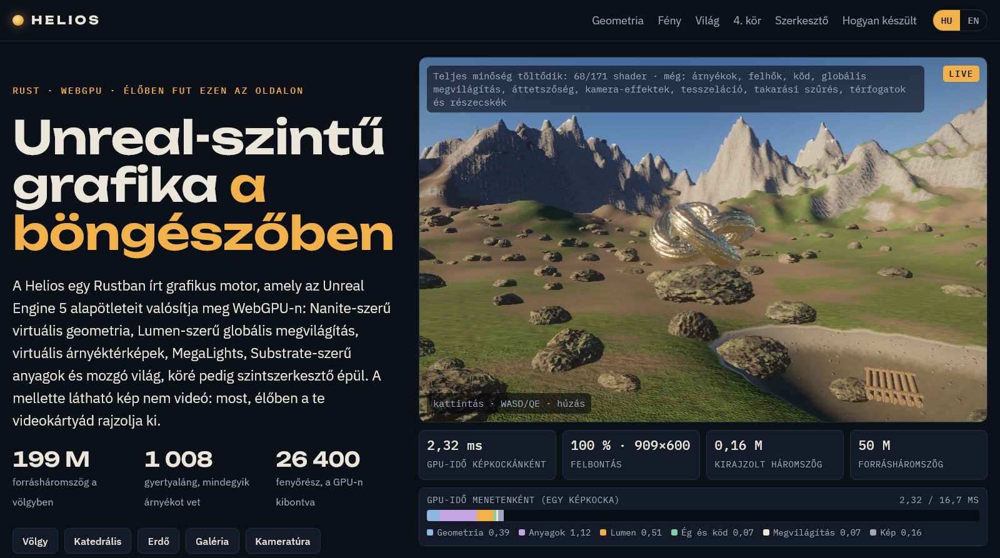
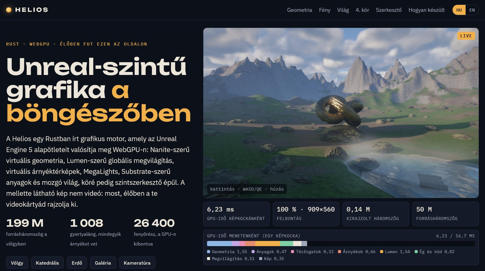

# The first image in seconds: progressive shader compilation in the browser (round 6 follow-up: `browser-startup`)

Design note. The README carries the user-facing text (*Quick start*'s browser line, *Showcase site*'s page API, the
*WebGPU constraints* table and gap 15 of "Status vs. Unreal Engine 5"); this file records why the start-up is built
the way it is, what was rejected, and the measurements.

## What

`firefox-freeze` found that the browser's long start-up was shader compilation — the renderer created ~160 pipelines
before its first frame, Firefox's GPU process compiled them one at a time (36–46 s, on every visit, no cache), and
Chromium compiled wgpu's synchronous `createComputePipeline` calls one at a time too — and stopped the page from
freezing behind them. The first image still took 27–58 s in Firefox and ~21–45 s in a fresh Chromium profile.

Now the first image needs only the **core** pipelines; every other feature joins as its pipelines arrive, like UE's
asynchronous shader compilation with fallbacks, and the last image is the one a native build renders:

* **Pipelines in groups** (`helios_render::pipelines`). Every pipeline belongs to a `Group` — `Core` (one-pass culling,
  rasterisation, material resolve, sun and sky lighting, TSR, exposure, bloom, tone mapping), `Shadows`, `Clouds`,
  `Fog`, `GlobalIllumination`, `Translucency`, `CameraEffects`, `Tessellation`, `OcclusionCulling`, `Effects` — and is
  a `Lazy<T>` value: natively made at once, in the browser queued. The renderer switches a feature off while its group
  is not ready (`Renderer::render` renders with the settings minus the uncompiled features; the settings keep what
  was asked for).
* **Two compilers.** Chromium (Dawn) compiles `create*PipelineAsync` on a thread pool and returns an identical
  descriptor's compiled pipeline at once: every queued pipeline is *warmed* — its constructor runs with the device's
  `create*Pipeline` switched to the asynchronous call, the stand-in it returns dropped — and made once warm, a cache
  hit. Firefox compiles one pipeline at a time whatever the API: the core set is created at once, the rest one per
  presented frame, each in a frame of its own that the next frames wait for (never presenting behind it).
* **Overlap with the bake.** The renderer (and its core queue) is created before the scene is baked: the GPU process
  compiles while the main thread bakes.
* **Cheaper shaders.** Three shaders took Firefox ~0.5–1 s each only to zero-initialise a large workgroup array; the
  texture synthesis is now one small pipeline per pattern; the material resolve only gets pipelines for the shading
  models the scene uses; editor and debug pipelines are compiled on first use.
* **The site shows it.** The veil counts the first image's shaders, then a note lists the features still coming.

## How a frame finds what to compile

A pipeline takes its group from the code that creates it (`pipelines::in_group`, a thread-local set by the renderer
around each pass's constructor; a `Lazy` value's constructor runs in its own group, so nested values inherit it).
Natively nothing is queued and every group is always ready: the native frame is unchanged.

| kind | made | examples |
|---|---|---|
| `Lazy::background` (every `util::compute_pipeline`) | natively at once; in the browser queued at creation | almost everything |
| `Lazy::new` (`util::lazy_compute_pipeline`) | on first use; queued by `prefetch` once the scene has the content | skinning, alpha-masked and voxel rasterisers, translucent models, volumes, particles, texture patterns, subsurface, MegaLights, picking, selection, invalidation debug |

Content-dependent pipelines are queued *before* the frame decides what it renders: `Renderer::prefetch_content`
scans the scene once per scene version (translucent models of visible instances, volumes, particles, whether a
material displaces), so a feature never comes on with a pipeline still to compile. Content the core set needs
(the material resolve's shading models and permutation, texture patterns, masked / voxel / skinned rasterisers)
is found during the first frame's scene sync; until the first image, a frame that found an uncompiled core pipeline
stops after the sync (`frame_count` does not advance) and the next one renders. After the first image a newly
needed core pipeline (an editor change, a new scene) is compiled in the frame, as before (`firefox-freeze`'s hold).

Tessellation is the subtle one: the tessellator is created only when the scene has displaced instances, which it does
not while tessellation is off. With tessellation asked for and a displacing material in the scene, the tessellator,
its graph dicing permutations, the material resolve's `TESSELLATION` permutation and the extended (graph / slab)
resolve pipelines in that permutation are created and queued in `Group::Tessellation` while the frames still render
undisplaced surfaces; the group is not ready until the tessellator exists.

## Design

### Chromium: warm, then make from the cache

wgpu's WebGPU backend calls only the synchronous `createComputePipeline` / `createRenderPipeline` and cannot adopt a
pipeline made in JavaScript. A test page (`dedup.html` in the scratch tools) measured what Dawn does with an
asynchronous compile followed by a synchronous call with an equal descriptor:

| (a 0.4–5 s test shader) | Chromium (fresh profile) | Firefox 159 |
|---|---|---|
| synchronous create | 0.48 s | 0.80 s |
| asynchronous, then synchronous with new module / layout objects of the same content | 0.43 s, then **0 ms** | 0.55 s, then 0.10 s |
| the same after the asynchronous pipeline was released | 0 ms | 0.10 s |
| queue work submitted while an asynchronous compile runs | not delayed | waits for it |
| six asynchronous at once | 0.69 s (≈ 1) | 3.4 s (= 6) |
| asynchronous compile while the main thread is busy 2 s, after a yield | overlaps (2.0 s) | overlaps (2.0 s) |

Dawn deduplicates pipelines by content (shader modules and layouts too), so a warm pipeline is free to make, and
asynchronous compiles run in parallel without holding the queue. The browser layer
(`pipelines::browser::install`) wraps the `GPUDevice` object's two methods: they count creations (as before), and
inside `warm` they call the asynchronous variant, keep the promise and return an empty object, which wgpu stores in a
pipeline that is dropped at once (wgpu's WebGPU pipelines do nothing on drop; nothing in a constructor calls a method
on its pipeline). When `Promise.all` of a constructor's compiles settles, the entry is warm; the frame loop's
`pump` makes it, uncounted, so no frame waits for it. A rejected compile is made anyway and reports its error the
normal way. The compiler is chosen by the user agent (`Chrome/`; `?shaders=serial|parallel` overrides).

### Firefox: one at a time, never presented behind

Firefox compiles one pipeline at a time, asynchronous or not, and the queue waits for each. So the core set is
created at once before the bake (the GPU process works through it while the main thread bakes), and the rest goes
one pipeline per cycle: a presented frame, then a frame that only creates the next pipeline and is not rendered,
then frames that wait (`onSubmittedWorkDone`) until it is compiled. Creating the pipeline right after presenting
held the page's next paint until the compile was done (rAF gaps of 0.2–1.4 s on the site whenever its telemetry
changed the DOM): the canvas's presentation waits in the same GPU-process queue. With a frame between them the page
painted at 16.7 ms throughout (below). A full-quality image therefore arrives later than in one batch (each compile
costs a frame or two of waiting), but the scene is interactive at a few frames per second meanwhile.

Two Firefox details found on the way: creating the renderer's shader modules and the core pipelines in one task
blocked the content main thread for ~5 s at the next turn of the event loop (until the GPU process had compiled the
set); a yield between the renderer's construction and the first pipelines removed it. And commands are sent to the
GPU process at the end of a task: without a yield before the bake the compiles would not overlap it.

### Cheaper shaders

A lab page compiled single pipelines (async, one at a time, unique modules) from composed WGSL variants.

* **Workgroup arrays.** The browser zero-initialises workgroup memory; naga (Firefox) writes it as one assignment of a
  zero value to the whole array, and DXC took ~1 ms per element: the sky's SH projection (`array<array<vec3, 9>, 64>`)
  and Lumen's probe SH (`array<array<vec4, 10>, 64>`) spent 0.7–1 s on it (Chromium's Tint: 0.04–0.1 s). Both now sum
  one coefficient at a time through a 64-element array — the same tree, the same additions, bit-identical results —
  and Lumen's radiance-cache probe update (`array<array<vec3, 4>, 32>`) likewise.
* **Texture synthesis per pattern.** `texgen.wgsl`'s `generate` evaluated any of 19 patterns behind a switch, each
  with fBm loops of constant octave counts that DXC unrolls: 1.3–1.5 s in Firefox, 2 s in Chromium. A `PATTERN`
  override makes one pipeline per pattern (60–100 ms each); a scene compiles the patterns it uses (the valley 7).
  Making the loops non-unrollable gained only 10 %.
* **Shading models the scene uses.** The material resolve had a pipeline (0.6–1.2 s) and a dispatch for each of six
  shading models; only the models of the scene's materials get both now (the others' tile lists were empty).
* **On first use**: picking, the selection outline, the invalidation debug view, subsurface diffusion and the
  heterogeneous volumes (all eager before).

| pipeline (Firefox 159, single compile) | before | after |
|---|---|---|
| sky SH projection | 0.76–1.3 s | 0.08–0.11 s |
| Lumen probe SH | 1.1–2.1 s | 0.19 s |
| Lumen radiance-cache probes | 0.45 s | 0.32 s |
| texture synthesis | 1.4–1.55 s (one) | 0.06–0.10 s per pattern |

### Rejected

* **Creating pipelines through JavaScript and wrapping them for wgpu** (or forking wgpu's creation path): wgpu 30 has
  no way to adopt a `GPUComputePipeline`; a custom wgpu backend would have to wrap every object type. Warming plus
  Dawn's content cache gives the same parallel compile with the stock wgpu.
* **Warming in Firefox**: its asynchronous compile is serial and holds the queue like the synchronous one; warming
  would compile twice (its DX12 shader cache made the second ~0.1 s, still no gain).
* **Skipping the draws of uncompiled pipelines** (a JavaScript proxy for every pipeline): a frame with arbitrary passes
  missing writes garbage into temporal and cached state (TSR history, Lumen's caches, virtual shadow pages); turning
  whole features off through the settings uses paths the renderer already has (each is a hotkey).
* **One preview tier, then everything**: per-feature gating lets shadows and GI come on seconds before tessellation.
* **Shrinking the material resolve** (0.6–1.2 s per model, 170 KB of composed WGSL): the remaining big item of the
  core set; a per-pass project.

## Measurements

Firefox 159 headed with a fresh temporary profile per run (window occlusion tracking off: the machine's desktop was in
use), Playwright's headless Chromium with a fresh profile per run, 1280×800 window, RTX 3090 and a Ryzen 5 7600X shared
with three other agents' builds and renders — DXC compiles on the CPU, and the machine was busier than in
`firefox-freeze`'s runs (the base valley took 45–50 s in Firefox here, 27–58 s there). Interleaved base
(`firefox-freeze` + `web-bake-worker`) / new runs, 3 per target. *First image*: navigation → the first presented frame
(base: the HUD / the site's GPU telemetry appears; new: the engine's own log, `performance.now()`, which the harness
confirms within 0.3–0.9 s). *Full quality*: every queued pipeline made (base: the first image — it waits for all).
*Page stalls*: `requestAnimationFrame` gaps over 200 ms after navigation. Firefox's *full quality* is from two more
interleaved pairs with the final batch sizes (a batch grows while it compiles in under 0.3 s); the first runs, one
pipeline to 16 per batch, reached it at 50.5–57.8 s (valley) and 54.4–54.6 s (site), 10–25 % after the base. Runs in
which Firefox throttled the window (1 s timer ticks: the desktop was in use) are left out.

| Firefox 159 | first image, base → new | full quality, new | longest page stall, base → new | others (new) |
|---|---|---|---|---|
| valley (`web/index.html?scene=valley`) | 44.8 / 47.8 / 49.7 → **10.8 / 11.4 / 11.7 s** | 46.8 / 51.0 s (base in the same pairs: 45.3 / 51.5) | 4.3–4.7 s → 4.2–4.7 s (the bake) | ≤ 0.3 s |
| cathedral | 36.2 / 38.2 / 44.2 → **12.1 / 13.5 / 15.1 s** | 33.2 / 33.3 / 43.2 s | 5.9–7.3 s → 5.8–6.8 s (the bake) | ≤ 0.4 s |
| site (`preview.html`) | 45.0 / 48.4 → **11.9 / 13.0 s** | 45.2 s (base: 37.4 / 43.7) | 4.7–4.9 s → 4.7–5.1 s (the bake) | ≤ 0.3 s |

| Chromium (fresh profile) | first image, base → new | full quality, new | longest page stall, base → new | others (new) |
|---|---|---|---|---|
| valley | 31.6 / 33.1 / 33.5 → **8.4 / 8.6 / 9.4 s** | 10.8 / 11.1 / 12.4 s | 12.2–12.9 s → 4.8–5.3 s (the bake) | ≤ 0.9 s |
| cathedral | 25.4 / 26.2 / 26.2 → **9.3 / 9.4 / 9.8 s** | = first image | 5.5–6.1 s → 6.0–6.2 s (the bake) | 1.0–2.6 s |
| site | 30.8 / 31.8 / 41.4 → **9.3 / 9.7 / 9.9 s** | 11.3 / 11.6 / 12.2 s | 11.5–16.5 s → 5.2–5.5 s (the bake) | ≤ 1.7 s |

Base Chromium stalled the page for 6–16 s at a time behind its synchronous compiles; the new build's only long stall is
the main-thread scene bake. In Firefox the main thread
was free during every compile wait (heartbeat), and with the background pipelines compiled in frames of their own the
page painted at 16.7 ms throughout the background compile (before that change the site stalled 0.2–1.4 s each time its
telemetry touched the DOM).

Where Firefox's first image of the valley goes (a quieter run, 8.5 s): navigation → engine start 0.6 s; the 41 core pipelines compile
during the 3.7 s bake; then the scene's content pipelines — 7 texture patterns and 5 material-resolve models, ~4 s —
before the first frame. Chromium compiles the core set in parallel during the bake and the content set in ~2 s.

* **Pipelines before the first image**: valley 163 → 52 (41 core + 7 patterns + 5 resolve models; 171 in all with the
  per-pattern texture pipelines), cathedral 60 of 154.
* **Native** (base vs new, 2560×1440, frame 150; GPU single runs on the shared GPU): images identical within the
  run-to-run noise at 100 % and 67 %.

| scene | 100 %: PSNR new vs base, pixels > 24/255 | base vs base | 67 %: new vs base | base vs base | GPU ms base → new (100 %) |
|---|---|---|---|---|---|
| valley | 53.2 dB, 0.0016 % | 52.5 dB, 0.0022 % | 55.4 dB, 0.0021 % | 53.7 dB, 0.0027 % | 8.85 → 8.85 |
| cathedral | 61.0 dB, 0.0000 % | 61.6 dB, 0.0001 % | 59.8 dB, 0.0001 % | 60.0 dB, 0.0001 % | 11.61 → 11.29 |
| forest | 41.1 dB, 0.17 % (38.9 dB, 0.45 % in a first, noisier pair) | 41.3 dB, 0.17 % | 42.1 dB, 0.16 % | 42.0 dB, 0.17 % | 15.67 → 15.82 |
| gallery | 65.0 dB, 0.0000 % | 66.1 dB, 0.0000 % | 62.8 dB, 0.0000 % | 62.6 dB, 0.0000 % | 8.01 → 8.20 |
| Fox (glTF, skinned) | 69.7 dB, 0.0000 % | 71.5 dB, 0.0000 % | – | – | 5.02 → 5.04 |

Natively the frame does the same work but for the material resolve's empty dispatches (models the scene does not use)
and per-pattern texture synthesis at load; the GPU differences are within the shared GPU's noise.

## Remaining limits

* Firefox's first image is bound by the core set plus the scene's content pipelines, ~8 s of compiling (half of it
  the material resolve: 0.6–1.2 s per shading model for a 170 KB shader); a slower CPU waits proportionally longer.
  Shrinking the resolve is the next step.
* The scene's content pipelines are found only after the bake (the scene defines them); a scene could declare its
  shading models and texture patterns up front so they compile during the bake too.
* Firefox reaches full quality at most as fast as compiling everything up front: every background batch costs a
  rendered frame and a round trip.
* After the first image a newly needed core pipeline (a new scene's material, a debug view's permutation, an editor
  change) is compiled in the frame that needs it, the canvas holding its last frame (`firefox-freeze`'s hold): skipping
  such a frame after the scene sync would lose that frame's invalidations.
* A few on-demand pipelines are outside the queue: Lumen's displaced-surface pipeline (made by `lumen_displaced.rs`)
  and MegaLights' and Lumen Lite's when switched on.
* The scene bake (3–6 s) still blocks the main thread.
