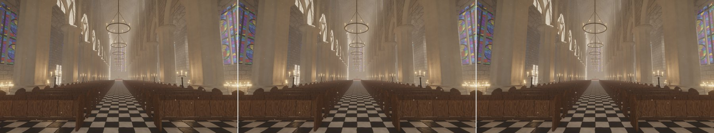

# Moving candles and their redraws: slot claims by per-frame cost (round 6 follow-up: `candle-redraw-budget`)

Design note. The README carries the user-facing text (the *Cached shadow maps for moving lights* bullet, items 4 and
9 of "Status vs. Unreal Engine 5"); this file records why it is built the way it is, and the measurements.

## What

Round 6 ([`fast-light-shadows.md`](fast-light-shadows.md)) let moving lights compete for the 32 shadow-map slots
at half their influence (`MOVING_WEIGHT`), since the page budget now bounds what re-anchoring their faces costs. In
the candle-lit cathedral on the classic light loop (`--scene cathedral --lights 300`, no MegaLights) that handed
10–11 slots to candles on the swinging chandeliers, and each of them brought a cost the budget does not see: the
candle's own wax, the ring under it and the neighbouring candles move with the light, so every page of its map is
refreshed for those dynamic casters every frame — the fixture's footprint spheres enclose the light, and its texels
at a few centimetres are a hundredth of a millimetre wide. Shadow pages went from 14 to ~140 a frame.

Now:

* **A moving light's claim on a slot falls with what its map costs per frame.** The GPU already counts, per slot,
  the pages rendered this frame (in full, or their dynamic casters only: `dirty_info`'s word 7 of the slot); it is
  read back with the per-face costs, smoothed per light (`Feedback::work`), and a moving light competes with
  `MOVING_WEIGHT / (1 + (work / 4)²)` of its influence (`moving_weight`): a chandelier light at its ring's centre,
  which redraws ~3.5 pages a frame, keeps 0.28 of it; a candle inside its swinging fixture, which redraws its whole
  map (20–50 pages a frame), keeps under 2 %. Where static lights compete for every slot, they keep them, as in
  round 5; a lantern next to the camera is hundreds of times more influential than the faint candles holding the
  last slots and still takes one; with slots to spare (the 33-light cathedral) every light gets one anyway.
* **The cost of a map the page pool starves is not zero.** The candle-lit cathedral requests about twice the
  1024-page pool every frame (~1000 requests unallocated, with or without moving maps), and a new slot can get no
  page at all: it renders nothing and would look free. A new pass (`count_local_requests`, one thread per local
  page-cache entry) counts every page a slot requests, resident or not (slot word 30). A read-back in which the
  pool held part of a map's requests is scaled up to all of them (`map_work`); one in which it held none says
  nothing about the cost and is skipped. A light never counted is assumed to redraw 8 pages per face every frame.
* **Moving lights that cannot win a slot do not spend the page budget.** The slot ranking (`SlotAllocator::ranked`)
  runs before the anchors, and moving lights outside the top 32 claims want no map this frame
  (`SlotAllocator::contenders`); before, the budget could pay for a new map that the slot competition then dropped.
* The reference mode (`--moving-light-maps`) keeps round 6's plain half weight, so that the image compared against
  shows the slots round 6 gave. HUD: `moving lights' pages rendered: N (dynamic casters only: M)`.

## Where round 6's cost went

`--lights 300`, 2560×1440, default view, frame 150; base = main 219e759; `fields` = the same build with
`--moving-light-fields` (moving lights on distance fields, i.e. round 5's choice here: 300 static candles leave no
slot); per pass: means over frames 50–150 (ms).

| | fields (≈ round 5) | round 6 | every frame (reference) |
|---|---|---|---|
| moving lights mapped | 0 | 11 | 24 |
| shadow pages a frame (dynamic-only, split) | 14 (12, 0) | 138 (~100, ~30) | 788 |
| (cluster, page) draws a frame | 0.4 k | 8.4 k | 96 k |
| vsm raster / expand / static layers | 0.026 / 0.162 / 0.013 | 0.234 / 0.274 / 0.037 | 2.51 / 0.86 / 0.01 |
| vsm mark local | 0.221 | 0.385 | 0.563 |
| lighting | 4.34 | 4.84 | 5.68 |
| GPU frame (min) | 14.23 | 15.29 | 19.52 |
| image vs every frame | 39.3 dB, 0.49 % | 43.4 dB, 0.16 % | (noise: 59.4 dB, 0.0002 %) |

The page work (raster, expand, static layers: +0.36 ms) is about a third of the +1.06 ms; the rest is the marking
(+0.16) and the lighting (+0.50) of the chandelier candles' receivers: their 12 m range covers the nave floor, where
the candelabrum candles they displaced reach 8 m. The paused cathedral, where these candles hold slots as static
lights (more of them than while they swing), costs even more in lighting (5.49 ms min). So making the candles' redraws cheaper could recover at most a third;
only giving their slots back recovers the whole.

## Options evaluated

* **Counting the redraws in the page budget** (a moving light's admission pays for its dynamic-only pages too).
  The budget (32 pages a frame) is sized for re-anchoring. The 33-light cathedral's eleven chandelier lights
  already render 31.5 pages a frame between them (29 of them dynamic-only redraws, +1.4 re-anchored), and with the
  lantern the moving maps render 61 a frame: admission against the same budget would drop chandelier lights round
  6 maps (and a budget raised to fit them would let more re-anchoring through for the lantern). The redraws differ
  from re-anchoring in kind — they buy nothing a larger tolerance could trade — so they enter the slot choice, not
  the budget.
* **Drawing the fixture in the light's own frame, or refreshing it at a reduced rate while it moves rigidly with the
  light** (it is nearly static relative to the light: a chandelier turns ≲ 10⁻³ rad a frame, under a texel at any
  depth). The map is rendered from the held origin, up to a tolerance (1 cm for a candle, 1.75 with the lead) from
  the light. A fixture drawn where it is relative to the light, but from the origin, is displaced by that offset from
  where its own surfaces receive light: the ring 30 cm below a candle would compare against an image of itself
  0.5–1 cm off, against a depth bias of two texels (~0.3 mm at mip 1 there) — acne on the half of the fixture facing
  the motion, light leaks on the other, flipping at every re-anchor (round 4's objection to a held map). The
  receivers cannot tell fixture texels from static ones in one map, and the filter's parallax correction
  (`local_filter_follow`) assumes world-fixed occluders. Rejected.
* **Rendering re-anchored pages split at once.** A re-anchored face's pages are rendered in full without a static
  layer, so the fixture's refresh next frame renders them in full once more (`PAGE_SPLIT`) before they settle into
  dynamic-only refreshes; candles re-anchored every two frames never settle (~30 split pages a frame in round 6's
  candle-lit view). Capturing the static layer on the re-anchoring render would save at most those 30 of 138 pages
  — a fraction of the page work, none of the lighting — and the lantern and the 33-light cathedral split 1–2
  pages a frame. Not done.
* **Slot weights.** A fixed lower weight for moving lights (round 5: only the slots static lights leave) gives the
  lantern no slot whenever the static lights fill them (round 6's measurement: distance fields, 33.9 dB against
  44.8). Weights by measured work, `MOVING_WEIGHT / (1 + work / W)`: with W = 4 six candles still kept slots (the
  candles' 20–50 pages a frame then cost a 4–13× smaller claim, and the static lights left for the last slots are
  12–25× fainter than they), 154 pages a frame; with W = 1 the candles go, but one chandelier light of the
  33-light cathedral and two with the lantern lose theirs to distant candelabra. The square, `1 + (work / 4)²`,
  separates the two cases: a few pages a frame cost little, a whole map every frame a factor of 25–150.
* **The work as rendered, without the request count.** A candle that took a slot in a full pool got no pages,
  rendered none, looked free (claim at the full half weight) and kept its slot without a shadow: with the linear
  weight 14 moving lights held slots in the candle-lit view with ~0 pages rendered, and the lighting paid for them
  (4.90 ms min against 4.24). Counting a starved map as redrawing all it requests went too far the other way: a far
  chandelier light of the 33-light cathedral whose six fallback pages were missing in one read-back lost its slot
  to a faint candelabrum in two of three runs. So a read-back without a resident page is skipped.

## Measurements

2560×1440, frame 150, base = main 219e759 (built from a separate copy with its own target directory). GPU frame
and per pass: minima of 3 interleaved base / new runs; the RTX 3090 was shared with other agents' builds and
benchmarks all session (single runs up to 2× slower; the medians below are the smallest of the three runs'
medians). Pages and draws: means over frames 50–150. Images: PSNR and pixels off by more than 24/255; noise = two
base runs.

**Candle-lit cathedral, classic loop** (`--lights 300`):

| | 100 %: base → new | 67 %: base → new |
|---|---|---|
| moving lights mapped (frame 150) | 10 → 0 | 6 → 0 |
| shadow pages a frame (dynamic-only) | 142 (102) → **14.2** (12.3) | 175 (128) → **14.8** (12.9) |
| (cluster, page) draws a frame | 8.7 k → 0.43 k | 15.4 k → 0.44 k |
| vsm raster / expand / static layers | 0.042 / 0.231 / 0.006 → 0.006 / 0.090 / 0.005 | 0.062 / 0.265 / 0.006 → 0.009 / 0.093 / 0.005 |
| vsm mark local | 0.360 → 0.214 | 0.153 → 0.114 |
| lighting | 4.73 → 4.22 | 2.05 → 1.95 |
| vsm dirty info (+ the request count) | 0.012 → 0.015 | 0.013 → 0.015 |
| GPU frame (min / median) | 15.29 / 16.01 → **14.22** / 14.78 | 8.92 / 9.61 → **8.53** / 8.74 |

Round 5's level (`--moving-light-fields`, the same slots): 14.23 ms, 14.4 pages, lighting 4.24 ms. Against the
every-frame reference (its 24 moving lights mapped, two runs 59.4 dB apart): round 6 43.4 dB, 0.16 %; now 39.3 dB,
0.49 % — round 5's figure (39.3 dB, 0.49 %): the candles' shadows are distance fields again. From under a
chandelier (`--eye 14.6,8.3,2.6 --at 17.5,7.3,0`): base 20 moving lights mapped, 279 pages and 26.6 k draws a frame;
now 1 (the candle nearest the camera, 8 pages a frame), 76 pages, 2.2 k draws (distance fields: 69 pages); against
the reference 42.1 dB → 40.8 dB (distance fields 40.8 dB). The ring and the candles' wax lose the map's contact
shadows of their neighbours, and nothing pops: static camera, last 16 frames, 0.038 % of pixels change by more than
24/255 per frame with round 6's maps, distance fields and the every-frame reference alike (the swinging
chandeliers, dust and flames).

**MegaLights** (`--lights 300 --megalights`): moving lights get no slots there anyway; unchanged — 14.70 → 14.68 ms
(100 %), 8.66 → 8.67 ms (67 %), 14 pages a frame, image 59.1 dB / 58.4 dB against base (noise 58.6 / 57.4 dB).

**Cathedral, 33 lights** (the eleven chandelier lights swinging): all eleven keep their maps in every frame of all
runs; GPU 10.34 → 10.33 ms (100 %), 6.33 → 6.27 ms (67 %); 48.6 → 49.0 pages, 3.3 k → 3.4 k draws; image 61.2 dB
against base (noise 61.1 dB); against the every-frame reference 48.9 dB before and after. The moving maps render
31–38 pages a frame between them, 26–30 of them dynamic-only redraws (new HUD figure).

**Lantern** (`--lantern`, chandeliers swinging): all twelve moving lights mapped in every frame before and after.

| | default view: base → new | close view, night: base → new |
|---|---|---|
| GPU frame (min) | 11.04 → 11.01 | 11.33 → 11.35 |
| shadow pages a frame (local in full) | 92.6 → 93.1 | 108.4 → 108.6 |
| draws | 12.2 k → 12.3 k | 7.1 k → 7.2 k |
| vsm raster / expand | 0.204 / 0.194 → 0.167 / 0.180 | 0.066 / 0.199 → 0.061 / 0.203 |
| image vs base (noise) | 58.5 dB (56.3) | 53.9 dB (50.5) |
| image vs every frame | 46.8–47.0 dB → 46.8–46.9 dB | 43.3–44.9 dB → 43.0–45.0 dB (6 runs each) |

The close view's spread against the reference is the read-back timing (which frame a face waits for the budget),
the same before and after. With 300 candle lights as well (`--lantern --lights 300`) the lantern keeps its map
(1 moving light mapped, 70 pages a frame) while the chandelier candles keep distance fields.

**Standard scenes** — no moving light competes for a slot there, so the only change is the request count in
`vsm dirty info` (+0.003–0.004 ms where local lights have maps; the valley has none):

| scene, 100 % / 67 % | GPU frame (min) base → new | shadow pages / draws | image new vs base (noise) |
|---|---|---|---|
| valley | 8.60 → 8.59 / 5.71 → 5.71 | 5.1 / 199 = | 52.5 dB, 0.006 % (53.3 dB, 0.003 %) |
| cathedral | 10.34 → 10.33 / 6.33 → 6.27 | 48.6 / 3.3 k → 49.0 / 3.4 k | 61.2 dB, 0.0002 % (61.1 dB) |
| forest | 14.49 → 14.40 / 9.79 → 12.11 (contention; per pass equal) | 319 / 110 k = | 40.7 dB, 0.18 % (40.2 dB, 0.22 %) |
| gallery | 7.89 → 7.97 / 4.93 → 4.95 | 2.2 / 2 = | 65.6 dB (65.0 dB) |

(The forest at 67 %: every new run fell into a busy stretch of the shared GPU — medians 10.5 → 19.8 ms — while every
pass is within 0.01 ms: vsm raster 0.645 → 0.647, expand 0.211 = , lighting 0.662 → 0.666.)

Tests: `cargo test --workspace --release` green. New unit tests: moving lights that redraw much yield their slot to
fainter static lights while a far more influential one keeps it, and every light gets one with slots to spare;
`moving_weight` keeps half the weight at no work and halves it at 4 pages; `map_work` scales a partly held map up
to its requests and skips one the pool held none of. Browser (headless Chromium, WebGPU, `./build-web.ps1`):
`?scene=cathedral&lights=300`, `?scene=cathedral&lantern=1` and `?scene=cathedral` render without WGSL or
validation errors; HUD: `moving lights: 0 with shadow maps …, 88 on distance fields`, `12 with shadow maps`, `11 with
shadow maps … moving lights' pages rendered: 24 (dynamic casters only: 24)`.

## Remaining limits

* **The page pool is too small for the candle-lit cathedral's 32 maps**, with or without moving lights: ~1000
  requests a frame stay unallocated, and a map whose slot is assigned once the pool is full may get no page at all —
  in the default view the six candelabrum candles nearest the camera hold slots with no page resident (the nearest
  requests 51), so their receivers get no shadow from them. Moving lights are judged by their requests now; static ones
  still hold such slots (a pool-fairness question for the page cache, not for this budget).
* **Candles inside swinging fixtures keep distance-field shadows where static lights compete** (39.3 dB against the
  every-frame reference instead of round 6's 43.4 dB in the candle-lit view): their maps cost their whole requested
  set every frame. The fixtures' footprints are instance slices; a cluster-level refresh (only the pages the ring's
  and candles' clusters touch) would make such maps cheaper, and could let them back in.
* **The weight is a heuristic.** `MOVING_WORK_PAGES` and the square are tuned to the demo's three cases (chandelier
  lights ~3.5 pages a frame, candles 20–50, the lantern ~30 and 30× brighter than the candles). A light's work is
  measured only while it holds a slot (a light that never held one is assumed to cost 8 pages per face), and a
  moving light that rendered much once keeps that cost until it holds a slot again.
* What round 6 left stays: the redraws themselves are still outside the page budget for lights that keep their
  slots, and a held origin casts the far shadows of a fixture next to the light from the origin
  ((t − 1) · offset off where the blocker search cannot reach).
