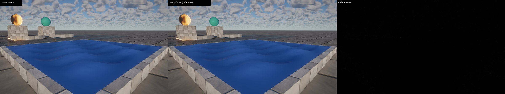
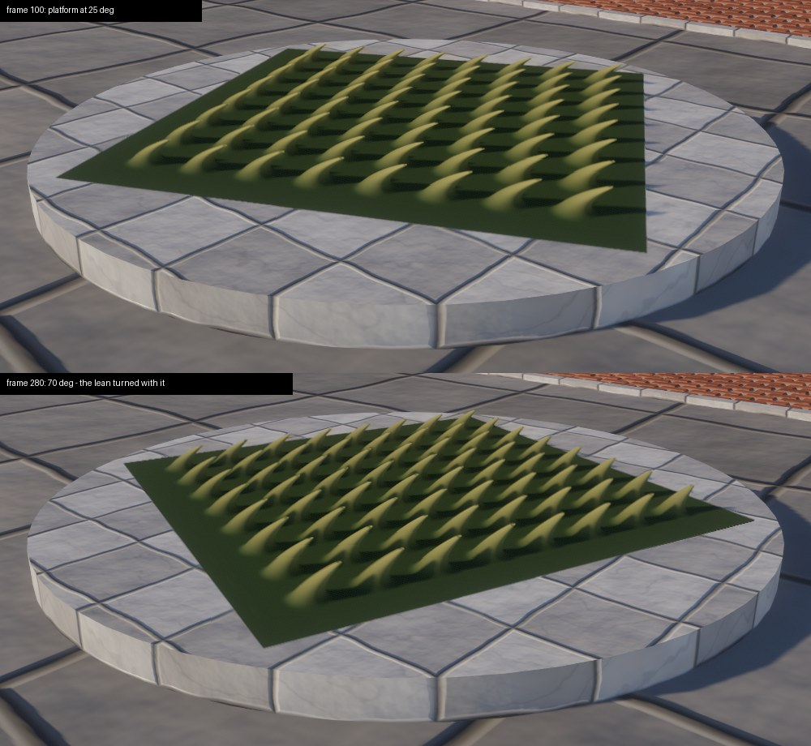
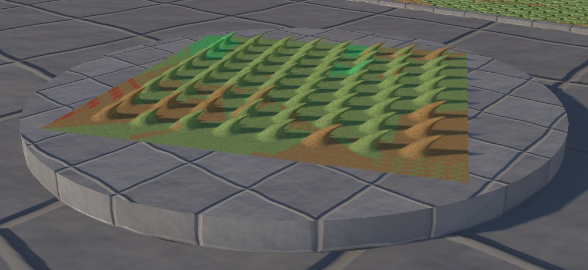

# Speed-bounded animated displacement, object- and tangent-space vectors (round 6: `displacement-motion`)

Design note. The README carries the user-facing text (the *Nanite Tessellation* and *Material graphs* bullets, gap
14 of "Status vs. Unreal Engine 5"); this file records why it is built the way it is, and the measurements.

## What

Round 5 left two limits on graph-driven displacement (`docs/round5/displacement.md`):

* **An animated displacement had no speed bound.** Every cached shadow page whose texels were finer than the
  displacement's reach re-rendered its dynamic casters every frame. The rippling cloth, filling the screen at
  2560×1440, cost as much in shadows as in its main view (168 pages a frame, shadow tessellation 2.08 ms).
* **The VectorDisplacement pin was world space only.** On a rotating (movable) instance a vector built from
  constants did not turn with it.

Both are closed:

* **Speed bound** (`animated-displacement-speed-bound`). The material compiler bounds how fast an animated
  displacement moves a point (`CompiledGraph::displacement_speed`, `helios_material::motion`), for each material
  instance's parameter values. The bound travels per material in the tessellation uniform; the invalidation pass
  turns it, per instance, into the same per-frame motion bound the wind and moving instances already use, so a
  cached page is refreshed only once the surface may have moved two of its texels since it was rendered. Graphs
  the analysis cannot bound keep round 5's every-frame refresh.
* **Vector spaces** (`displacement-vector-spaces`). A **TransformVector** node (UE's *Transform*: Tangent, Local,
  World) re-expresses a float3 direction from one space in another, in both of a graph's functions. A vector
  displacement built in object or tangent space and turned into world space follows its instance — in the
  tessellators, the resolve, the shadow pages and the previous frame's pose. The gallery shows it on a turning
  platform of *combed tufts*.

## The speed bound

### Analysis

A graph is arbitrary code, but animated displacements are mostly simple functions of the time: a constant times
`Time` into a sine, a Panner scrolling a noise, products with bounded factors. The compiler keeps the
displacement function's nodes (`DisplacementMotion`: the nodes in evaluation order, their input sources, the
parameter slots) and `DisplacementMotion::speed` interprets them abstractly. Every value gets, per component,

* an **interval** that holds it at every point of every surface at every time, and
* a **rate**: a bound of |∂v/∂t| — forward-mode differentiation in the time, by intervals.

The rules are the textbook ones, made conservative:

| Node | Interval | Rate |
|---|---|---|
| constants, parameters | the value (a material instance's own) | 0 |
| `Time` | (−∞, ∞) | 1 |
| positions, UVs | (−∞, ∞) | 0 |
| `VertexNormal` | [−1, 1] | 0 |
| `Add`, `Subtract` | interval sum | rates add |
| `Multiply` | interval product | max\|a\| · rate b + max\|b\| · rate a (a zero factor wins over an unbounded one) |
| `Divide` | when the divisor's interval excludes 0 | rate a / min\|b\| + max\|a\| · rate b / min\|b\|²; else unbounded |
| `Lerp` | a (1 − t) + b t | rate a · max\|1 − t\| + rate b · max\|t\| + max\|b − a\| · rate t |
| `Sine`, `Cosine` | [−1, 1] | the argument's (\|sin′\| ≤ 1) |
| `Min`, `Max`, `Clamp`, `Saturate`, `Abs`, `OneMinus`, `Length` | as the function | 1-Lipschitz: the argument's (the largest of several) |
| `SmoothStep` | [0, 1] | 1.5 / min\|max − min\| times the argument's, with still edges |
| `Power` | with a constant exponent p ≥ 1 | p · max(base)^(p−1) · rate base; otherwise unbounded |
| `Normalize` | [−1, 1] | \|dv\| / min\|v\| (unbounded if v may vanish) |
| `Dot`, `Cross`, `Append`, `ComponentMask` | per component | product rule per term |
| `Panner` | uv + speed · t | rate uv + \|speed\| · rate t |
| `Noise` | [0, 1] | 0.5 · scale · Σ_octaves 0.5^(o+1) 2.02^o · 4.7 · \|rate of the position\| |
| `TransformVector` into world space, or between object and tangent | the input's length | the input vector's speed |
| `Frac`, `Floor`, `Step`, `If` on a moving value | — | unbounded (discontinuous in the time) |
| `TextureSample`, `Triplanar`, `NormalBlend` with moving coordinates | — | unbounded (a texture's slope is unknown) |
| `TransformVector` out of world space | — | unbounded if the vector moves (the instance's anisotropy stretches it) |

The **noise slope** 4.7 bounds `gradient_noise` (noise.wgsl) for *any* gradients in [−1, 1]³: the directional
derivative is linear in the eight corner gradients, so its worst case is Σ_c ‖∂(w_c (f − c))/∂d‖₁, maximised over
the cell and the direction. A numerical search finds 4.625, attained at the cell's centre along an axis; 4.7 pads
it. (For random gradients the steepest slope found was 2.2: the bound is the worst hash, not the typical one.) The
footprint fade of fBm octaves only removes slope.

Besides the per-component rates a value carries the bound of its **vector speed**, so that a rotation —
`TransformVector`, which mixes components — keeps a vector's speed rather than inflating it by √3.

The displacement's speed is then, in units of the magnitude per second, a **height's** rate (the clamp to 0..1 is
1-Lipschitz) or a **vector's** speed (the clamp to the unit ball is a projection, 1-Lipschitz too). The cloth:
two travelling waves, 0.27 · 1.9 + 0.1 · 3.1 = 0.82 per second (exact: both crests can pass at once), plus the
scrolling wrinkles, 0.24 · 0.5 · 4 · 1.515 · 4.7 · |(0.22, 0.09)| = 0.81, pinned edges a factor in [0, 1]: 1.64 per
second, 26 cm/s at its 16 cm magnitude.

Tests check sines of scaled time against their exact rate, parameters per material instance, the Lipschitz noise
of a panner, the rotation-preserving vector speed, that discontinuities, accelerating `t · t`, scrolled textures
and world → object transforms stay unbounded, and that finite differences of a CPU model of a bounded graph (a
sine through a smoothstep plus a cosine over `2 + sin t` with a parameter clock) never exceed its bound, which
stays within 3× of the sampled maximum.

### Rejected alternatives

* *Sampling the displacement over time* (on the GPU, or the CPU mirror): not a bound — it misses the fastest
  moment and costs every frame.
* *A user-entered speed per material* (UE's WPO "max displacement" is the only bound UE has for WPO, and none for
  speed): it would be wrong as soon as someone edits the graph; the analysis follows every edit and parameter.
* *Symbolic differentiation into WGSL* (a `graph_displacement_speed` function evaluated per vertex): a pointwise
  rate, not a bound for the page; pages need one number per instance, and that number is cheaper on the CPU.

### In the renderer

* `tessellation::displacement_speed(scene, material)` evaluates the bound with the material instance's parameter
  values (overrides, else defaults) and multiplies by the magnitude: object units per second (0: static; `None`:
  unbounded). `TessMaterial` gained a third vec4, `motion` (x: that speed, negative when unbounded): the material
  table writes it with the materials, and the extended-material sync patches it whenever parameters change, next
  to the graph source (`write_graph_motion`), so dragging a "Rate" slider moves the bound without recompiling.
* `displacement_speed(instance)` (displacement.wgsl) is that times the instance's largest scale.
* The invalidation's collect pass (vsm_invalidate.wgsl) gives an animated caster's footprint `per_frame = min(speed
  · Δt, 2 · reach)` instead of `2 · reach`; `change` stays `2 · reach`. A page is refreshed once `min(change,
  per_frame · age) ≥ 2 texels` — as for the wind: a level whose texels are coarse relative to the motion waits
  several frames, one whose texels dwarf the reach never refreshes. Local light pages apply the same test in their
  own texels. A caster both in the wind and animated adds the two motions (round 5 took the larger).
* `RenderSettings::displacement_speed_bound` (default on; `--no-displacement-speed-bound`, `Tessellation.time.z`)
  restores the every-frame refresh: the reference for stale-shadow checks.

What a skipped page may show is the surface up to two of its texels behind — the tolerance the wind and moving
instances already have, chosen so that it is not visible.

## Object- and tangent-space vectors

### Why a node, not a space on the pin

UE's Material Editor has one World Position Offset pin, in world space, and a *Transform* node (Tangent / Local
/ World / View …) that users put in front of it; the same pattern here keeps the VectorDisplacement pin's meaning,
its bound (`magnitude · scale`) and its speed analysis unchanged, and the node composes: a tangent-space bend plus
a world-space sag is two branches and an Add, which a space choice on the pin cannot express. The node also works
in the surface function (re-expressing a normal or a direction for shading).

`Op::TransformVector { source, destination }` with `VectorSpace::{World, Object, Tangent}`, saved by name
(`{"type": "TransformVector", "source": "Tangent", "destination": "World"}`; the source defaults to Object, the
destination to World: UE's Local → World). Same spaces: no code. It takes a float3 (a scalar is an error, not a
broadcast: a direction has three components). The generated code calls one helper per context with the spaces'
codes as constants (`displacement_transform_vector(input, v, 1u, 0u)`), which the shader compiler folds.

### Which spaces

* **Object**: the instance's linear part over its largest scale, L / s. An object-space vector of length ≤ 1 stays
  ≤ 1 in world space, so the magnitude still bounds it, and the tessellator's conversion back (`vector · magnitude ·
  N`, N = s · L⁻ᵀ: the row transform is (L / s)⁻¹) makes the offset exactly `vector · magnitude` in object units —
  under non-uniform scale it stretches with the instance, as a height along the normal does. In the displacement
  function `DisplacementInput.object_to_world` carries L / s (built from `instance.world` in
  `displacement_input`); world → object is its inverse (b × c, c × a, a × b over the determinant). In the
  surface function the resolve has the normal matrix N: object → world is N⁻ᵀ, world → object is Nᵀ.
* **Tangent**, in the displacement: an orthonormal frame in object space, (T, N × T, N) with N the interpolated
  object normal and T the object X axis projected into its plane (object Z where the normal runs along X),
  then L / s as for object space. On the gallery's beds and any plane or terrain, U runs along object X, so T is the
  mesh's U direction and N × T its V axis as the shading frame orients it (`+y` towards decreasing v): the frames
  agree. Tangent (0, 0, 1) is exactly the height's direction.
* **Tangent**, in the surface function: the pixel's shading frame (tangent, bitangent, normal: the frame the Normal
  output and normal maps use, from the UVs per triangle).

### What tangents the tessellator has

None stored: meshes carry positions, normals and UVs; the shading frame is built per triangle from the UVs
(`gbuffer.wgsl`). A per-triangle frame cannot drive displacement: the two triangles of a shared edge have different
UV gradients wherever the parameterisation bends, so the same edge vertex would move to two places — a crack.
The tessellator's inputs that are continuous across edges are the interpolated position, normal and UV; a frame
must be a function of those. The normal plus a fixed object axis is: both sides compute bit-identical frames, and
it needs nothing new in the mesh format. Its price is the hairy-ball theorem: on a closed curved surface the
tangent swirls around the two points whose normal is ±X (on flat faces along X it falls back to Z cleanly). Stored
per-vertex tangents (MikkTSpace, in the cluster format) would give UE's frame; that is a geometry format change
left for later.

### Consistency

* **Tessellators, shadows, resolve.** The value is a pure function of the undisplaced point (object normal,
  instance transform), so the main view's dicer, the shadow pages' dicer and the resolve (which evaluates it at the
  stored barycentrics) agree, and shared edges stay bit-identical.
* **Motion vectors, previous transform.** An object- or tangent-space vector, turned to world by L / s and back by
  the same instance's normal matrix, is a fixed object-space offset whatever the rotation; the resolve's previous
  position (that object point through the previous transform and wind) is therefore exact for a turning instance.
  (A world-space vector on a turning instance keeps round 5's approximation: its object offset changes with the
  rotation and the previous frame's is taken with the current one.)
* **Speed bound.** Into world space and between object and tangent the transform is a rotation over a scale ≤ 1:
  the vector's speed carries through. Out of world space it is unbounded (the inverse stretches by the instance's
  anisotropy, which the graph does not know); a still vector stays 0.
* **Editor.** The palette lists TransformVector under *Vector* with two drop-downs (World / Object (local) /
  Tangent); the status line says "tangent-space vector displacement"; scene files store the spaces by name.
* **Test** (`tessellation::tests::object_and_tangent_space_vectors_turn_with_the_instance`, a CPU mirror of the
  helpers): the object offset of an object- or tangent-space vector is the same under two rotations (and the world
  vector turns), equals `vector · magnitude` under non-uniform scale, tangent z is the normal, tangent x object X on
  a flat bed; a world-space vector's offset changes.

### The gallery's turning platform

`presets::combed_tufts` — *Combed tufts (tangent-space vector displacement)*: cells of object xz, in each a
pointed tuft, `height = (1 − smoothstep(0, 0.42, r))²` shrunk towards the mesh's edges by its UVs, displaced by the
tangent-space vector (lean · height² · 0.7, 0, height · 0.7) through TransformVector Tangent → World, roots dark,
tips light; parameters "Tuft Density" (3 per object metre) and "Lean" (0.8). In the gallery a 1.8 m square of the
bed mesh (scale 0.6, magnitude 22 cm: tufts 9 cm tall) turns once per 24 s on a drum behind the default camera
(`--eye 1.9,1.1,15.6 --at 0,0.1,13.4`), a `DemoMotion` spin: a movable instance. The tufts lean the way the
platform faces as it turns (screenshots below).

The gallery needed a ninth extended resolve pipeline for it — the slab materials (two shading models) and six
graphs filled all eight. Classification now bins 24 slots (8 plain, 16 extended); the tile buffer grows by eight
slots' lists (1.8 MiB at 2560×1440).

## Measurements

2560×1440, RTX 3090 shared with three other agents' builds and renders; interleaved runs against a build of
main (6eb1c4d), minima of 3 (GPU pass times in ms). *Pages / frame* and *shadow micro-triangles* are the means of
the last 60 of 150 frames (the headless run now logs them: with cached pages refreshing every few frames one
frame's count says little). *Reference*: this branch with `--no-displacement-speed-bound` (round 5's every-frame
refresh).

**Animated displacement** (base → this branch; reference):

| View | GPU frame | Shadow tessellation | VSM expand | Pages / frame | Shadow micro-triangles |
|---|---|---|---|---|---|
| cloth close-up `--eye 4.4,0.6,10.9 --at 6.3,0.15,9.0` | 11.74 → 11.66 (11.80) | 2.07 → 2.04 (2.10) | 0.31 → 0.27 | 172 → 140 (172) | 9.95 → 9.55 M (9.95) |
| cloth at 7 m `--eye 2.0,1.4,15.0 --at 6.3,0.1,9.0` | 8.04 → 7.87 (8.08) | 0.17 → 0.12 (0.17) | 0.19 → 0.15 | 83 → 45 (83) | 0.34 → 0.13 M (0.34) |
| gallery default view (all beds far) | 8.08 → 8.01 (8.06) | 0.09 → 0.07 (0.09) | 0.11 → 0.10 | 9.0 → 2.2 (9.0) | 0.01 → 0.00 M |
| gallery default view, 67 % | 5.02 → 4.97 | 0.08 → 0.06 | 0.11 → 0.09 | 9.0 → 1.5 | 0.02 → 0.00 M |

Why the close-up gains little: clipmap level k has texels of 2^k mm (level 0: 1/1024 m), so the 2-texel threshold is
2 mm at level 0, 4 mm at level 1, 8 mm at level 2. The cloth's bound, 26 cm/s, is 4.4 mm a frame at 60 Hz: levels
0 and 1 still refresh every frame, level 2 every second frame, level 3 every fourth … level 6 every thirtieth, and
levels 7+ (texels ≥ 12.8 cm, beyond the 8 cm reach) never, as before. The close-up's pages are almost all levels
0–2 (2–8 mm texels, the near and middle of the frame), where nearly all of its shadow micro-triangles are: the
surface there really moves two texels a frame, so the refreshes are needed — a tighter bound could at best move level 1 to every second frame (the waves alone,
an exact bound, are 2.2 mm a frame). From a few metres away, where the pages are coarser, the shadow work halves
or better (cloth at 7 m: −62 % shadow micro-triangles; the gallery's default view: 9 → 2 pages a frame).

**No stale shadows.** With a static camera on the cloth (1600×900, 16 dumped frames), this branch against the
every-frame reference, frame by frame: PSNR 64.4–64.6 dB, at most 0.0001 % of pixels differing by more than 24/255
(`cloth-bound-vs-reference.jpg`: the ×8 difference is noise); temporal stability (pixels changing by > 24/255 per
frame) 0.0032 % for this branch, the reference and main alike. At 2560×1440 the reference vs this branch is
67.8 dB against 67.6 dB for two runs of main.

**Scenes without animated displacement** (base → this branch, GPU frame; images: PSNR base/new vs base/base,
% pixels > 24/255):

| Scene | 100 % | 67 % | Image (100 %) |
|---|---|---|---|
| valley | 8.74 → 8.72 | 5.48 → 5.44 | 54.8 / 54.5 dB, 0.002 % / 0.002 % |
| cathedral | 10.83 → 10.83 | 6.64 → 6.64 | 61.2 / 61.5 dB, 0 / 0 % |
| forest | 16.92 → 16.74 | 11.39 → 11.45 | 40.5 / 41.2 dB, 0.21 / 0.17 % (wind) |
| gallery | 8.08 → 8.01 | 5.02 → 4.97 | 62.7 / 66.2 dB, 0 / 0 % |

Every pass within ±0.04 ms except the forest's VSM raster (2.29 → 2.08, run-to-run noise of its wind-driven
refreshes) and the gallery's resolve (0.93 → 0.94: the 24-slot classification). The gallery image differs a little
more than run-to-run noise: the turning platform and its drum (behind the camera) add to the global illumination;
no pixel changes by more than 24/255.

**The turning platform** (`--eye 1.9,1.1,15.6 --at 0,0.1,13.4`, 2560×1440, this branch only): GPU frame 9.78 ms,
1.79 M micro-triangles (raster 1.20 ms, resolve 0.96 ms), ~40 shadow pages a frame refreshed as it turns (1.9 M
shadow micro-triangles, shadow tessellation 0.39 ms). It costs nothing in the default views (above: the gallery's
default view is not slower).

**Browser** (headless Chromium 1248, WebGPU on D3D11): the gallery, the cloth, mushroom and tuft views, debug view
25 and the editor (graph editor on *Combed tufts*: "tangent-space vector displacement"; on *Rippling cloth*:
"animated displacement (≤ 1.64 × magnitude/s)"; the Details state reports the cloth material's 0.26 m/s; a live
edit of the TransformVector's source re-dices the tufts) run without console, WGSL or validation errors.
Screenshots `browser-*.jpg`.

**Tests**: `cargo test --workspace --release` passes (helios-material 22 tests, 7 new in `motion` and one for
TransformVector; helios-render 149, including the tessellation mirror of the vector spaces and every node type —
TransformVector too — validated in the displacement and surface functions; helios-demo 30, one new for the
editor and scene files).

## Remaining limits

* The bound is conservative: the cloth's measured rate of change is below its 1.64 per second (the noise slope is
  a worst case over all hash values; the waves' bound is exact). At fine levels the cloth really moves more than
  two texels a frame, so those pages still refresh every frame; the saving is at coarser levels (distant views,
  the gallery's default view, volumetric fog's pages).
* Unbounded graphs (time through `Frac`/`Floor`/`Step`/`If`, scrolled textures, `Time` raised to a power, divisions
  by a moving value that may vanish) keep the every-frame refresh; the Details panel says so.
* The bound is per instance, not per page: a cloth's pinned edges refresh at the speed of its centre.
* The displacement tangent frame is the object-X-projected frame, not the UV frame: on meshes whose U does not run
  along object X a tangent-space vector leans another way than the normal map's x, and around a curved surface's
  ±X points the tangent swirls. Per-vertex stored tangents would fix both.
* World → object/tangent of a moving vector has no speed bound (instance anisotropy unknown to the compiler).
* A world-space vector on a turning instance still takes its previous position with the current rotation.
