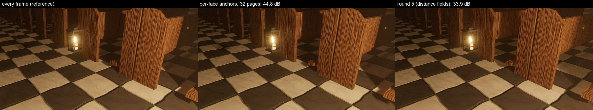
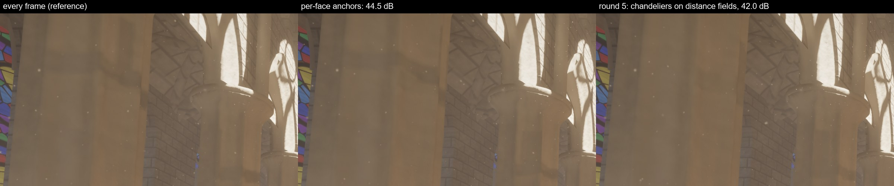

# Shadow maps for fast, sharp moving lights (round 6: `fast-light-shadows`)

Design note. The README carries the user-facing text (the *Cached shadow maps for moving lights* bullet, item 4 of
"Status vs. Unreal Engine 5"); this file records why it is built the way it is, and the measurements.

## What

Round 5 ([`local-shadow-cache.md`](../round5/local-shadow-cache.md)) holds a moving local light's shadow map at an
origin within 0.1 source radii of the light (at least 1 cm), corrects the parallax in the soft-shadow filter and
re-renders the map from a new origin once the light leaves that tolerance — at most one light per frame
(`--moving-light-renders 1`). A moving light only got a map if that budget could keep up with its top speed, and
only a slot that static lights had left. That excluded exactly the lights whose shadows show most when they move: a
small flame carried at walking pace crosses its 1 cm tolerance every frame, needs a render every frame — more than
the whole budget — and was traced through the distance fields, however close to the camera.

Now:

* **Each face of a cube map has its own origin** and is re-anchored on its own.
* **The budget is a number of pages per frame** (`RenderSettings::moving_light_pages`, `--moving-light-pages N`,
  default 32), and a face costs the pages the view requests of it, which the GPU counts every frame.
* **A light that crosses its tolerance sphere every frame is rendered every frame from where it is** (the lead
  ahead of the light shrinks with its speed, to none) — the every-frame reference's image for that light, at the
  cost of its faces' requested pages at the moving mip bias.
* **A light the budget cannot follow is held at a coarser tolerance** (twice, then four times) instead of being
  given up, and a face that waits for the budget is given two frames of the light's motion before that happens.
* **A moving light competes for a slot at half its influence** instead of only for the slots static lights leave.
* Test case: `--lantern` (`?lantern=1`) — a lantern carried down the cathedral's central aisle and back (a 2 cm
  candle flame, up to 1.6 m/s; its iron frame swings with it). `--movers 1` keeps only the lantern moving.

## The test case

None of the demo scenes had a fast, sharp moving light: the chandeliers swing at ≤ 0.9 cm a frame with a 1.4 m
source (14 cm tolerance), the candle-lit cathedral's chandelier candles are MegaLights' (which traces moving lights).
So the cathedral got a lantern, behind a flag (it changes the default view's lighting and the slot competition, so
the standard views stay as they were): an iron frame (base, cap, four corner posts, a rail below and one above the
flame, a bail handle; ~1 k triangles), a candle and a flame, its light a 2 cm source (tolerance: the 1 cm minimum)
of intensity 12 and 10 m range at hand height minus 21 cm. `Motion::Carry` walks it from x = 8 to x = 30 along the
central aisle and back in 44 s, easing in and out at the ends (top speed 1.57 m/s = 2.6 cm a frame at 60 Hz: 2.6
tolerances a frame), with a hand bob and a ±0.2 rad sway at two steps a second. The frame moves with the light
(`Movable`), so its shadows are dynamic casters as the chandeliers' rings are.

Views: the default cathedral view (the lantern 8 m ahead, walking away) and a close view at night,
`--eye 11.4,1.2,-0.6 --at 12.9,0.5,0.5 --sun 200,-25`, where it lights the aisle floor and the pew ends throw long
shadows into the rows.

What round 5 did with it depends on how it started:

* *With the chandeliers swinging* (the default): the lantern starts the run at rest, so it holds a map when it
  starts walking, and being furthest out of tolerance it takes the frame's one render, every frame (re-anchored 0.75
  tolerances ahead: 0.75–1.85 tolerances off). The chandeliers never get a render again; one by one they fall more
  than two tolerances behind and lose their maps. After 1500 frames: 24 lights with maps, 2 of them moving
  (without the lantern: 32, 10 moving). The fast light made the slow ones flip to distance fields.
* *Alone* (`--movers 1`): the 33 static lights take all 32 slots and a moving light only gets what they leave — the
  lantern had no map at all, distance fields however close it came. A fast light that starts moving without a map
  (entering the view, say) is refused by the budget in any case: it needs 1.5 renders a frame.

Now all 12 moving lights keep maps in every one of frames 500–1500 of the same run (1280×720, the lantern turning at
the end of the aisle meanwhile), none relaxed; at 2560×1440, where the lantern's faces cost more pages, three end up
at a coarser tolerance and none on distance fields. With the budget cut to 12 or 6 pages: still all 12 mapped in
every frame, held at coarser tolerances (9 and 4 lights), 9.8 and 4.8 pages a frame rendered from new origins.

## Options evaluated

Quality figures: the close lantern view with only the lantern moving (`--movers 1`), 1600×900, frame 150, against
`--moving-light-maps` (every moving light's map re-rendered every frame from the light: the reference; two runs of it
differ by 65.6 dB, no pixel by more than 24/255).

| | PSNR | > 24/255 | (cluster, page) draws / frame |
|---|---|---|---|
| distance fields (round 5: no slot) | 33.9 dB | 1.59 % | 335 |
| **per-face anchors, 32-page budget** (rendered every frame, moving mip bias) | **44.8 dB** | **0.11 %** | 4392 |
| … 8-page budget (faces in turn, ≤ 3 frames behind) | 43.6 dB | 0.17 % | 2543 |
| … 4-page budget | 42.9 dB | 0.17 % | 2495 |
| tolerance × 2 (2 cm) | 44.6 dB | 0.13 % | 2514 |
| tolerance × 4 | 43.1 dB | 0.14 % | 1888 |
| tolerance × 8 | 42.0 dB | 0.21 % | 1242 |
| every frame, no moving mip bias (`MOVING_MIP_BIAS` 0, budget 200) | 65.5 dB | 0 % | 4509 |
| reference (every frame) | — | — | 4509 |

* **Every frame** (`--moving-light-maps`, UE's behaviour). Right for the lantern — it needs a new origin every frame
  anyway — and wasted on the chandeliers, whose cached maps match it within 48–51 dB (round 5). With the lantern in
  the close view at 2560×1440 it renders 161 local pages a frame in full (70 k draws) against 28 (7.4 k) with
  per-face anchors (Measurements).
* **Only the pages the view samples (near the camera).** A re-anchor already renders only the requested pages: the
  receivers' pages at their mip, the coarsest page of every face a receiver touches (the fallback while finer pages
  are missing, and for translucent surfaces), filter-corner pages and the fog's coarse pages. The per-face counts
  show where they go — the lantern in the close view: 16, 0, 0, 1, 3, 0 pages on its six faces, the faces that
  only the fallback page serves cost one. Dropping the fallbacks or the far receivers' pages would save a few pages
  and leave receivers with nothing to sample in the frames before they are requested again; not done.
* **Amortizing a re-anchor over several frames — faces in turn, parallax-corrected meanwhile.** This is what
  per-face origins are; with a tight budget the lantern's faces take turns and lag up to three frames (8 and 4
  pages: 43.6 and 42.9 dB). Mips in turn would amortize spot lights too (one face), but a pixel's filter reads
  several mips (fallbacks), each would need its own origin offset per tap, and spot lights' faces are single
  already: not done.
* **A budget in pages, or in estimated milliseconds.** Pages are counted exactly and almost free (one atomic per
  physical page in a pass that already runs). Their cost varies — a cathedral page near the floor holds hundreds of
  pew clusters, a page of the lantern's open aisle a few dozen — so a draw-count budget would track milliseconds more closely; it needs the
  expansion to count draws per face. Pages first; draws are a possible refinement.
* **A larger tolerance for lights whose penumbra is wide on screen.** Measured as a uniform scale on the lantern
  (table): twice the tolerance halves the renders for 0.2 dB, four times costs 1.7 dB, eight 2.8 dB — all far closer
  to the reference than distance fields. Whether the error shows depends on the offset in screen pixels, which
  varies over the receivers of one light; the budget is the simpler arbiter. So the default stays at 0.1 source
  radii and the larger tolerance is the fallback when the budget cannot follow a light (`MAX_RELAX` = 4).
* **Prioritising by screen influence.** Within the budget, faces go by error, then influence; the per-face page
  counts weigh faces by what the view samples. Between lights, the slot competition: moving lights at half their
  influence instead of last. Without it the lantern alone gets no slot at all (above).
* **The moving mip bias** (UE's `ResolutionLodBiasLocalMoving`, one mip) stays: it is the whole difference between
  the lantern's every-frame map and the reference (without it the two images match to 65.5 dB, the noise), and it
  halves the lantern's pages (17 instead of 33 a frame in the close view at 1600×900).

## How it works

**Per-face origins** (`vsm_anchor.rs`, `vsm_local.rs`). `Anchors::update` returns six origins per light
(`Origins`; a spot light uses the first). The slot allocator keeps them per slot and marks a face stale when its
origin changed — `flags.x` of the slot is now a bit mask of faces, and `invalidate_local` frees only those faces'
pages. Each face's `view_proj` looks from its own origin and `face_offsets[face]` (origin − light, replacing round
5's single `anchor_offset`) drives the parallax correction of the taps that face serves (`local_filter_follow`).
`position_range` is now the light itself, which picks the face (`local_face`) and the light direction of the filter
disk; `flags.y` says that some face is held (the marking doubles its footprint for the shift, the sampler applies
it). Faces apart by a few centimetres no longer meet exactly: a point the light-centred face choice gives to a face
may lie just outside that face's frustum, in a sliver as wide as the origins are apart that no face covers. Cube
lookups (`local_in_face`) therefore clamp to the face instead of failing; the clamped texel is at most that sliver
away. Faces of one light are due together most of the time (they share the light's motion) and are re-rendered
together unless the budget splits them, so seams are rare and short-lived.

**What a face costs** (`vsm.wgsl`). `dirty_info` already runs a thread per physical page after the page cache has
allocated this frame's requests; each local page whose entry was requested this frame (`entries[e].z == frame`)
adds one to its face's counter (slot words 18–23 of the info buffer; `local_dirty_info` counts the pages rendered
in full in words 24–29). Those words are copied into a read-back buffer each frame the previous read-back is done
(`LocalShadows::record_feedback`; a few frames late, nothing waits) and become the light's per-face page costs
(`LightState::pages`), kept per light so that a light that lost its map still has its last costs. A face's cost is
then exactly what re-anchoring it renders: its requested pages, coarse fallback, fog and filter-corner pages
included.

**The budget**. All faces out of tolerance — and all faces of lights that want a new map — are sorted by error (in
tolerances), then influence, and paid for in that order while the frame's pages last. A render larger than the
whole budget goes alone in a frame (it would otherwise never go), so the pages rendered from new origins per frame
are at most the budget or one face. A new map is admitted if the pages per frame the held maps need at their
lights' recent top speeds — Σ cost × min(1, speed / (1.75 · tolerance)) — plus its own stay within the budget.

**The lead** (`lead`). Round 5 put a new origin 0.75 tolerances ahead of the light, so that the light crosses the
whole tolerance sphere before the next render. A light that moves s per frame is next due after k frames, and its
error over them is max(lead, k·s − lead): smallest at k·s / 2, bounded by k·s − lead ≤ tolerance and capped at 0.75.
For a slow light that is round 5's 0.75; above 1.75 tolerances a frame k = 0 — the light is rendered every frame and
the best origin is the light itself. That makes the fast lantern's map the reference's map, but for the moving mip
bias.

**Relaxed tolerance** (`MAX_RELAX`). A light the budget cannot sustain at its tolerance is admitted at twice or four
times it if that fits, and a held light whose faces fall behind (a face beyond 2 tolerances plus two frames of its
motion when its turn does not come) doubles its tolerance once a frame up to four times, before it gives its map up
until it rests. Measured below: four times the lantern's tolerance is 1.7 dB below its every-frame map, distance
fields 11 dB. The relaxation stays until the light rests (no hysteresis to undo).

**Slots** (`SlotAllocator::assign`). Moving lights competed only for the slots left by static ones, because round 4
re-rendered their maps every frame. Their cost is now bounded by the page budget, and lights the budget turned down
have no origins and do not compete at all, so they rank by influence like static lights, at half of it
(`MOVING_WEIGHT`): a lantern next to the camera takes the slot of a faint candelabrum far off, a chandelier light
whose influence is like a candelabrum's does not.

**Statistics.** The HUD's `moving lights` line: lights with maps (and how many at a coarser tolerance) and on
distance fields, faces re-anchored and their pages this frame, the pages per frame the held maps need against the
budget, local pages rendered in full (and those of moving lights). Headless runs log the means over the last two
thirds of the frames (GPU, every pass, pages, draws, faces re-anchored) and whether any moving light was on
distance fields or relaxed in any of those frames.

## Measurements

2560×1440, frame 150 unless noted, base = main 6eb1c4d plus this branch's demo-only changes (the lantern, the
headless means; the renderer untouched). **The RTX 3090 was shared with three other agents' benchmark loops for the
whole session**: the same scene's GPU frame varied by 2–5× between runs (the valley from 8 to 36 ms), so the
milliseconds below are minima over 5–6 interleaved runs and only differences well above that noise mean anything.
The page and draw counts (means over frames 50–150, deterministic up to ±5 %) and the images do not depend on it.

**Standard scenes** — same work and same image; the only new GPU work there is the per-face counting in
`vsm dirty info` (0.011 → 0.013–0.016 ms):

| scene, 100 % / 67 % | GPU frame (min, HUD) before → after | shadow pages / draws a frame | image after vs before (noise: two runs before) |
|---|---|---|---|
| valley | 20.2 → 12.1 / 9.8 → 7.2 (noise) | 5.1 / 199 = | 56.7 dB, 0.001 % (56.5 dB, 0.001 %) |
| cathedral | 13.06 → 13.30 / 9.23 → 9.52 | 46.4 / 3174 → 49.0 / 3468 (an 11th chandelier light mapped) | 60.6 dB, 0.0003 % (61.0 dB, 0.0001 %) |
| forest | 19.8 → 33.2 / 21.8 → 14.7 (noise) | 319 / 110 k = | 41.1 dB, 0.18 % (41.4 dB, 0.17 %) |
| gallery | 8.36 → 11.47 / 7.19 → 8.04 (noise) | 9 / 8 = | 66.2 dB, 0.0001 % (67.2 dB, 0 %) |

**The cathedral's chandeliers** (no lantern): all eleven chandelier lights now hold maps (before: ten; the eleventh
had no slot left by the static lights). A separate A/B of five interleaved runs, under contention that made every
frame about three times slower but evenly so: GPU frame 29.49 → 29.77 ms at 100 % (+1 %), 17.96 → 18.30 ms at 67 %
(+2 %) — the eleventh mapped light. Against the every-frame reference: default view 48.9 dB before and after
(round 5: 48.9 dB), from under a chandelier (`--eye 17.5,4,5 --at 17.5,0,0.5`) 42.6 dB before and after
(distance fields 34.0 dB). Per pass (minima, 67 %): vsm raster 0.081 → 0.047, expand 0.268 → 0.289, mark local
0.097 → 0.121, lighting 1.47 → 1.30, local light shadows 0.156 → 0.250 ms; ~1 face re-anchored a frame, 2.1 local
pages rendered in full a frame (of them 1.9 by moving lights).

**The lantern** (`--lantern`, chandeliers swinging too), means over frames 50–150, per pass minima (ms):

| | default view: before | after | every frame | close view, night: before | after | every frame |
|---|---|---|---|---|---|---|
| shadow pages a frame (local, in full) | 101 | 92 (34) | 207 (176) | 103 | 108 (28) | 204 (161) |
| (cluster, page) draws a frame | 16.0 k | 12.1 k | 83.7 k | 5.9 k | 7.4 k | 69.8 k |
| faces re-anchored a frame | — | 5.1 | — | — | 6.9 | — |
| vsm raster | 0.585 | 0.441 | 2.958 | 0.264 | 0.213 | 4.412 |
| vsm expand | 0.319 | 0.378 | 0.551 | 0.317 | 0.321 | 0.941 |
| vsm mark local | 0.191 | 0.246 | 0.194 | 0.319 | 0.306 | 0.294 |
| lighting | 3.22 | 3.20 | 3.29 | 3.66 | 3.00 | 5.62 |
| GPU frame (min, HUD) | 14.14 | 15.89 | 16.91 | 16.66 | 12.95 | 21.33 |
| image vs every frame | 47.2 dB | 46.6 dB | (noise 59.7 dB) | 45.5 dB | 45.0 dB | (noise 61.2 dB) |

At frame 150 round 5 still looks right here: the lantern holds the map it started with and takes the frame's one
render every frame, and the chandeliers have not yet fallen far enough behind to lose theirs. Over 1500 frames
(the same view, the lantern turning at the end of the aisle): round 5 ends with 24 mapped lights, 2 of them moving
— 8 chandelier lights on distance fields, 42.0 dB against the reference at frame 1500; now 32 with all 12 moving
lights, 44.5 dB (every moving light on distance fields: 41.1 dB). At 2560×1440 the lantern's faces cost more than at
1280×720, and three lights were at a coarser tolerance at the end (the budget 32 against 39 pages a frame held maps
needed), ~28 pages a frame rendered from new origins against 161 when every moving light re-renders every frame.

**The candle-lit cathedral in the classic loop** (`--lights 300`, no MegaLights): moving lights used to get no slot
there (300 static candles); now 10–11 chandelier candles near the camera compete at half their influence and hold
maps (1–2 at a coarser tolerance), 77 stay on distance fields. Shadow pages 14 → 140 a frame, 100 of them
dynamic-only redraws of the chandeliers around their candles, draws 0.4 k → 8.5 k, vsm raster 0.03 → 0.87 ms,
lighting 24.1 → 22.2 ms (minima of two runs each under the heaviest contention of the session). The dynamic redraws
are outside the page budget (limits).

Tests: `cargo test --workspace --release` green. New unit tests: the lead keeps the error within the tolerance and
is zero for a light rendered every frame; faces re-anchored within the page budget, furthest first, a face larger
than the budget alone; runaways relaxed twice, then dropped until they rest; only lights the budget can follow get
maps (at the tightest tolerance that fits); fast lights rendered every frame from where they are, waiting a frame when
the budget is short; slots keep per-face origins and drop only the moved faces' pages; moving lights compete at half
their influence. Browser (headless Chromium, WebGPU, `./build-web.ps1`): `?scene=cathedral&lantern=1` and the
default cathedral render without WGSL or validation errors; the HUD shows `moving lights: 12 with shadow maps (0 at a
coarser tolerance), 0 on distance fields`.

## Remaining limits

* **The budget counts pages, not their cost.** A page near the cathedral's floor holds hundreds of pew clusters, a
  page of open air a handful; draws per face would track milliseconds better (the expansion would have to count
  them). A face larger than the whole budget is rendered alone in a frame, so a frame renders at most the budget
  or one face from new origins.
* **The dynamic redraws are not budgeted.** A held map's pages under casters that move with the light (the lantern's
  frame, a chandelier's ring) are still refreshed every frame by their move footprints, outside the page budget; a
  moving light that takes a slot from a static one brings those with it.
* **Seams between faces held apart.** While two faces of a cube have different origins, a sliver as wide as the
  origins are apart (≤ a few centimetres) between their frusta is covered by neither; lookups there clamp to the
  edge texel of the face the light-centred choice gives.
* **A relaxed tolerance stays until the light rests**; there is no hysteresis that tightens it again when the budget
  frees up.
* **Spot lights are one face**, so they are re-anchored whole; mips in turn would split them, at the cost of an
  origin per looked-up page.
* **What round 5 left stays**: occluders right next to a large light beyond the blocker search keep the origin's
  shadow, single-tap lookups (fog, lights beyond a pixel's four filtered ones) are not parallax-corrected, and the map
  is a mip coarser while the light moves. MegaLights still traces moving lights.
* The lantern lives behind `--lantern`: in the default view it would change the lighting of the standard
  measurement and the slot competition of the chandeliers.
