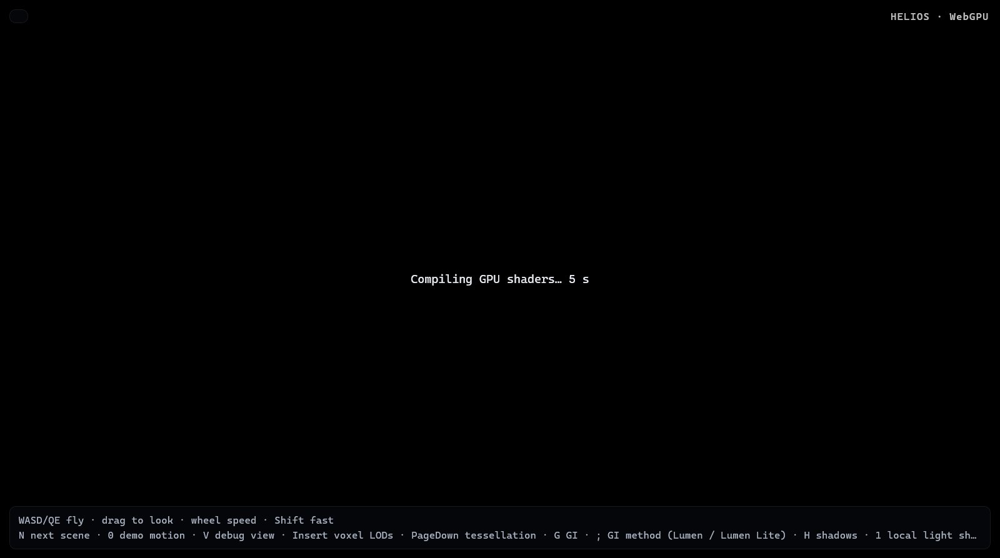
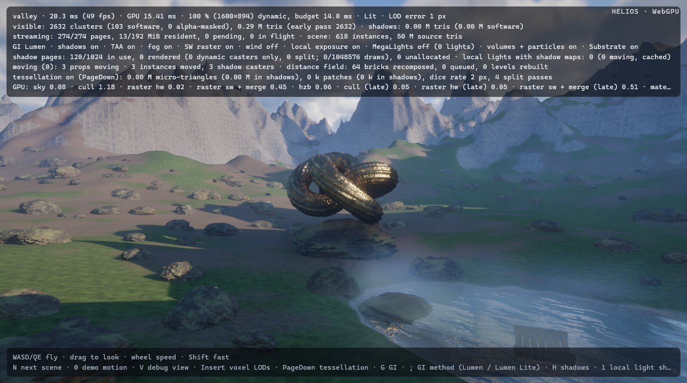

# The showcase no longer freezes Firefox (round 6 follow-up: `firefox-freeze`)

Design note. The README carries the user-facing text (*Quick start*'s browser line, *Showcase site*'s page API, the
*WebGPU constraints* table and gap 15 of "Status vs. Unreal Engine 5"); this file records how the cause was found,
why the fix is built the way it is, and the measurements.

## What

Opening the showcase (https://mp3pintyo.github.io/helios/) in Firefox made the browser stop responding. The cause
was not a hang, an infinite dispatch or a JavaScript busy loop: it was **shader compilation**. The renderer creates
its compute and render pipelines up front (and more in its first frame), Firefox's GPU process compiles them one
after another, and the first frame was presented behind that queue — so the tab stopped painting, scrolling and
answering clicks for 40–45 s, and a frozen page looks like a frozen browser.

Now the page stays live from the first second: the engine never presents a frame that queued compiles, it waits for
the GPU process instead, and it reports the wait (`Compiling GPU shaders… 12 s` in the status element,
`heliosBusy()` for a page). Rarely needed pipelines are compiled on first use, so there is less to wait for.

## How the cause was found

Firefox 159 ran with a fresh temporary profile (`-profile <tmp> -no-remote`), driven over WebDriver BiDi from a small
Python client (`--remote-debugging-port`; console entries, script evaluation, screenshots). Headless Firefox exposes
no WebGPU adapter (`requestAdapter()` resolves to null even with `gfx.webgpu.ignore-blocklist`), so the runs were
headed. Each page got a preload script with two probes: a 50 ms `setInterval` heartbeat (the longest gap is the
longest main-thread block) and a `requestAnimationFrame` log (the longest gap is the longest time the page did not
paint); a second window with a CSS animation probed the rest of the browser.

| probe (valley, base build) | result |
|---|---|
| main-thread blocks | 3.4–3.9 s (the scene bake, before the first frame), 0.6 + 0.8 s (Lumen's displaced variants) |
| page `requestAnimationFrame` | one gap of **36–41 s** after the bake, then 16.7 ms frames |
| BiDi round trips (parent process) | ≤ 3.5 s (during the bake) |
| second window's animation | 16.7 ms frames throughout |
| `browsingContext.captureScreenshot` of the page during the gap | timed out |

So the content main thread was idle while the page could not paint for 40 s. Bisecting: the plain demo
(`web/index.html?scene=valley`) froze exactly like the site, so the site's media and layout were not involved. An
instrumented run (wrapping `GPUDevice.prototype.createShaderModule` / `create*Pipeline` and `GPUQueue.submit`)
recorded every module and pipeline the engine creates — 53 modules and 196 pipelines for the valley, all created
within 150 ms of JavaScript time — with no validation error. A replay page then created each recorded pipeline alone
with `create*PipelineAsync` and timed it:

| | Firefox 159 | Chromium (Playwright, fresh profile) |
|---|---|---|
| 196 pipelines one by one (sum) | 36.0 s | 42.0 s |
| all 196 at once (`*Async`, wall clock) | 46.1 s | 5.4 s |
| largest single pipelines | translucency 1.5 s, texgen 1.3 s, material resolve 0.6–1.1 s (×12), probe SH 1.1 s | similar |

Nothing is pathological: no pipeline takes more than 1.5 s (WGSL → HLSL → DXC on D3D12; Firefox ships
`dxcompiler.dll`). The sum is the problem. Firefox compiles one pipeline at a time even through the async API and
keeps no pipeline cache between visits; Chrome compiles async pipelines on a thread pool and caches compiled shaders
on disk, but its synchronous `create*Pipeline` — the only one wgpu calls — is serial too, and a first visit in a
fresh Chromium profile stalled the valley's first frame for **35.7 s** as well. In both, the page's next paint waits for the canvas frame,
which waits behind the compiles in the GPU process: the whole tab stops painting (the probes cannot tell which
compositor step holds it, only that other windows keep animating).

## Design

### Never present behind a compile

wgpu has no asynchronous pipeline creation (and no way to wrap a `GPUComputePipeline` made in JavaScript), so the
engine cannot keep compiles off the queue. It can keep its *frames* off it:

* **Count creations.** `web.rs` wraps the `GPUDevice` object's `createComputePipeline` and `createRenderPipeline`
  (own properties; wgpu's bindings call them as methods of the object) with a counter. No renderer code had to learn
  about it, and lazily created pipelines — a material permutation, a debug view, MegaLights switched on, a new
  scene's translucency — are caught too.
* **Render off-canvas.** Each frame renders into an engine texture of the canvas's size and format. If the frame
  created no pipeline, the texture is copied to the canvas texture (canvas usage `RENDER_ATTACHMENT | COPY_DST`) and
  presented; if it did, the canvas is not touched, and the loop waits for `queue.onSubmittedWorkDone()` — which the
  GPU process answers only after the compiles queued before it — skipping frames (no update, no render) until it
  resolves. The page's own `requestAnimationFrame`, layout, scrolling and input run normally meanwhile; the canvas
  keeps its last frame (or stays empty before the first).
* **Start in the wait.** The renderer's constructor queues the bulk of the compiles, so the loop starts waiting.
* **Report it.** After half a second the status element shows `Compiling GPU shaders… N s` and the new
  `heliosBusy()` export returns that text (empty while rendering), so a page can show it over the canvas.
* A frame that keeps creating pipelines is presented anyway after eight such frames in a row (a guard; no pass
  does that today).

The copy costs one full-resolution texture-to-texture copy per frame (1.4 MP at 1600×894; not measurable against
the frame's noise) and one texture.

### Compile less up front

Every pipeline the renderer creates is a compile the browser does before the first frame, used or not. An
instrumented run marked the pipelines a frame actually binds (`setPipeline`) during 6 s of the valley and the
cathedral: 64 of the valley's 196 and 35 of the cathedral's 168 were never used, worth 12 s and 6 s of Firefox's
compile time. `util::Lazy<T>` makes a value on first dereference (a `OnceLock` and a constructor closure), so
`pass.set_pipeline(&self.pipeline)` compiles it when a frame first draws with it and reads as before. Made lazy:

| pipelines | why they may never run | Firefox compile |
|---|---|---|
| material resolve, plain permutation (6) | the valley and the gallery tessellate and use the tessellation permutation; the resolve already compiled other permutations on first use | 3.7 s |
| translucency shading models (4) and their depth peeling (3) | water, glass, blended surfaces, the underwater view: per scene content | ≤ 3.9 s |
| culling with `SKINNING` (5) | scenes without skinned instances | 0.9 s |
| software raster, alpha-masked (4); hardware raster, alpha-masked (2) | scenes without alpha-masked clusters | 1.2 s |
| voxel raster (4) | scenes without voxel clusters (Nanite Foliage) | 1.0 s |
| MegaLights (6) | off by default | 0.5 s |
| particle simulation and lighting (2) | scenes without emitters | 0.6 s |

Natively nothing changes but the moment of these compiles (the first frame that needs them; D3D12 / Vulkan compile
them in milliseconds).

### Rejected

* **`create*PipelineAsync` from JavaScript.** wgpu cannot adopt a pipeline created outside it. Pre-warming
  (creating the same pipelines async first, so the synchronous call hits a cache) would roughly halve Chrome's first
  visit — Dawn compiles async pipelines in parallel — but doubles Firefox's work (no cache), needs every pipeline
  layout replicated in JavaScript and depends on Dawn's cache keys.
* **Hiding the scene name until compiled** (`heliosScene()` empty while the first compile runs), so the site keeps
  its loading veil: the site gives the engine 60 s to report a scene, which a slower CPU than this machine's would
  exceed in Firefox, and the page would then report a failure while the engine starts behind it.
* **Spreading pipeline creation over frames.** Without async compilation each frame would still present behind
  its share of the queue: a 0.5–1.5 s hitch per frame instead of one long freeze, and longer in total.
* **Faster shaders.** The cost per pipeline is DXC optimising large shaders (166 KB of WGSL for the material resolve,
  loops with constant bounds in texture generation and the sky's SH projection); shrinking them is a larger,
  per-pass project.

## Measurements

Firefox 159 headed, fresh profile per run, 1280×800 window (canvas 1600×894 at the 1.25 device pixel ratio of this
machine; the site's stage 909×560), RTX 3090 and a Ryzen 5 7600X shared with three other agents' builds and
renders — DXC compiles on the CPU, so the compile waits vary 1.5–2× between runs. Interleaved base / new runs,
3 per target (the valley 5); *first frame* is navigation → the first rendered frame (demo: HUD text; site: GPU
telemetry), *page stalls* are `requestAnimationFrame` gaps over 200 ms during the load.

| | first frame, base → new (min / max) | longest page stall, base → new | other stalls (new) |
|---|---|---|---|
| valley (`web/index.html?scene=valley`) | 33.9 / 63.9 → 26.9 / 58.4 s | 28–57 s → 3.6–4.9 s (the bake) | 0.6 + 0.8–1.2 s (Lumen variants) |
| cathedral | 48.2 / 50.4 → 27.2 / 33.5 s | 37–43 s → 4.9–5.0 s (the bake) | none |
| site (`preview.html`) | 52.0 / 63.6 → 28.7 / 40.2 s | 47–57 s → 3.7–6.0 s (the bake) | 0.6–1.6 s (Lumen variants) |

With the change the remaining stalls are the main thread's own work (scene bake, Lumen's displaced variants); during
the compile waits (valley 9.4 + 11.7 s on a quiet machine, 14 + 17 s under load; cathedral 8–16 + 8–12 s; the
site's valley 11–15 + 10–20 s) the page painted at 16.7 ms and the second window was never affected.

* **Pipelines before the first frame**: valley 196 → 163 (127 queued by the constructor, the rest by the first
  frames: the tessellation permutation of the material resolve, tessellation's dicing, the masked / voxel / culling
  variants the scene has).
* **A lazily compiled feature**: switching the valley to a debug view (`V`) compiled 7 pipelines (the resolve's
  `DEBUG_VIEWS` permutation) in a 10.4 s wait in Firefox; the page's longest stall meanwhile was 0.85 s.
* **Steady state**: `requestAnimationFrame` median 16.7 ms and p95 16.7 ms in both builds (vsync-bound), HUD GPU
  time 8.5 / 8.0 ms new vs 8.5 / 8.8 ms base on the quiet pair (the off-canvas copy is below the noise; it is not a
  timed pass).
* **Chromium** (Playwright's headless Chromium, fresh profile, valley, 2 + 2 interleaved runs): first frame 38.2 /
  45.0 s → 27.8 / 29.7 s, longest page stall 32.9 / 39.8 s → 10.9 / 11.5 s. Chromium's page still stalls in
  stretches during the compile: its GPU process compiles the synchronous pipelines on the thread that also serves
  the page's compositing, so only fewer pipelines help there. A returning Chrome visitor hits the shader cache.
* **Native** (base vs new, 2560×1440, 100 %, frame 150): the images are identical
  within the run-to-run noise, including the scenes that exercise the lazy pipelines (the forest's alpha-masked and
  voxel clusters, the Fox's skinning). The GPU totals are single runs on the shared GPU (the Fox, the only quiet
  one: 5.06 / 5.05 → 5.03 ms); nothing in the frame changed but when the lazy pipelines are compiled.

| scene | PSNR new vs base | pixels > 24/255 | base vs base (noise) |
|---|---|---|---|
| valley | 58.7 dB | 0.0007 % | 56.8 dB, 0.0017 % |
| cathedral | 61.1 dB | 0.0000 % | 61.3 dB, 0.0000 % |
| forest | 42.2 dB | 0.134 % | 40.9 dB, 0.209 % |
| gallery | 65.8 dB | 0.0000 % | 64.1 dB, 0.0000 % |
| Fox (glTF, skinned) | 70.2 dB | 0.0000 % | 73.4 dB, 0.0000 % |

## What Firefox needed, in short

* Nothing in the WGSL or the device limits: Firefox (wgpu/naga) accepted all 53 modules and 196 pipelines without a
  validation error, and the requested limits (`maxStorageBufferBindingSize` 2 GiB, 24 sampled textures, BC and
  timestamp queries) are all within what it offers on this RTX 3090.
* Not presenting behind compiles (above). Firefox compiles one pipeline at a time, also through the async API, and
  has no pipeline cache between visits: every visit pays the full compile.
* Testing it needs a headed Firefox: headless Firefox 159 offers no WebGPU adapter.

## Remaining limits

* The first frame still waits for every pipeline it uses: 27–58 s for the valley in Firefox on this machine (a 6-core Ryzen 5 7600X;
  DXC compiles on the CPU, so slower CPUs wait proportionally longer), on every visit. Chrome waits as long on a
  first visit and caches the result.
* A lazily compiled pipeline makes the frame that first needs it wait (the canvas keeps the previous frame): a debug
  view's material permutation ≈ 10 s, a scene switch's new permutations a few seconds in Firefox.
* The site hides its loading veil once the scene is built, so during the compile it shows an empty stage. It can show
  `heliosBusy()` over the canvas (a small change to `site/index.html`, outside this branch's scope).
* Main-thread work is unchanged: the scene bake (3–4 s) and Lumen's displaced variants (0.6–0.8 s each, one per
  frame) still block the page; `web-bake-worker` moves the variants off the main thread.
