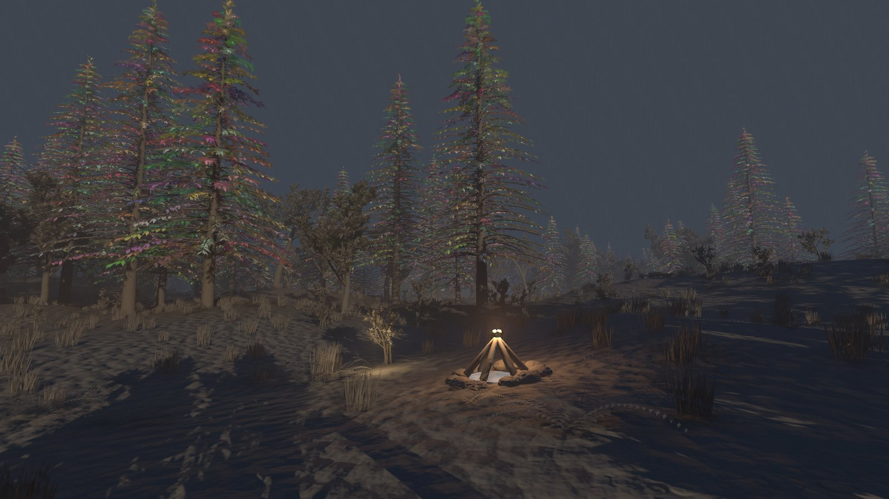
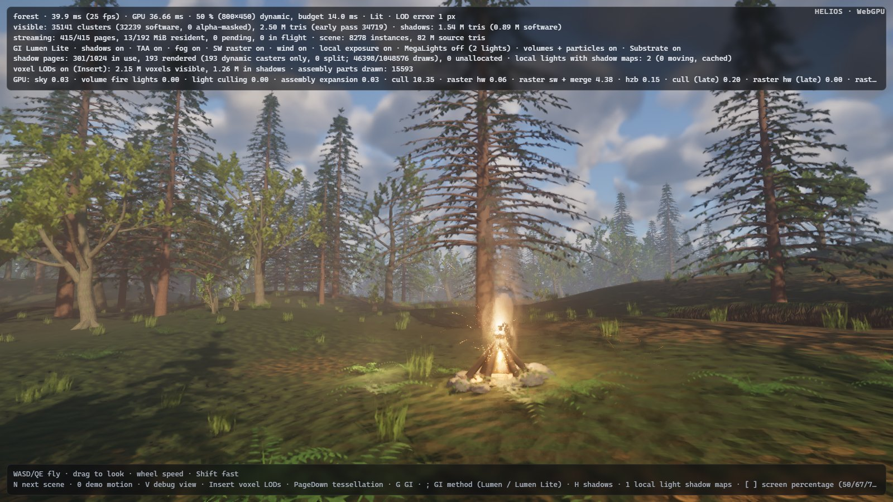

# Cheaper culling of Nanite Foliage's assemblies (round 6: `foliage-culling`)

Design note. The README carries the user-facing text (the *Nanite Foliage* and *Two-pass occlusion culling* bullets,
the pipeline overview, gap 10 of "Status vs. Unreal Engine 5"); this file records where the time went, why the fix is
built the way it is, and the measurements.

## What

Round 4's Nanite Foliage draws a conifer near the camera as its parts: 176 needle sprays per tree, each an instance
record written by the GPU's assembly expansion, ≈ 26 000 part instances in the default forest view. Round 4 measured
their culling at ≈ 0.5 ms (1600×900), round 4's regression hunt at ≈ 0.75 ms (2560×1440), round 5 found no measured
idea. The parts' finer triangles (≈ 1 ms of rasterisation) are the feature's cost and not the target here.

Result: the parts' culling overhead fell from ≈ 0.6 ms to ≈ 0.1 ms, and culling as a whole (all views) from 1.47 to
0.73 ms in the forest at 2560×1440 — below what the forest's culling cost with every assembly drawn as its base —
with the image unchanged. In the browser the forest's culling (`cull` + `cull (late)`) went from ≈ 19–21 to ≈ 8–11 ms.

## Where the time went

`cull` and `cull (late)` in the HUD sum all views: the main view's early and late passes, the sun's twelve clipmap
levels and the local lights' view, each running the same three stages (instances → pages → clusters). A throw-away
build split them into one timed pass per stage and view; another kept every assembly's base (no parts) for reference.
Forest, 2560×1440, 100 %, base build (HUD per-pass times, minima of 7 runs; without parts 2 runs, ms):

| stage | main | main (late) | shadows (sun + local) | with every base kept (no parts) |
|---|---|---|---|---|
| instances | 0.02 | — | 0.30 | 0.02 / — / 0.20 |
| pages | 0.05 | — | 0.23 | 0.02 / — / 0.16 |
| clusters | 0.26 | 0.22 | 0.35 | 0.11 / 0.09 / 0.27 |

So the parts cost ≈ 0.3 ms in the main view (nearly all of it in the two cluster passes) and ≈ 0.25 ms in the
shadow views, plus 0.03 ms of expansion. Two causes:

* **Empty lanes.** Culling is hierarchical by workgroup: a page batch (up to 64 pages of an instance) takes a
  64-lane workgroup in the page pass, and every surviving page a 64-lane workgroup in the cluster pass, one lane per
  cluster. A needle spray is a small DAG — 448 triangles, 17 clusters on 6 pages over 4 levels — so a part's page
  batch kept 6 of 64 lanes busy (9 %) and each of its pages ≈ 3 clusters (≈ 5 %). Every part of every tree in view
  did that, in the early and again in the late pass (the late pass re-culls the same page items against the HZB).
* **The same test 176 times.** A part's instance record carries its tree's bounds (the wind's reach and plant origin
  are the tree's), so every view tested each tree's sphere once per part: ≈ 26 000 identical frustum and dirty-page
  tests in each of the 14 culling views, each emitting a page batch.

## Design

### Cluster candidates for small pages

Pages of at most 16 clusters do not take a cluster workgroup. The page pass lists their clusters one by one — an
(instance, cluster) pair per cluster, two per 16 bytes — in a third region of the view's work buffer, after the page
work items; the cluster pass's dispatch is one workgroup per page work item followed by one per 64 candidates, and
both kinds of workgroup run the same cluster test and output aggregation. The candidates of a page workgroup are
reserved with one global atomic; a page whose candidates do not fit the region (twice the page item capacity) voids
the slots it reserved below the capacity (`INVALID_ID`, skipped) and falls back to a page work item, so nothing is
lost when the list fills. The late pass re-dispatches the same arguments and so re-culls the same candidates.

This is not specific to assemblies: grass (21 clusters on 6 pages), ferns, logs and the voxel clusters' small pages
benefit too, which is why the forest's culling ends below what it cost without parts. Thresholds 8, 16, 32 and 64
(every page) were measured; 16 was best or equal in every stage (larger pages fill their own workgroup well enough,
and listing them writes more candidates).

### One culling record per assembly instance

Each assembly instance owns one more instance record, placed between the scene's instances and the part slots (the
instance buffer is now `[scene | culling records | part slots]`, so the instance pass's dispatch simply covers the
scene and the records; the indirect dispatch over the slots handed out, and its single-thread `finish` pass, are
gone). The expansion writes it with what the parts share — the base's record (bounds, wind, plant origin) with the
parts' flags plus `INSTANCE_PART_LIST` — and three fields reused for the parts: `page_offset` = the first part's
instance, `cluster_offset` = the stride (the most pages of any of the assembly's parts, from the CPU), `page_count` =
parts × stride; `max_scale` bounds the parts' scales (the base's times the largest part transform scale), which only
the displacement padding reads. A base drawn whole hides its record (`INSTANCE_HIDDEN`).

Instance culling therefore tests a tree once per view, exactly as each part did (same sphere, wind strength, flags;
the scale bound can only pad more), and emits ⌈parts × stride / 64⌉ page batches. In the page pass a lane of such a
batch resolves to (part = lane / stride, page = lane mod stride), reads the part's record and, if the part has that
page, tests it with the part's transform as before; the surviving page goes on as a page item or as cluster
candidates of the part. A conifer is 17 page workgroups instead of 176; nothing after the page pass changed, so
visibility bits, streaming feedback, picking and the selection outline (part owners) work as before.

Parts with fewer pages than the stride leave lanes idle: here all six spray variants have 6 pages, so none are.

The old indirect dispatch over the slots handed out also let its last workgroup visit up to 63 slots past them,
still holding an earlier frame's parts (a few stale sprays for a frame after fewer trees expanded); no thread visits
part slots directly any more.

### The clipmap levels share one work buffer

Candidates double the size of a view's work buffer (page items + candidates). The sun's 16 clipmap views each held
their own, but they are culled one after another and each is expanded into page draws before the next is culled, so
their work lists are dead by then: the levels now share one buffer (`CullView::share_work`), which more than pays for
the candidates (16 × 1.75 MiB before → one 2.6 MiB buffer; the main view's buffer grows 5.5 → 9.3 MiB, the local
lights' 3.0 → 4.8 MiB; 36.5 → 16.7 MiB in all). Page batches are reserved for the records' worst case (every
assembly instance expanded: 21 578 batches in the forest) instead of one per part slot (32 768).

## Alternatives evaluated

* **Workgroup-aggregated batch reservations in the instance pass** (one global atomic per workgroup instead of one
  per visible instance): no measurable change (sun instance passes 0.10–0.11 ms with either), reverted. With the
  records, the pass has ≈ 17 700 threads per view, too few for the atomic to matter.
* **Per-view compact part lists** (an extra pass per view that tests each part's own bounds and compacts the
  survivors before the page pass): the page pass already tests every part's pages with the part's own transform,
  and an extra dispatch per view costs about what it would save.
* **Switching to the base earlier for distant assemblies**: changes the image (the base is coarser by up to its
  transition error), so it is not a culling optimisation; the parts' culling is now cheap enough that the threshold
  stays where the LOD rule puts it.
* **Merging dispatches / sharing work between the main and the shadow views**: the views' tests differ (frustum vs
  dirty pages, LOD scale), only the expansion is shared and it already runs once. Culling the twelve sun levels in one
  multi-view dispatch would remove most of the remaining fixed cost (12 × 5 small dispatches and barriers) but
  restructures the virtual shadow map's per-level culling and expansion; not done here.

## Measurements

2560×1440, RTX 3090 shared with three other agents' builds and renders (at times 90 % busy: whole frames were
often 2–3× slower than on an idle GPU). Base = `main` 6eb1c4d. Two methods:

* **Per stage**: throw-away builds of the base and of this branch that time each culling stage of each view as its
  own pass (labels `cull instances [main]` …), HUD-smoothed per-pass times, minima of 7 / 3 interleaved runs.
* **Per pass**: the new headless `GPU minima over N frames` log (README, *Headless flags*): every pass's minimum over
  frames 50–150, then the minimum over 3 interleaved runs. Per-pass minima repeat to ±0.005 ms under the load;
  whole-frame minima do not (one slowed pass spoils a frame), so the frame column is the sum of the per-pass minima —
  a consistent estimate for A/B, below a real frame by the frame-to-frame variation of the passes. The base build for
  this method is 6eb1c4d with the minima commit cherry-picked.

Forest, 100 %, per stage (ms; sun + local are the twelve clipmap levels and the local lights' view together; the
base's throw-away labels could not tell them apart):

| stage | main | main (late) | sun + local | with every base kept (no parts): base → after |
|---|---|---|---|---|
| assembly expansion | 0.04 → 0.04 | | | 0.01 → 0.01 |
| instances | 0.02 → 0.01 | — | 0.30 → 0.14 (0.10 + 0.04) | 0.22 → 0.13 |
| pages | 0.05 → 0.03 | — | 0.23 → 0.18 (0.15 + 0.03) | 0.18 → 0.20 |
| clusters | 0.26 → 0.07 | 0.22 → 0.05 | 0.35 → 0.21 (0.15 + 0.06) | 0.47 → 0.29 |
| all | | | **1.47 → 0.73** | 0.88 → 0.63 |

The parts' share (with parts minus without): ≈ 0.59 ms → ≈ 0.10 ms, of which 0.03 ms is the expansion writing the
part records. The rest of the gain is the cluster candidates on the scene's other small meshes (grass, ferns, logs,
the voxel pages), which is why the forest now culls for less than it did with every assembly drawn as its base.

Standard views, per pass (`cull` + `cull (late)`, all views; sum of per-pass minima as the frame estimate):

| scene | cull + late, 100 % | cull + late, 67 % | frame (sum of pass minima), 100 % | 67 % |
|---|---|---|---|---|
| forest | 0.971 + 0.214 → 0.511 + 0.045 (**−0.63**) | 0.922 + 0.214 → 0.469 + 0.048 (**−0.62**) | 14.64 → 14.11 | 10.19 → 9.57 |
| valley | 0.195 + 0.016 → 0.199 + 0.015 | 0.195 + 0.016 → 0.198 + 0.015 | 8.41 → 8.35 | 5.30 → 5.32 |
| cathedral | 0.277 + 0.017 → 0.306 + 0.015; again: 0.310 + 0.017 → 0.305 + 0.016 | 0.264 + 0.017 → 0.271 + 0.015 | 10.16 → 10.23; again: 10.58 → 10.40 | 6.13 → 6.16 |
| gallery | 0.255 + 0.014 → 0.263 + 0.015 | 0.260 + 0.014 → 0.268 + 0.014 | — | — |

Valley, cathedral and gallery have no assemblies; their culling moves by +0.003 to +0.009 ms in valley and gallery
(the page pass has two more barriers per workgroup) and within the run-set variation in the cathedral, whose swinging
chandeliers change the local lights' dirty pages from set to set (0.277 vs 0.310 ms for the same base build); the
per-stage split of the cathedral shows every stage of every view equal within ±0.002 ms. Their other passes are
unchanged. The gallery's frame sum is not given: its tessellation passes varied by several
milliseconds under the load in both builds. HUD-smoothed whole frames of the quietest forest runs: 16.96–17.03 →
16.03–16.22 ms.

Browser (headless Chromium, WebGPU, `./build-web.ps1`; HUD after 60 s, dynamic resolution settled at 50 %; 2 runs of
the base, 3 of this branch, same shared GPU): forest `cull` 17.0–18.6 → 7.5–10.7 ms, `cull (late)` 2.3 → 0.2 ms. The
same work as natively, but there it costs ten times more (Chrome's coarse timestamps make single small passes
imprecise; the sums over the 14 views agree run to run). No WGSL or validation errors; debug view 23 shows the same
trees as parts (15 593 at 1600×900).

Memory: culling work buffers 36.5 → 16.7 MiB (the clipmap levels' shared buffer more than pays for the candidates);
instance buffer + 1 273 culling records × 240 B (0.3 MiB) in the forest.

**Images** (frame 150, the demo motion is deterministic; PSNR / largest difference / pixels differing by more than
24/255; noise = two runs of the same build):

| view | base → after (two pairs) | noise (base, after) |
|---|---|---|
| forest 100 % | 41.3 dB, 211, 0.164 % · 41.2 dB, 210, 0.163 % | 40.6 dB, 0.253 % · 40.4 dB, 0.259 % |
| forest 67 % | 41.7 dB, 192, 0.173 % · 41.3 dB, 188, 0.215 % | 41.5 dB, 0.210 % · 41.8 dB, 0.166 % |
| forest calm (`L` wind and `'` volumes off) | 41.6 dB, 0.276 % · 44.5 dB, 0.091 % | 44.5 dB, 0.092 % · 41.5 dB, 0.277 % |
| valley 100 / 67 % | 56.5–58.8 dB, ≤ 0.0006 % | 56.4–58.8 dB, ≤ 0.0009 % |
| cathedral 100 / 67 % | 59.6–61.5 dB, ≤ 0.0001 % | 59.7–61.8 dB, ≤ 0.0001 % |
| gallery 100 / 67 % | 62.3–66.9 dB, ≤ 0.0001 % | 62.4–66.4 dB, ≤ 0.0001 % |

All within the run-to-run noise (the forest's comes from the wind, the fire and the stochastic voxels; in the calm
pair one run of the new build is the odd one against both base runs and its own twin). The culling decisions are the
same tests on the same bounds; only the order of visible-cluster entries changes.

## Remaining limits

* An expanded tree still writes all its parts as full 240-byte instance records every frame (0.03 ms for ≈ 26 000
  parts), whether or not any view sees them; the records are needed by every later stage (pages, clusters,
  rasterisers, resolve).
* The record's lanes use the largest page count of the assembly's parts as the stride: parts with fewer pages leave
  lanes idle (none in the forest, whose spray variants all have 6 pages).
* Instances with few pages (grass, ferns) still take a 64-lane page workgroup per batch; page candidates for them,
  like the cluster candidates, would save part of the remaining ≈ 0.18 ms of page culling in the shadow views.
* The twelve sun levels are culled one after another, each with five small dispatches and their barriers; most of
  the ≈ 0.4 ms of shadow culling left is that fixed cost. Culling all levels in one multi-view dispatch would remove
  it but changes the virtual shadow map's per-level culling and expansion.
* The record bounds the parts' scales by the base's scale times the largest part transform scale, so a displaced
  assembly's instance test is padded slightly more than its parts' were (the page and cluster tests are exact).
* Cluster candidates take at most twice the page item capacity; beyond that, small pages fall back to page work
  items (counted by the LOD budget as before).
