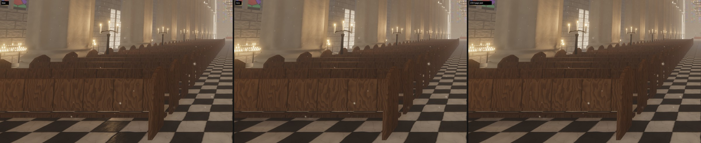
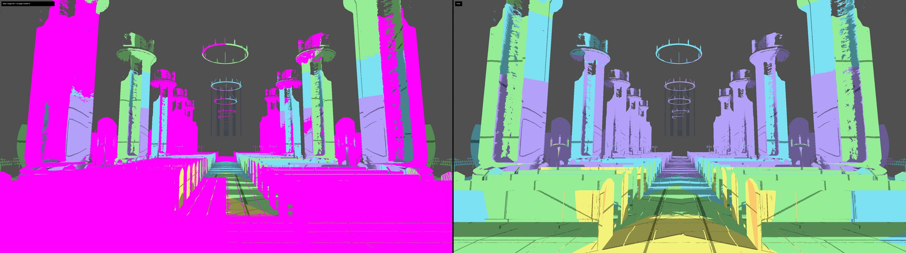

# A shadow page pool that serves what matters first (round 6 follow-up: `vsm-pool-fairness`)

Design note. The README carries the user-facing text (the *Local light virtual shadow maps* bullet, item 4 of
"Status vs. Unreal Engine 5"); this file records why it is built the way it is, and the measurements.

## What

The sun's clipmap and the 32 local lights' maps share one physical pool of 1024 pages of 128² texels
(`vsm.rs`, `page_cache.wgsl`). The candle-lit cathedral on the classic light loop (`--scene cathedral --lights 300`)
requests ~1860 of them a frame. The page cache placed requests in the order the allocation queue happened to hold
them — in practice the order of the entries, sun first, then slot 0, 1, … — and a requested page that was resident
stayed resident. So once the pool was full, the slots with the highest indices got nothing: in the default view the
six candelabrum candles nearest the camera held shadow-map slots with **no page resident at all** (not even the
coarsest fallback of a face) and cast no shadow — the floor under the front pews was lit straight through them. The
HUD's `840 unallocated` was a capped count; the true figure was the same ~840 pages, every frame.

Now:

* **A full pool serves requests by priority** (`page_cache.wgsl`). Every request falls into one of 256 priority
  buckets: first the coarsest page of every face of every mapped light (≤ 6 per slot: the fallback a receiver reads
  while finer pages are missing — every light that holds a slot casts *some* shadow before anything else is placed),
  then the sun's clipmap pages (they have no coarser fallback of their own), then the local lights' pages by the rank
  of their light's influence on screen (`slot_ranks`: range coverage × brightness, the same measure that hands out the
  slots), within a light coarse mips before fine ones. While the requests fit, nothing changes: requests are queued
  as they come and resident pages stay, as before. When they do not, `cache_plan` (one thread) walks the bucket
  histogram to the first bucket where the requests stop fitting — the cut — and `cache_reassign` (dispatched
  indirectly, only in such frames) evicts resident pages below the cut, keeps those of the cut-off bucket while the
  pool has room for them (ahead of that bucket's new requests: no page flips between two requests of equal rank) and
  queues the new requests in bucket order, so that the free pages go to the best first. What is left without a page
  is always the least important, not whatever was queued last. Pages kept for reuse but not requested go first.
* **The local lights' resolution adapts to the pool's load** (`PoolPressure`, UE's virtual shadow map dynamic
  resolution, `r.Shadow.Virtual.DynamicRes.MaxResolutionLodBias`). Priorities alone leave the lights below the cut on
  their coarsest page — all resolution lost at once. A pool resolution bias instead makes them request coarser mips:
  when the pages requested (read back with the statistics) exceed 95 % of the pool, it rises by half the log₂ of the
  overload (a mip coarser quarters a light's fine pages), then waits four read-backs for the frames in flight; below
  70 % it falls by 0.05 mips a read-back. It is spread over the slots by rank: none for the light that matters most
  on screen, twice the bias for the faintest. In the candle-lit view it settles at ~1.4 mips (the six nearest candles
  at full resolution, the faintest dozen on their coarsest pages, ~960 pages requested); the 33-light cathedral (55 pages
  short before) at 0.2, the lantern (94 short) at 0.34; the standard scenes never fill the pool and stay at 0.
* HUD: `shadow pages: … N requested … M unallocated` (the true count now), and a `local lights' shadow pages` line:
  pages resident of those requested, maps without a resident page, the pool bias.

## Why priorities and an adaptive bias, not a larger pool

Measured against a build with a 2304-page pool (48² tiles; the candle-lit view's 1669 requests all fit), in the
candle-lit default view at 2560×1440:

| | pages requested / unallocated | maps without a page | image vs the 2304-page pool |
|---|---|---|---|
| base (first come, first served) | 1862 / 840 | 6 | 43.0 dB, 0.164 % > 24/255 |
| priorities only | 1862 / 838 | 0 | 60.7 dB, 0 % |
| priorities + pool bias (spread 0.25–1.75×) | 964 / 0 | 0 | 59.8 dB, 0 % |
| **priorities + pool bias (spread 0–2×)** | **962 / 0** | **0** | **60.2 dB, 0 %** |

Two runs of one build differ by ~60 dB here, so once no map is starved, the image cannot be told from the large
pool's: the lights cut back (the faintest, furthest from the camera) cast their shadows on receivers far away, where
their coarse pages are about as fine as the screen. The whole 43 dB was the six starved candles.

* **A larger pool** (UE's default is four times larger) would have held the view: 2304 pages fit its 1669 requests
  without bias. But the pool's memory is the depth atlas (64 MiB at 1024 pages) plus the software rasteriser's u32
  mirror of it, which also holds the pages' static layers (another 64 MiB + 16 MiB of scratch tiles); the mirror is
  one storage binding, and WebGPU's default limit is 128 MiB — 2304 pages need 170 MiB, i.e. adapters that grant
  more, and 1024 pages for the rest; 4096 pages would take 528 MiB of VRAM. And requests scale with the lights' map
  count and resolution, not with the scene: 1000 candles request as much as 300. Priorities and the bias handle any
  overload at the same memory; the pool size stays a constant.
* **Priorities without the bias** are as good in this view (60.7 dB) but leave the pool full every frame: the
  reassignment runs every frame (+0.02 ms), pages kept for reuse are evicted at once (looking back costs renders),
  and the lights below the cut have only their coarsest page — 128² texels for a 90° face — however near the
  camera their receivers come when it moves. The bias loses a little everywhere instead of everything somewhere.
* **"Coarse mips of every light before fine mips of any"** (one of the brief's suggestions): a receiver requests the
  mip that matches its screen footprint, so coarse requests come from receivers far away and fine ones from
  receivers near the camera. Ordering by mip would serve far, faint receivers before the near ones, which matter
  most; only each face's coarsest page — the one fallback every receiver requests — is served for every light first.
* **Spreading the bias uniformly** (UE applies one global bias): measured with a spread of 0.25–1.75× (59.8 dB) and
  0–2× (60.2 dB) — the most influential lights keep their resolution.
* **Per-light bias from the read-back request counts** (choosing each light's bias to fit a budget): needs a model of
  how requests fall with the bias (coarse fallbacks do not), and read-backs are a few frames late; a single
  controlled bias spread by rank converges in 2–4 steps without one.

## Moving candles inside their fixtures (investigated, not changed)

The second part of the brief asked to give the candles on the swinging chandeliers shadow maps cheaply again
(candle-redraw-budget made them yield their slots: each redraws its whole map every frame, 20–50 pages, because its
fixture moves with it). Three routes, one implemented and measured, two analysed; none is kept.

* **Maps without the fixture** (implemented: the expansion skipped movable casters whose bounds hold a moving
  light, the invalidation ignored their moves for that light, and the shadow pass traced the fixture's shadow in the
  mesh distance fields around the light — `mesh_sdf_soft_shadow` over the last near-field stretch of the ray — taking
  the darker of the two; such a map then costs only its re-anchoring, at four times the tolerance since what it
  still holds is static and metres away). A light that lost the slot with its fixture in the map competed with the
  cheaper map's claim. In the candle-lit view 13 chandelier candles got such maps at 17 pages a frame of
  re-anchoring (none of dynamic redraws), but the image hardly moved: 54.7 dB from the build without them (51.9 dB
  from under a chandelier), against the every-frame reference 40.7 dB instead of 40.6 (default view) and 40.6 dB
  instead of 40.2 (from under a chandelier, `--eye 14.6,8.3,2.6 --at 17.5,7.3,0`); round 6's maps with the fixture
  in them reached 43.4 and 42.1 dB. A candle on a chandelier 7.5 m up casts, from its 2 cm flame, mainly the shadow of its own fixture
  — the ring passing 30 cm under it, the neighbouring candles, the rods — and that shadow stays a distance-field
  shadow; the pews and pillars far below are soft and similar either way. The map is worth its cost only with the
  fixture in it. (The lighting pass pays for 13 more mapped lights and a near-field trace each.)
* **Refreshing only the pages the fixture's clusters touch** (instead of every page its instance footprints reach):
  sampling the chandelier's geometry around one of its candles, cluster-sized spheres (8–15 cm) cover 15 % of the
  candle's mip-0 pages, 28 % at mip 2, 40 % at mip 3 — uniformly over the faces. But the candle's own wax, a
  cluster 5–30 cm under the flame, subtends a cone of ~45° half-angle or more downwards: the whole centre of the −Y face,
  which is where the floor's requested pages are, every frame. Smaller savings elsewhere would not lift the claim of
  a light that still redraws most of what the view samples of it. Not built.
* **Caching the fixture in the light's frame** (drawn at its pose relative to the light, translated by each face's
  offset, refreshed only when it turns relative to the light — ≲ 10⁻³ rad a frame, under a texel at mip ≥ 1): the
  receivers would then need a different parallax correction per texel — `+offset` for fixture texels (they are an
  exact image from the light), `(1 − t) · offset` for static ones — and a depth map does not say which is which.
  Classifying by blocker depth (closer than the fixture's radius) fails for the chain (12 m), for static casters near
  a light, and in the blocker search, which averages both; a second blocker search per class doubles the filter for
  every such light. The previous agent's acne argument stands for the merged map. Not built.

So the chandelier candles keep distance-field shadows where static lights compete for the slots, as the base of
this branch had them (and they take maps wherever slots are to spare).

## Measurements

2560×1440, frame 150, base = `candle-redraw-budget` b06892c (built from a separate worktree with its own target
directory). GPU frame and per pass: minima of 3 interleaved base / new runs (ms). The RTX 3090 was shared with other
agents' renders and a game for the whole session — single runs up to 20× slower — so only the minima and the
per-pass figures mean anything, and differences under ~0.3 ms in the frame are noise. Pages: means over frames
50–150 (the base's `unallocated` is its HUD's capped count at frame 150). Images: PSNR and pixels off by more than
24/255, new vs base; noise = two base runs.

**Candle-lit cathedral, classic loop** (`--lights 300`; `--lights 1000` requests the same: 32 slots either way):

| | 100 %: base → new | 67 %: base → new |
|---|---|---|
| pages requested / unallocated a frame | ~1860 / 840 → **963 / 0** | (not counted) / 79 → 828 / 0 |
| maps without a resident page | 6 → **0** | 0 → 0 |
| pool resolution bias | — → 1.46 mips | — → 0.50 mips |
| shadow pages rendered a frame (draws) | 14.0 (334) → 12.0 (236) | 14.8 (430) → 10.7 (231) |
| vsm cache | 0.017 → 0.022 | 0.016 → 0.021 |
| local light shadows (the six candles filter again) | 1.03 → 1.40 | 0.63 → 0.63 |
| lighting | 4.46 → 4.29 | 1.96 → 1.95 |
| GPU frame (min / smallest median) | 15.39 / 16.40 → 14.74 / 15.46 | 8.58 / 8.90 → 8.37 / 8.75 |
| image new vs base (noise) | 43.0 dB, 0.164 % (59.9 dB) | 45.4 dB, 0.145 % (45.6 dB, 0.144 %) |

The base's minima here are higher than candle-redraw-budget measured for the same build (14.22 ms): the session's
contention. The new work is the six candles' filtering, +0.37 ms in `local light shadows` (they shaded as unshadowed
before, at no cost), and the page cache's begin / plan passes, +0.005 ms everywhere. `--lights 1000`: 16.73 →
16.78 ms (local light shadows 1.57 → 1.82), 67 % 10.22 → 10.18; image vs base 43.1 dB (noise 59.7). At 67 % the
starved maps were others (79 pages short): 45.4 dB against a noise of 45.6 dB says the view changed by no more than
two base runs differ there (TSR at that resolution).

Against the 2304-page pool: 60.2 dB (two runs of one build: ~60 dB). Static camera, last 16 frames at 1600×900: 0.0071 → 0.0070 %
of pixels change by more than 24/255 per frame (mean difference 0.682 both): no popping from pages changing hands.

**MegaLights** (`--lights 300 --megalights`): its static slots were starved the same way (its rays use their maps).
14.79 → 14.73 ms (100 %), 8.65 → 8.58 ms (67 %), 963 pages requested, none unallocated, image vs base 43.7 dB
(noise 59.8 dB).

**Cathedral, 33 lights** (the default view overflowed by 55 pages): 0 unallocated, bias 0.20 mips, 953 pages
requested; 11.56 → 11.30 ms (67 %: 7.35 → 6.89; not full there), all eleven chandelier lights mapped; image vs base
61.0 dB (noise 60.7 dB).

**Lantern** (`--lantern`; 94 pages short): 0 unallocated, bias 0.34; 11.08 → 11.07 ms (67 %: 6.77 → 6.81), all twelve
moving lights mapped, 94.0 pages rendered a frame (base 92.9); image vs base 55.3 dB (noise 55.9 dB).

**Standard scenes** (the pool is never full: only the cache's new passes run, +0.005 ms):

| scene, 100 % / 67 % | GPU frame (min) base → new | pages requested | image new vs base (noise) |
|---|---|---|---|
| valley | 8.54 → 8.52 / 5.36 → 5.38 | 211 / 131 | 54.7 dB, 0.002 % (53.8 dB, 0.002 %) |
| cathedral | 11.56 → 11.30 / 7.35 → 6.89 | 953 / 667 | 61.0 dB (60.7 dB) |
| forest | 14.50 → 14.51 / 9.78 → 9.78 | 500 / 301 | 40.5 dB, 0.187 % (40.9 dB, 0.174 %) |
| gallery | 7.85 → 7.90 / 4.87 → 4.90 | 371 / 212 | 65.4 dB (65.4 dB) |

Memory: the pool is unchanged (64 MiB of depth, 80 MiB of mirror); the page cache's lists grow by 4 KiB (the
histogram), plus two 16-byte argument buffers.

Tests: `cargo test --workspace --release` green. New unit tests: the pool bias rises with the overload, waits for the
frames in flight, holds in the band between room and full and relaxes slowly, and is spread by rank (none for the
first, twice for the last); slots rank by influence, unused slots last; the info layout test evaluates the shader's
sums of constants (the per-page arrays now derive from `VSM_PHYSICAL_PAGES`). Browser (headless Chromium, WebGPU,
`./build-web.ps1`): `?scene=cathedral&lights=300`, `?scene=cathedral` and `?scene=cathedral&lantern=1` render
without WGSL or validation errors; HUD: `local lights' shadow pages: 655 of 655 requested resident · maps without a
resident page: 0 · pool resolution bias 0.48 mips` (1200×675, dynamic resolution).

## Remaining limits

* **The bias is global, spread by rank.** It knows the pool's load, not which light's requests cause it; a light near
  the camera with many requests and a faint one with few are biased by their rank alone. A rank change (the camera
  moves past a light) changes a light's mip boundaries, and its new pages are rendered.
* **The pool stays 1024 pages.** Scenes whose requests exceed it at the largest bias (2.5 mips) — not reached by the
  demo's views — fall back on the priorities: the faintest lights keep their coarsest pages only.
* **Priorities rank lights by the slot measure** (range coverage × brightness), not by the screen area their pages
  serve: a light that covers the view but is faint ranks below a bright one far away.
* **Chandelier candles keep distance-field shadows** in the candle-lit cathedral (above): their maps are worth it
  only with their fixture in them, and that costs a redraw of most of the map every frame.
