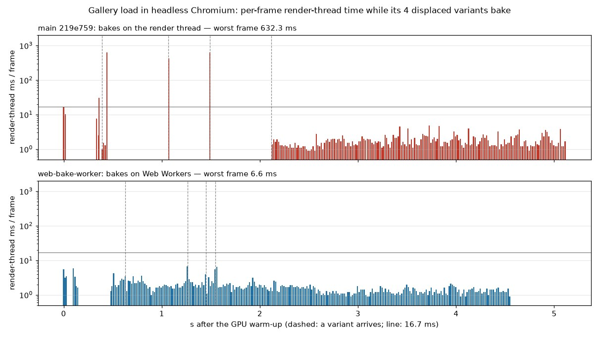

# Displaced variants bake off the render thread in the browser (round 6 follow-up: `web-bake-worker`)

Design note. The README carries the user-facing text (the *Displaced surfaces* paragraph of the *Lumen-style GI*
bullet, the WebGPU constraints table, gap 14 of "Status vs. Unreal Engine 5"); this file records why it is built the
way it is, and the measurements.

## What

Round 6 made Lumen follow Nanite tessellation through *displaced variants* (`docs/round6/lumen-displacement.md`):
per displaced (mesh, material) a distance field and mesh cards baked from the displaced surface. Two CPU steps of a
variant are long — the **refinement** of the mesh's LOD cut into points ¾ of a voxel apart (up to 516 k triangles),
and the **bake** of the field and the cards from the displaced positions — and natively both run on worker threads.
The browser build has no threads: wasm threads need a `SharedArrayBuffer`, which needs a cross-origin isolated page
(COOP/COEP headers), and GitHub Pages cannot send those headers. So the browser ran them on the render thread, one
task per frame, each a stalled frame of 30–920 ms whenever a scene with displacement loaded (the gallery has four
variants, the valley two) or a displacement was edited.

Now they run on **Web Workers**. The render thread's share is handing over inputs and taking in results, at most one
such piece per frame, and the frame stays within a few milliseconds of a frame without baking.

## Why Web Workers, and not a time-sliced bake

Both options from the brief were weighed with the browser's own numbers (headless Chromium, the base build):

* **(b) A resumable bake, time-sliced at 2–4 ms per frame on the render thread.** The gallery's four variants are
  ≈ 1.9 s of render-thread CPU (bakes of 31 + 714 + 464 + 652 ms, plus the refinements); at 3 ms per frame that is
  ≈ 630 frames, 10 s at 60 Hz before the last variant is in (now: ≈ 1.6 s), and every one of those frames still
  carries 3 ms of baking on top of its own work. It would also need resumable versions of five algorithms that every
  mesh's bake shares (refinement, the volume bake with its sign flood fill and crack sealing, the heightfield bake,
  the depth-peeled card capture, the normal accumulation), kept bit-identical to the one-shot versions natively.
* **(a) Web Workers** need no `SharedArrayBuffer`: workers that share no memory exchange messages, and an
  `ArrayBuffer` is *transferred*, not copied. A `WebAssembly.Module` can be posted to a worker too, so each worker
  instantiates the page's already-compiled module — no second download, no second compilation — and runs exactly
  the code the render thread would have run: the results are bit-identical by construction. The workers run in
  parallel, so the variants are in sooner than on the render thread.

(a) it is, with the old path kept as the fallback (no `Worker`, a worker that fails to start or traps, or
`?bake-workers=0`). A *dedicated small bake module* (a second crate with only `helios-geometry` and the bake) was
rejected: a second wasm-bindgen output and build step for a module the page has already compiled in full.

## How

* **Work as data** (`helios-render/src/lumen_offload.rs`). A variant's CPU work is a `Work` value that carries all
  its inputs — `Refine { corners, spacing, triangles }`, `Bake { base, mesh, positions, card_scale, serial }` — and
  computes an `Output` from them alone (`Refined` or `Baked(variant, ms)`). Natively a `Work` runs on a thread as
  before (the closures that used to capture the inputs became `Work` values; nothing else changed). In the browser it
  is encoded into a flat little-endian record (`Work::encode`), run by the worker through the exported
  `heliosBakeTask` → `run_bake_task`, and its `Output` comes back the same way. Every baked struct (`MeshSdf`,
  `Aabb`, `MeshCards`, `Card`, `DisplacedVariant`, `Refined`) is written and read field by field with exhaustive
  patterns, so a field added to one of them does not compile until it crosses the wire too.
* **The pool** (`helios-demo/src/bake_worker.js`, `web_bake.rs`). One file is both ends: imported by the engine's
  glue (wasm-bindgen copies it to `pkg/snippets/`) it exports the pool; started as a module worker it imports the
  same glue, instantiates the module it is sent (`wasm_bindgen::module()`), and runs tasks. `start()` returns at once
  where there is no `window`, so a worker instance only bakes. Up to `hardwareConcurrency − 2` workers (1–4) start
  with the first task — a scene without displacement starts none — a task goes to an idle worker or the least busy
  one (since the follow-up below: the page queues tasks and posts one only to an idle, ready worker), and a worker
  idle for 20 s is retired (a wasm instance keeps the memory its largest bake grew it to). Where
  the page's origin differs from the script's (a sandboxed frame), the worker is started through a blob that imports
  the script. A worker that fails fails its tasks; the engine then runs them itself (`Task::Remote` keeps its `Work`
  for that). Tasks dropped unfinished (the scene was left) are cancelled, so their results are not kept.
* **The render thread's share**, which is what remains of the stall, is bounded three ways:
  * *Only the points come back from a refinement.* The page needs the points (the GPU displaces them) but not the
    triangles, which only the bake reads: up to 6 MB for the terrace, which would cross to the page and back. An
    offloaded bake gets the LOD cut instead (`BakeMesh::Refine`, a few kilobytes) and refines again — the refinement
    is deterministic, so the triangles are the same; it costs the worker a refinement (≈ 10 % of a bake: natively
    the gallery refines its variants in 175 ms and bakes them in ≈ 2 s).
  * *One variant per GPU job in the browser* (`ONE_VARIANT_PER_JOB`): a job's points are uploaded and its read-back
    handed to the bakes in one frame, so a job of one variant bounds that frame's copying; a variant waits a few
    frames longer.
  * *One piece of render-thread work per frame* (`DisplacedSurfaces::busy`): handing a read-back to a bake, taking
    in one worker result, running one fallback task, recording the next GPU job, and the Lumen re-upload once the
    variants are in each wait for a frame that has done none of the others.

  The read-back is decoded straight into positions, a bake's input buffer is sized up front, and a result's card
  triangles are decoded straight from its bytes, so each crossing is about one copy into or out of the module's
  memory and one by the browser.

Natively nothing runs differently: `offloading()` is false (no offload is installed), refinements keep their
triangles, jobs take every refined variant, and `busy` is never set.

## Measurements

Headless Chromium 1248 (WebGPU through D3D11) at 1280×720, RTX 3090 and CPU shared with three other agents' builds
and renders. A page script times every `requestAnimationFrame` callback; a frame's render-thread time is the sum of
its callbacks (the engine's frame, plus the editor's in the editor). Three runs each of the base build (219e759),
this branch, and this branch with `?bake-workers=0`, interleaved; the values of all three runs are given. Each run
starts with a 30–55 s stall in which the GPU process compiles the scene's pipelines and no frame is drawn (no
main-thread work: no long tasks); "all variants in" counts from its end.

| Gallery load (4 variants) | base | workers | `?bake-workers=0` |
|---|---|---|---|
| worst frame while baking (ms) | 718 / 813 / 920 | **6.1 / 6.4 / 7.1** | 666 / 746 / 735 |
| 2nd worst / p95 (ms) | 657–894 / 466–650 | 4.6–6.2 / 3.7–4.1 | 643–736 / 26–33 |
| frames > 20 ms | 4 / 4 / 5 | 0 / 0 / 0 | 4 / 4 / 4 |
| frames without baking: worst / median (ms) | 2.7–10.3 / 1.5–2.0 | 2.3–4.1 / 1.4–1.7 | 2.5–3.8 / 1.5–1.6 |
| all variants in (s) | 2.3 / 2.8 / 3.3 | 1.6 / 1.6 / 1.5 | 2.5 / 2.8 / 2.7 |

| Valley load (2 boulder variants) | base | workers | `?bake-workers=0` |
|---|---|---|---|
| worst frame (ms) | 789 / 881 / 856 | **12.3 / 14.4 / 10.5** | 916 / 795 / 822 |
| 2nd worst / p95 (ms) | 595–648 / 7.5–9.9 | 6.7–8.2 / 2.9–4.1 | 589–598 / 5.7–12.3 |
| frames without baking: worst / median (ms) | 2.3–3.6 / 1.6–1.8 | 2.4–3.9 / 1.7–2.2 | 3.0–5.6 / 1.8–2.1 |
| all variants in (s) | 1.55 / 1.67 / 1.62 | 1.23 / 1.15 / 1.11 | — |

*One gallery load per build (log scale; dashed: a variant arrives). Base: the beds' bakes are three frames of 420–630 ms
(the terrace's ≈ 30 ms), during which nothing is drawn. Workers: every frame below 7 ms; the gap at 0.15–0.5 s is the GPU process compiling the
displacement pipeline (no main-thread work, in both builds).*

The valley's worst frame is not a bake: it is Lumen's scene re-upload when the variants are in (≈ 9 ms with the
valley's 613 distance-field instances; the gallery's is ≈ 3 ms), which every structural change does natively too and
which the base build did inside its last bake's frame.

| Editor: the cloth's displacement magnitude dragged for 2 s (`editor.html?scene=gallery`) | base | workers | `?bake-workers=0` |
|---|---|---|---|
| worst frame from the drag until the last variant (ms) | 738 / 876 / 742 | **26.5 / 21.2 / 24.5** | 884 / 769 / 740 |
| median frame of that window (ms) | 24.1 / 28.7 / 23.0 | 13.8 / 13.9 / 8.3 | 25.5 / 24.4 / 20.7 |
| frames > 20 ms | 65 / 64 / 73 | 15 / 3 / 14 | 56 / 70 / 71 |
| last variant after the release (s) | 1.56 / 1.78 / 1.58 | 1.05 / 1.16 / 1.15 | 1.89 / 1.66 / 1.60 |

A drag costs a frame by itself: every edit re-applies the material and re-uploads Lumen's scene. The same drag with
tessellation off (`PageDown`: no variant wanted, nothing bakes) has worst frames of 16.7–17.9 ms and a median of
11.5–12.1 ms (2 runs; a third did not drag), so with the workers the bakes add at most ≈ 4–9 ms to the worst frame of
a drag, where they added 0.6–0.9 s. The base build also pays for the refinements on the render thread every few
frames of a drag (median 23–29 ms).

**Where the render thread's remaining milliseconds go** (temporary timers in a gallery load; removed): taking in a
refinement's points ≤ 4.2 ms (the terrace's 260 k points; a bed's 65 k ≈ 1 ms), handing a read-back to its bake
≤ 3.5 ms (terrace; was 30 ms for four variants in one job before one variant per job and the direct decoding), taking
in a bake ≤ 5.4 ms (a bed's 124 k card triangles, 9 MB), recording a GPU job ≤ 1.8 ms, the LOD cut < 0.1 ms. Before
the per-frame limit, the frames that did several of these at once reached 25–35 ms.

**Worker bake times** (logged by the bake) are 590–1240 ms per bed variant against 440–890 ms on the render thread:
the worker refines once more, and four bakes run at once on a CPU the other agents' builds share. The variants are
still in sooner, as they bake side by side.

**Results**: `lumen_offload::tests::offloaded_work_is_bit_identical` bakes a displaced sheet both ways — refined
without triangles and baked from the LOD cut through the encoded wire, versus everything in place — and compares the
variants (field words, cards' texels, triangles) for equality. In the browser the variant logs (triangles, field
resolution) match the base build's. **Natively** (no change intended): the gallery's mushroom bed in the card view
(`--scene gallery --eye -5.9,0.3,10.4 --at -6.5,0.08,9.2 --view 14 --size 1280x720 --frames 400`) logs the same four
variants as the base build and renders the same image: 67.4 / 69.1 dB against the base (base vs. base 65.3 dB),
no pixel over 24/255 in any pair. Native per-pass GPU times are not affected (no GPU work changed; the native frame
records the same passes), so no GPU A/B series was run.

## Interfaces relied on (for merging with `card-albedo`)

The change is to *where and when* the CPU work runs, not what it computes. It relies on:

* `lumen_displaced::bake(base: &MeshSdf, refined: &[[u32; 3]], positions: &[Vec3], card_scale, serial) ->
  Option<DisplacedVariant>` — now taking the refinement's triangles rather than the whole `Refined` (it only read
  them) — and `refine(&[[Corner; 3]], spacing) -> Refined`. Both run in the worker.
* The fields of `DisplacedVariant { sdf, aabb, triangles: Vec<[CardVertex; 3]>, cards: Option<(f32, f32,
  MeshCards)>, serial }`, `MeshSdf`, `Aabb`, `MeshCards { texel_size, cards }` and `Card { axis, layer, origin,
  resolution, plane, depth_range, texels }`, which `lumen_offload.rs` encodes and decodes (`Writer::sdf / aabb /
  cards`, `Reader::…`, `Output::encode / decode`), and `CardVertex = (Vec3, Vec3)`.
* `crate::cards::{CARD_TEXEL, capture_config}` (called inside `bake`, so in the worker).

If `card-albedo` adds a field to `Card`, `MeshCards` or `DisplacedVariant`, or changes `CardVertex`, the exhaustive
patterns in `lumen_offload.rs` stop compiling until the field is carried; if `bake` needs more inputs (UVs, material
albedo), they go into `Work::Bake` and its encoding. `lumen_offload::tests::offloaded_work_is_bit_identical`
checks the result end to end.

## Follow-up: variants reported missing, and a watchdog (`web-bake-worker-fix`)

**The report.** Another agent (`card-albedo`) loaded the gallery on a fresh page in headless Chromium and found
that the workers had not delivered the beds' variants after 60–160 s, on this branch alone too, while
`?bake-workers=0` delivered them.

**What it was.** It did not reproduce. With a fresh browser profile and a fresh server for every load, the
original build delivered every variant in all of: eight gallery loads with workers (`index.html?scene=gallery`, one
of them on the `card-albedo` build), two loads of the showcase site as `site/build.py` lays it out
(`preview.html`: the valley, then the gallery; one with the earlier agent's switch-away-and-back cancellation
check), five gallery loads with `?bake-workers=0`, and pages opened one after another in one browser. The workers'
console stayed empty, no `error` event fired, and early messages were not lost (see the handshake below).

What every fresh load does have is a long stall at its start: Chromium's GPU process compiles the scene's
pipelines (a fresh profile has no shader cache), and no `requestAnimationFrame` callback runs for **45–71 s** in
the gallery and 31–47 s in the valley — with and without workers alike (the gallery's first variant came 50–76 s
after navigation with workers, 40–75 s without; `card-albedo`'s build: 70.5 s without a frame). Variants are
requested and taken in by frames, so none can arrive before the stall ends, by either path; within one browser a
second page stalls again (50–62 s). A check that waits a fixed time on a fresh page therefore sees the variants or
not depending on where the stall ends, which is the likeliest reading of the report.

The pool did, however, have exactly the failure mode reported, even if it did not occur here: a task left it only
through its worker's answer or an `error` event. A worker that never answered — an instantiation that hangs, a
message lost on the way, a worker the browser stops without an error event, a stale cached `bake_worker.js` from
before a deploy speaking another protocol — would have left its task pending and its variant missing for good,
silently. So the fix makes that impossible instead of chasing one trigger.

**The fix: nothing a worker does can leave a variant missing.** The pool (`bake_worker.js`) was rewritten around
a handshake and a watchdog:

* *Handshake.* A worker posts `hello` once its script has set its message handler; only then does the page send it
  the compiled module, and the worker answers `ready` (or `ready: false` with the error) once its instance runs.
  Before, the page posted the module right after `new Worker`, relying on the browser to hold that message until the
  worker's script had run. Chromium does so for a script that sets its handler synchronously, also behind a static
  import (the blob fallback), but drops early messages as soon as the script awaits anything first (measured with
  a script served 2 s late: a module worker whose top level awaits an import or a timer never sees the messages
  posted at construction). The old worker set its handler synchronously, so this was not the trigger; the
  handshake removes the dependence on it.
* *Tasks wait on the page, not in a worker.* A task is posted only to a worker that is ready and idle, so the
  worker starts it at once and the time to its answer is the time of the task. Queued tasks wait in the page's
  queue (cancelled ones are dropped there, without ever being sent).
* *Watchdog.* A worker that does not report ready within 8 s, or does not answer its task within 10 s (a bed's
  bake takes 0.5–4 s on this shared CPU), is terminated and its task failed; so is one that raises an `error` or
  `messageerror` event or cannot instantiate the module. A failed task runs on the render thread (`Task::Remote`
  keeps its `Work`), with that frame's hitch, but the variant arrives. A watchdog timer that fires late (the
  page's thread was blocked, so the answer may be queued behind it) looks again 100 ms later before failing.
  Replacement workers start for the queue; after three failures the pool stops starting workers and every later
  task runs on the page.
* *The engine's own backstop* (`lumen_displaced.rs`): a task still pending 60 s after it was handed over is run on
  the render thread too (it cancels the remote one), in case the pool itself stopped answering; the limit allows
  for tasks queued behind others in a pool of one worker.
* *A read-back that fails to map* (status back to idle after its submission) no longer holds the GPU job forever:
  its variants are displaced again. (Not seen; it was the other way a variant could stay missing for good.)

**Verified** (headless Chromium 1248, a fresh profile and a fresh server per load, the same page-side frame
trace as above; GPU and CPU shared with three other agents, whose load made frames sparser than in the first
measurements):

| Fresh loads with the fix | gallery (10 loads) | valley (10 loads) |
|---|---|---|
| loads with every variant | **10 / 10** (4 each) | **10 / 10** (2 each) |
| watchdog warnings, errors | none | none |
| worst frame while baking (ms) | 6.7 / 6.8 / 7.0 / 7.3 / 8.2 / 8.4 / 9.4 / 11 / 13.6 / 31 | 10.4 / 11.9 / 12.1 / 13.1 / 13.4 / 13.5 / 13.6 / 14.0 / 14.1 / 24.2 |
| p95 (ms) | 3.5–5.6 | 3.9–5.7 |
| frames > 20 ms | one frame in one load | one frame in one load |
| frames without baking: median (ms) | 1.5–2.1 | 1.7–2.3 |
| GPU-process stall at start, no frame (s) | 51–71 | 31–47 |

Against the base build's 718–920 ms (gallery) and 789–881 ms (valley) worst frames the gain holds; the valley's
≈ 13 ms is Lumen's re-upload, as before. "All variants in" now reads 1.7–12.6 s after the start-up stall, because
the GPU process paused frames again for 0.4–2.2 s at a time while the variants were in flight; interleaved with
the original pool on the same machine (3 + 3 gallery loads) it is the same: original 8.7 / 11.2 / 12.5 s, worst
frame 6.3 / 6.9 / 7.6 ms; with the fix 6.8 / 9.2 / 10.0 s, 6.1 / 6.8 / 19.3 ms.

**Editor** (`editor.html?scene=gallery`, the cloth's displacement magnitude dragged for 2 s, as above), interleaved
with the original pool: every drag got its variants (two per drag: the content at a refinement's start and the
final one). Worst frame from the drag until the last variant: original 25.6 / 32.0 / 34.5 ms, with the fix
23.3 / 25.7 / 28.9 / 32.4 / 32.7 ms (base build 738–876 ms); last variant after the release: original
2.5 / 2.5 / 5.4 s, with the fix 2.0 / 2.7 / 5.8 / 6.0 / 6.5 s. Both are bimodal with how sparse the frames were (the
5–6.5 s drags drew 5–8 frames per second in their window, the 2–2.7 s ones 14–31; the GPU was shared): the pipeline takes one step per frame (a
refinement's points, the GPU job, its read-back, the bake's result), and in an instrumented drag with steady frames
the last variant came 1.25 s after the release, with every task posted to an idle worker within the frame it was
submitted in.

The showcase site (`site/build.py`, `preview.html`: the valley, then a click on the gallery): both loads got the
valley's two and the gallery's four variants. **Fault injection** (copies of the build with a sabotaged
`bake_worker.js`, gallery): a worker that never reports ready, one whose every task loops forever, one whose script
throws while loading, one whose answers are lost and one whose every task traps — in each case all four variants
arrived (from the render thread, with that path's hitches), with the watchdog's warning in the console; the tasks
went to the render thread at once (error, trap), after 8 s (not ready) or after 10 s (no answer).

## Remaining limits

* **The render thread still copies.** Taking in a bed's bake (9 MB of card triangles) costs up to ≈ 5 ms and a
  terrace refinement's points ≈ 4 ms: the frames of those arrivals are 4–5 ms above a frame without baking. Avoiding
  it would mean keeping the card triangles out of the page (they only serve a re-capture at another card texel) or
  uploading straight from the worker's buffer, which `wgpu`'s API does not offer.
* **Lumen's re-upload** when a scene's variants are in (≈ 9 ms for the valley's 613 instances, ≈ 3 ms for the
  gallery) stays on the render thread, as natively; it is the same rebuild every structural scene change does.
* **The GPU process** compiles the displacement pipeline of a scene's displacing graphs on first use; the page draws
  no frame for ≈ 0.4 s (no main-thread work). The base build has the same stall, hidden among its bake hitches.
* **Fallback.** Where no worker can run (no `Worker`, a worker that does not load, `?bake-workers=0`) the bakes run
  on the render thread one per frame as before, with the same hitches. A worker that fails or times out is
  replaced, its task runs on the page; after three failures every later task runs on the page. A bake that
  legitimately takes longer than 10 s (a much slower device) is run again on the page, paying the hitch the
  workers avoid.
* **Memory.** Each worker holds its own wasm instance: the module's static data plus what its largest bake grew the
  heap to (tens of MB for a bed or the terrace), up to four workers, released 20 s after the last bake.
* **Latency.** A worker refines once more (≈ 10 % of a bake) and the CPU is shared with the page, so a single
  variant takes somewhat longer to bake than on an idle render thread; the variants of a scene bake side by side and
  are in sooner overall.
* Other start-up CPU work in the browser (the scene build, texture encoding) still runs on the render thread.
