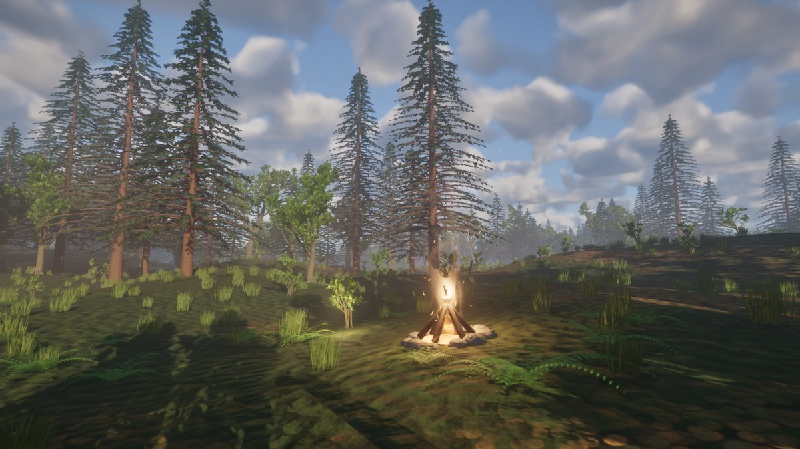
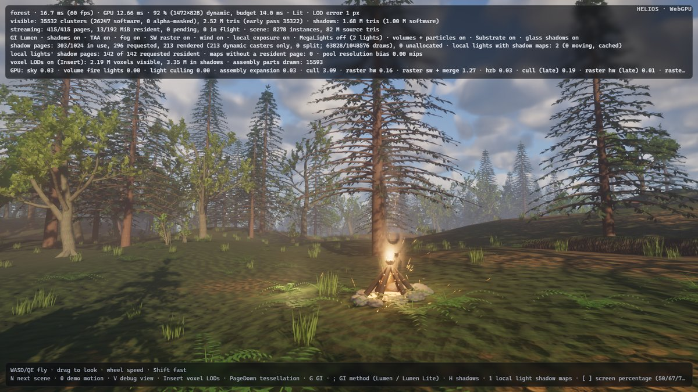

# Leaner Nanite culling (round 8: `nanite-culling-split`)

Design note. The user-facing description is the *Two-pass occlusion culling* bullet of
[`architecture/nanite.md`](../architecture/nanite.md) and item 17 of [`status.md`](../status.md); this file records
where the culling time goes, what was built, what was measured and rejected, and why.

## UE reference

UE 5.9 reworked Nanite's culling in two ways: (a) instances are sorted into simple and complex work — complex being
skinned, spline-deformed and World-Position-Offset (wind) meshes, whose bounds and tests need extra care — and each
kind is processed separately, so simple instances take a lean path; (b) the hierarchy traversal can test several
levels of a mesh's cluster hierarchy (BVH) in one step, cutting passes and round trips between dispatches. Both are
automatic; the gains grow with scene size.

## How Helios culls (before this round)

Helios has no BVH traversal with persistent threads (WebGPU has no forward-progress guarantee between workgroups).
Every view runs one chain of six dispatches (`passes/culling.rs`, `cull.wgsl`, `cull_args.wgsl`):

1. `cull_instances`: one thread per instance (and assembly culling record): frustum / dirty shadow page test of its
   bounds, padded for wind, displacement and skin; emits one *batch* per 64 of its pages.
2. `prepare_page_dispatch` (one thread).
3. `cull_pages`: one 64-lane workgroup per batch, one lane per page: residency, frustum / dirty page, and the LOD test
   of the page's coarsest parent; surviving pages become page work items, or for pages of ≤ 16 clusters their
   clusters become *cluster candidates* (round 6).
4. `prepare_cluster_dispatch`.
5. `cull_clusters`: one lane per cluster: the LOD cut, frustum, HZB, streaming feedback, raster binning.
6. `prepare_early_draw` / `prepare_late_draw`.

The hierarchy is thus two levels deep (pages, then clusters); a page is a group of clusters of one DAG level. The
main view runs the chain twice (early pass, late pass from step 5 on), the sun's twelve clipmap levels and the
local lights' view once each: 14 views, ≈ 80 dispatches per frame. Bounds dilation for deformation happens in every
stage (`wind_padded`, `displacement_padded`, `posed_bounds`), recomputing the wind strength per page and per cluster.

## Where the time goes

A throw-away per-view split of the profiler labels (`HELIOS_CULL_STAGES`, kept as a profiling aid: every stage of
every view its own timed pass, labels `cull instances [main]` …) and per-view work counters, forest at 1600×900,
GPU minima over frames 50–150:

| stage | main | main (late) | 12 sun levels + local lights |
|---|---|---|---|
| instances | 0.012 | — | 0.122 |
| pages | 0.028 | — | 0.148 |
| clusters | 0.050 | 0.037 | 0.162 |

* **Fixed costs dominate the shadow views.** Per view and stage, an *empty* pass costs 0.006–0.007 ms (pass,
  barriers, the one-thread prepare dispatch). In the measured frame 7 of the 12 sun levels had no dirty page at all,
  yet each still ran its instance pass over all 17 750 instance records (every thread loading its instance only to
  find the level's dirty rectangles empty), then the empty page and cluster passes. Levels with work cost
  0.008–0.018 ms per stage, the local lights' view 0.03–0.05.
* **Lanes, not tests, in the page pass.** The main view emitted 5 432 page batches for ≈ 6 300 instances in view:
  grass (6 pages), ferns (12), logs and mushrooms (4), conifer needles (15–17), boulders (29–30) — a 64-lane
  workgroup each, mostly idle. (Cluster lanes were already packed by round 6's candidates: 152 307 candidates +
  3 126 page items for 63 000 visible clusters.)
* **The deformation code is cheap per test.** Compiling culling without any wind, displacement or skin bound code
  (an experiment that is wrong for the wind) changed the main view's stages by 0.016 → 0.013 (instances),
  0.020 → 0.016 (pages), 0.052 → 0.047 (clusters), 0.038 → 0.035 ms (late): ≈ 0.015 ms in all — an upper bound for
  what a per-instance split could save there, in a scene where most instances (trees, grass, ferns) are complex
  anyway. (Its shadow numbers are not comparable: without wind every plant is a static caster and leaves the
  dynamic-caster-only shadow pages.)

## What was built

### Page candidates (`cull_instances` → `cull_pages`)

An instance with at most 16 pages no longer takes a 64-lane batch: it lists its pages as *page candidates* —
(instance, page) pairs, two per 16 bytes, in a fourth region of the view's work buffer (after the cluster
candidates, up to two per batch slot; `CullCapacity::work_bytes`). The page pass is dispatched over the batches and
then one workgroup per 64 candidates (`prepare_page_dispatch` reads the count from the spare `CullState` word 13);
both kinds of workgroup run the same per-lane page test. As with the cluster candidates, an instance whose
candidates do not fit voids the slots it reserved below the capacity (`INVALID_ID`) and falls back to batches.
Assembly culling records keep their batches (their lanes are already their parts' pages, `stride` per part), and so
does the local lights' view: there a page test loops over the lights, lanes of one instance share its loads, and
candidates measured 0.007 ms *slower* in the cathedral (0.112 → 0.119 ms of shadow page culling). Forest main view:
5 432 → 1 070 batches, `cull pages [main]` 0.028 → 0.020 ms. Thresholds 16 and 32 measured alike (32 slightly
worse in the instance pass); 16 matches the cluster candidates.

### Clean clipmap levels leave at once

`cull_instances` first checks whether the view is a sun clipmap level whose two rectangles (dirty pages, pages
rendered in full) are both empty — then nothing can pass `vsm_overlaps`, and every thread returns before loading
its instance. The page and cluster passes of such a level were already empty dispatches. Shadow instance stage
0.070 → 0.057 ms (cathedral), 0.058 → 0.043 ms (valley); in the forest, where wind keeps most levels dirty, no
change. This is the part of UE's "fewer passes / round trips" that fits Helios without restructuring the virtual
shadow map: an empty level now costs only its dispatch overhead.

### Simple / complex: a lean specialisation (`DEFORMING`)

`cull.wgsl` routes all deformation through three helpers (`cull_strength`, `deformed_bounds`,
`cull_dynamic_caster`) behind a pipeline-overridable `DEFORMING`. The culling pipelines now come in three
specialisations: deforming without skins (the default), deforming with skins (round 5's `SKINNING`), and *lean*:
no wind, displacement or skin code at all. `GpuScene::deforms()` decides per frame — the wind blows (`write_wind`
records whether its strength is above 0) on some instance with a wind response, or some instance is displaced or
skinned — and `Culling::passes_for` takes the lean pipelines otherwise (in the browser once compiled in the
background: `Lazy::new` + `prefetch`, the general pipelines meanwhile, which are exact too). The lean variant gives
identical results: with no deformation every padding helper returns its input and `dynamic_caster` reduces to
`MOVABLE | ANIMATED`. The cathedral (no wind, no skins, no displacement) and every windless frame take it.

UE splits per *instance*. Here a per-instance split would need separate page and cluster lists and dispatches per
class — at least three more dispatches per view (≈ 40 per frame), each costing what the whole measured saving of
the deformation code is (≈ 0.015 ms in the forest's main view, most of whose instances are complex anyway). So the
split is per frame; per-instance work stays in one dispatch.

## Alternatives measured and rejected

* **Testing several DAG levels at once (UE's multi-level step).** A per-mesh *level table*, computed on upload from
  the page records (no `.hvm` change): for each run of pages of one LOD level, a record bounding all pages from the
  mesh's first to the end of that run (merged parent sphere, padded against f32 rounding, largest parent error).
  Prefixes only grow, so the test is monotonic, and the instance pass skipped every page before the longest prefix
  whose parents are already detailed enough — the finer levels of a distant instance in one test instead of one
  page lane each. A unit test proved it conservative (every skipped page is rejected by the page test; the LOD cut
  never takes a cluster from a skipped page). Measured: it saved 0.002–0.003 ms in the main view's page pass and cost
  0.003–0.005 ms in its instance pass (valley `cull instances [main]` 0.006 → 0.011), nothing in the shadow views;
  with a binary search through the table (a chain of dependent loads in a latency-bound pass) the local lights'
  instance stage went 0.034 → 0.061 ms. With 2–35 pages per mesh the page pass already handles a mesh's levels in
  one dispatch, so there is no round trip to save. Removed.
* **Per-instance simple/complex lists** (see above).
* **SMALL_INSTANCE_PAGES = 32**: no better than 16 (instance pass +0.001 ms).
* **Culling all clipmap levels in one multi-view dispatch chain** would remove most of the remaining fixed cost
  (≈ 12 × 6 dispatches), but restructures the virtual shadow map's per-level culling and expansion
  (`vsm.rs`, `vsm_expand.wgsl`); out of scope here (round 6 reached the same conclusion).

## Measurements

RTX 3090 shared with four other agents' builds and renders; 1600×900, default views, frame 150 (`--frames 150
--screenshot`); per-pass GPU minima over frames 50–150 (`GPU minima over N frames`), then interleaved base/new runs.
Base = `main` 06306df + the `HELIOS_CULL_STAGES` profiling aid (7e02911).

Per stage (`HELIOS_CULL_STAGES=1`, ms, three interleaved runs; sum of the stages per run):

| scene | base | after | stages that moved |
|---|---|---|---|
| forest | 0.562 / 0.562 / 0.565 | 0.548 / 0.551 / 0.554 | pages [main] 0.028 → 0.020, clusters [main] 0.051 → 0.048, late 0.039 → 0.034–0.036, instances [main] 0.012 → 0.013 |
| cathedral | 0.359 / 0.360 | 0.344 / 0.344 | instances [shadow] 0.070 → 0.057, clusters [shadow] 0.130 → 0.127–0.129, instances [main] 0.006 → 0.008 |
| valley | 0.285 / 0.284 | 0.272 / 0.270 | instances [shadow] 0.058 → 0.043 |

As shipped (one `cull` / `cull (late)` pass per view, `cull` + `cull (late)` over all views, ms):

| scene | base: cull + late (three runs) | after | change (minima) | frame minima base → after |
|---|---|---|---|---|
| forest | 0.474 / 0.484 / 0.472 | 0.469 / 0.474 / 0.471 | 0.472 → 0.469 (−0.003, within noise) | 8.13 → 8.11 |
| valley | 0.211 / 0.210 / 0.210 | 0.196 / 0.195 / 0.195 | 0.210 → 0.195 (**−0.015, −7 %**) | 4.69 → 4.63 |
| cathedral | 0.279 / 0.279 / 0.277 | 0.263 / 0.265 / 0.265 | 0.277 → 0.263 (**−0.014, −5 %**) | 5.64 → 5.60 |

In one pass per view the forest's page-pass saving mostly overlaps with other work; the clean-level exit and the lean pipelines keep their gain. The frames move within their run-to-run variation.

**Images** (frame 150; PSNR / largest difference / pixels differing by more than 24/255; noise = the same build
twice): forest base → after 39.3 / 39.5 dB, 0.35 / 0.34 % (noise 39.7 / 39.2 dB, 0.33 / 0.35 % — wind, fire and
stochastic voxels); valley 61.4 / 59.4 dB (noise 60.5 / 58.6); cathedral 61.0 / 61.0 dB, largest difference 23–26
(noise 61.3 / 61.3 dB, 18–26). Visible cluster counts are identical in the cathedral (5 357) and the valley
(3 288) — the culling decisions are the same tests on the same bounds; only the order of the work lists changes.

Browser (headless Chromium 1248, WebGPU via D3D11, `./build-web.ps1`): forest and cathedral load and render, Tint compiles the deforming culling pipelines (forest, wind) and the lean ones (the cathedral, windless), no WGSL or validation errors in the console (only Chrome's `powerPreference` notice). Chrome's coarse timestamps put the forest's `cull` at ≈ 3 ms (92 %, dynamic resolution) — the dispatch chains, not the tests, are what the browser pays for.

Memory: the work buffers grow by the page candidate region, one 16-byte slot per batch slot: main view +1.4 MiB
(87 114 batch slots in the forest), shared clipmap work buffer +0.6 MiB, local lights' +0.9 MiB.

## Remaining limits

* The view chain is still six dispatches per view and the twelve sun levels are culled one after another: on an
  empty level the instance pass now exits at once, but the dispatches and barriers remain (≈ 0.02 ms per level in
  the per-stage profile). One multi-view dispatch chain for all levels would remove them.
* The simple/complex split is per frame, not per instance: in the forest and valley (wind) every frame takes the
  deforming pipelines; their per-test cost of the deformation bounds is ≈ 0.015 ms per frame in the main view.
* No traversal of the cluster DAG beyond pages: a page is tested as a whole, then each of its clusters. Coarse pages
  above the LOD cut still send all their clusters to the cluster test (rejected one by one), because a page-level
  "all too coarse" test needs to know that every child page is resident.
* Page candidates are not used in the local lights' view or for assembly culling records.
