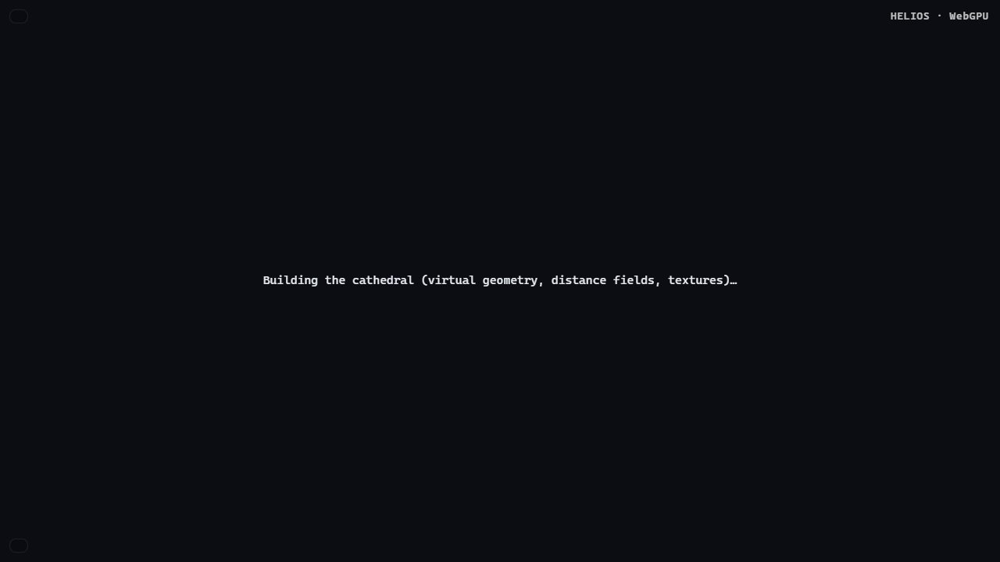
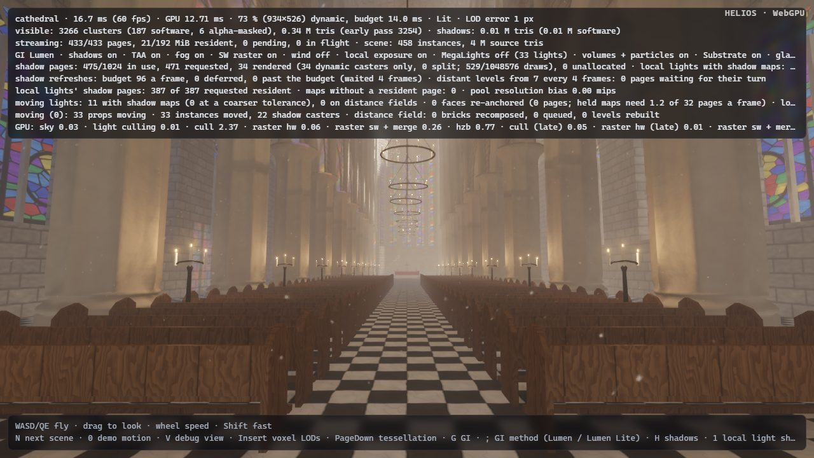

# Round 8 — browser platform: the scene bake on Web Workers, f16 shaders, device limits

Three items of the round's second wave, all about the browser build: the start-up's last main-thread stall (the
scene bake), half-precision shaders (`shader-f16`), and whether the round's new bindings still fit the device limits
the browsers offer. Measurements on a Ryzen 5 7600X + RTX 3090 shared with four other agents' builds and renders —
interleaved base / new runs, fresh browser profile per run; the base is main 549c7d9.

## 1. The scene bake on Web Workers (backlog 220, `browser-bake-worker`)

**Problem.** Round 6 made the browser compile its pipelines progressively and moved Lumen's displaced-variant bakes
to Web Workers, but the scene bake itself — the cluster DAG, pages and distance field of every mesh, 3–6 s — still
ran on the page's thread before the first frame: the page froze (no input, no paint, no spinner) for that long, and
in Chromium, which compiles the core pipelines in parallel within ~2 s, the bake was the first image's critical path.
A CPU profile of the valley's load in headless Chromium: 4.2 s of the page's 5.1 s of wasm time was the builder,
3.9 s of it `build_virtual_mesh` (the terrain alone 2.5 s, three rocks 0.5 s each, the sculpture 1.05 s).

**UE reference.** UE cooks meshes offline (Nanite data, distance fields) and streams them; what it builds at
runtime (PCG, procedural meshes) runs on worker threads (task graph), never the game thread.

**Design** (`crates/helios-demo/src/scene_bake.rs`, `mesh_store.rs`, `web_bake.rs`, `bake_worker.js`).

* *The builder stays the builder.* Every scene builder adds its meshes through `mesh_store::add` (the seam the
  `.hvm` streaming of round 3 introduced). Two new stores: `Shard { index, count }` bakes only its share of the
  meshes and adds empty stand-ins for the others; `Baked` takes meshes baked elsewhere by build index (checking the
  name; a missing or renamed one is baked on the spot). A worker runs the scene's builder with a `Shard` store and
  returns its meshes as `.hvm` bytes (`VirtualMesh::to_bytes`, the streaming format, which carries every field);
  the page then runs the builder with a `Baked` store. Materials, instances, lights and camera are the builder's
  own on the page, and the meshes are bit-identical to a page bake: the same code on the same inputs
  (`scene_bake::tests` compares the gallery in 3 shards and the forest in 2, through the wire format, with a direct
  bake: every mesh's bytes, names and instance counts).
* *Assignment without communication.* All workers see the same meshes in the same order, so each can assign them
  alike: the next mesh goes to the least loaded worker so far, the load being its source triangles (ties to the
  lowest index). Meshes whose bake reads earlier meshes — a forest assembly's base is built from its sprays' baked
  meshes — are wrapped in `mesh_store::unit`, which keeps them on one worker (the owner keeps copies for the
  base's bake). On the valley this gives the terrain (295 k triangles) one worker and the rocks and the sculpture
  the others: the bake takes about as long as its largest mesh.
* *Settings the builders read* (the cathedral's candle lights and lantern, page globals) travel in the task.
* *The pool* is round 6's (`bake_worker.js`: a worker instantiates the page's compiled `WebAssembly.Module`), one
  task per worker; `heliosBakeTask` tells a scene task from a Lumen task by its first word. Scene shards and Lumen
  variants share the workers.
* *A heartbeat instead of a time limit.* Round 6's watchdog failed a task after 10 s, so a bake legitimately longer
  than that (a terrain on a slow phone) ran a second time on the page. The bakes now report progress
  (`helios_geometry::progress::tick`: each simplified DAG group, every 1024 triangles of a volume distance field; a
  thread-local counter calls the installed hook every 32 ticks), the worker passes it to the page at most once a
  second (`bakeBeat`), and the watchdog re-arms on it: a worker is failed after 10 s of *silence*. Lumen's variant
  bakes beat too (they run the same geometry code).
* *The page waits asynchronously* (`scene_bake::build`, polled every 8 ms) and keeps working the pipeline queue
  meanwhile; the status line shows the build as before.
* *The content pipelines compile during the bake.* As the tasks go out the page builds a stand-in of the scene
  (`Shard::stand_in`: nothing baked, ≈ 0.3 s) and `Renderer::prefetch_scene` syncs it without rendering (the frame
  stops after its scene sync, as the first frames do while core pipelines compile): the texture patterns, the
  material resolve's shading models and tessellation permutation, translucent models and volumes are queued then,
  not after the bake. In Chromium the textures are generated 20 ms after the scene arrives (base: 4 s later).
* *Scene switches.* `heliosLoadScene` is now `async`: it bakes in the workers while the current scene keeps
  rendering and resolves once the new scene is in (the site awaits it); the embedded page's `N` does the same.
  Switching the valley to the gallery took 0.6–0.7 s with no main-thread block over 150 ms.
* *Fallback.* No workers (`?bake-workers=0`, no `Worker`, a pool that gave up), an imported glTF model, or a failed
  shard: those meshes bake on the page, as before.

**Alternatives.** *A time-sliced bake on the page* (rejected in round 6 for the variants): resumable versions of the
DAG build, simplification and distance-field bake, and every slice still on the page's thread. *One worker running
the whole builder*: frees the page but keeps the bake's length (5.6 s) on Chromium's critical path. *Serialising the
whole `Scene`* from one worker: materials, instances, lights and textures would need a wire format of their own; the
builder without its bakes costs the page only ≈ 0.3 s. *Workers coordinating through a shared counter*
(work stealing): needs `SharedArrayBuffer`, i.e. cross-origin isolation, which GitHub Pages cannot give. *Baking
offline* (`--bake-hvm`, `?stream=`): exists, but the showcase builds its scenes procedurally, so they can be edited.

**Firefox's compile time.** Firefox compiles one pipeline at a time. With `?compile-batch=1&compile-log=1` (new) the
valley's background set is 147 pipelines, 42.8 s of compiling: the translucency shading models (4 classic + 4 AVBOIT,
13.4 s), the material resolve's tessellation permutation (5, 5.6 s), Nanite tessellation's dicing (8 main + 4
shadow permutations of `LEVEL` × `PASS`, 7.3 s), then a long tail under 0.6 s each. The first image needs 57 (core
43 + the scene's 14 content pipelines, ≈ 8–10 s). This round moves the content pipelines into the bake (above) but
does not shrink the set: the large items are other subsystems' shaders (merging the dicing levels into one pipeline
with a dynamic level, or AVBOIT's front / back buckets, would each save 3–5 s in Firefox but needs GPU-time
measurements of those passes; recorded as next steps).

**Measurements.** `index.html?scene=…`, 1280×720 window, base (main 549c7d9) and new interleaved, 3 pairs per row,
a fresh browser per run: headless Chromium 1248 (WebGPU on D3D) and headed Firefox 155 (Playwright 1.63's build,
`dom.webgpu.enabled`; headless Firefox offers no adapter). *First image* / *full quality* from the engine's log
(`performance.now()`), *longest main-thread block* from a 25 ms `setInterval` heartbeat started before the page's
scripts. Four other agents were building and rendering on the same CPU and GPU, so single values vary by ±30 %.

| Chromium | first image, base → new (s) | full quality | longest main-thread block (s) | bake → page build |
|---|---|---|---|---|
| valley | 11.3 / 11.4 / 13.2 → 12.1 / **9.1 / 9.3** | = first image | 4.1 / 5.2 / 5.5 → 1.2 / 0.4 / 1.2 | page 4.1–5.4 s → workers 6.4–9.2 s + page 0.2–0.3 s |
| cathedral | 9.1 / 9.4 / 10.1 → **7.4 / 7.2 / 6.8** | = first image | 5.1 / 5.4 / 5.6 → 0.7 / 1.7 / 0.7 | page 5.1–5.6 s → workers 4.2–5.0 s + page 0.4–0.5 s |

| Firefox | first image, base → new (s) | full quality, base → new (s) | longest main-thread block (s) | bake → page build |
|---|---|---|---|---|
| valley | 9.7 / 9.1 / 9.9 → 12.2 / 9.2 / 8.8 | 46.4 / 43.2 / 45.0 → 62.7 / 44.5 / 58.4 | 3.7 / 3.6 / 3.7 → 0.3 / 0.3 / 0.3 | page 3.6–3.7 s → workers 1.8–2.2 s + page 0.2 s |
| cathedral | 22.6 / 10.7 / 10.5 → 11.7 / 9.8 / 11.5 | 49.6 / 27.0 / 26.4 → 39.3 / 26.5 / 40.7 | 13.1 / 4.8 / 4.8 → 1.0 / 0.6 / 0.7 | page 4.7–13.1 s → workers 2.8–4.2 s + page 0.4–0.9 s |

* **The page no longer freezes for the bake.** Its longest block falls from 3.6–5.6 s (13 s in a loaded run) to
  0.3–1.7 s. What remains is the builder's own work on the page, done twice: the stand-in (prefetch) and the real
  build, each mostly generating the source meshes (the valley's terrain noise, the cathedral's welding and creased
  normals, 0.2–0.9 s), plus Lumen's card capture when the scene arrives. The page paints and answers input during the
  bake (the status line, a screenshot taken 2.5 s in: `platform/1-baking.jpg`).
* **Chromium's first image** comes 1–3 s sooner (cathedral 9.1–10.1 → 6.8–7.4 s; valley 11.3–13.2 → 9.1–9.3 s, one
  run 12.1 s): the bake spreads over four workers and the content pipelines compile during it (the material
  textures are generated 20 ms after the scene arrives, 4 s after it before). The workers' bake is slower than its
  share of the page's (6.4–9.2 s wall clock for the valley against 4.1–5.4 s on the page): four workers, the GPU
  process compiling in parallel and the other agents compete for six cores; it still ends earlier than the page's
  serial bake plus the content compile.
* **Firefox's first image** is unchanged within the noise (it was already bound by the serial compile of the 57
  first-image pipelines, ≈ 8–10 s, which the bake overlapped); the bake itself takes 1.8–4.2 s in the workers
  against 3.6–4.8 s on the page. Full quality varies with the machine's load as much as between builds (valley 44.5
  in one new run, 58–63 in two; round 6 measured 47–51 s on the same scene); nothing in the change runs after the
  first image except idle workers, which are retired 20 s later.
* **Bake workers that fail.** The handshake, watchdog and fallback of round 6 are unchanged but for the heartbeat;
  in these 24 loads, the f16 checks and the scene-switch tests no worker failed. (One base-build load early in the
  session logged round 6's "bake worker did not start" for its Lumen variants: 8 s without the worker's hello; it did
  not recur.)

Native (Vulkan, 1600×900, frame 150), base vs new — the native path is unchanged but for the progress ticks and
the cost argument of `mesh_store::add`: valley 55.9 dB (base vs base 56.0), forest 39.1 dB, 0.35 % of pixels over
24/255 (39.2 dB, 0.35 %: the wind), gallery 64.9 dB (64.2 dB).

**Remaining limits.** Every visit bakes again (UE cooks offline; `?stream=` exists for pre-baked libraries). The
bake takes as long as its largest mesh (no mesh is split across workers). The page still runs the builder twice
(stand-in and real), generating the source meshes each time (0.2–0.9 s per run); making mesh generation lazy in
the builders would halve it. Imported glTF models bake on the page. Each worker keeps its wasm memory (tens of MB
after a scene shard) until it is retired, 20 s after its last task. Firefox's compile set is unchanged (above).

## 2. Half precision: `shader-f16` (backlog 219)

**UE reference.** UE 5.8 uses FP16 in targeted materials and global passes, and since 5.8.1 TSR runs 16-bit VALU by
default on NVIDIA.

**Design.** The device requests `SHADER_F16` (WebGPU `shader-f16`) when the adapter has it — Chromium 156 and
Firefox 155 both offer it on the RTX 3090, as does native Vulkan. `half.wgsl` defines `hf`, `hf2`, `hf3`, `hf4` as f32
types; on a device with f16 shaders `shader::create_module` composes a shader that includes it with `half_f16.wgsl`
instead (f16 aliases; its `enable f16;` moved to the top of the composed source). So one variant exists per device:
no extra pipelines, nothing more to compile. `--no-shader-f16` / `?f16=0` force f32;
`shader::tests::half_precision_variants_validate` validates both variants.

**What was converted and measured.** TSR first (`tsr.wgsl`): the neighbourhood's YCoCg moments, the two filters'
sums and the history clip in `hf`, on exposed colours (clamped at 64 so nine squared differences stay finite), the
moments relative to the centre sample to avoid f16 cancellation. Then the most expensive full-screen filter in the
profile, MegaLights' spatial denoiser (`megalights_denoise.wgsl`, 2–4 ms at 1600×900 with 300 lights): its luminance
weights and colour sums. Post passes (bloom, local exposure, tone mapping, depth of field) cost 0.02–0.1 ms each at
1600×900 here, below what the shared GPU can resolve. Per-pass GPU minima, interleaved:

| pass (1600×900) | f32 | f16 | image f32 vs f16 (noise: same variant twice) |
|---|---|---|---|
| TSR, valley, native Vulkan (3 + 3 runs) | 0.110 ms | 0.120 ms | 52.5 dB, 0.0001 % of pixels > 24/255 (58.3 dB) |
| TSR, cathedral, Chromium (2 + 2) / Firefox (1 + 1) | 0.110 / 0.122 ms | 0.107 / 0.143 ms | — |
| MegaLights spatial, cathedral 300 lights, native (4 + 4) | 2.34 ms | 2.89 ms | 42.2 dB, 0 % (58.9 dB) |
| MegaLights spatial, Chromium / Firefox | 0.48 / 2.06 ms | 0.50 / 2.19 ms | — |

Neither pass got faster on any path, and the denoiser's image moved measurably. The NVIDIA Ampere GPU executes f16
at the f32 rate unless the compiler packs pairs (HFMA2), and these passes are bound by their texture fetches (9
taps of colour, depth, normal per pixel) more than by arithmetic. Per the brief neither pass is converted: the
infrastructure stays (one variant per device, ready for GPUs with faster f16 — AMD's packed math, mobile GPUs), and
the two conversions are kept as `docs/round8/platform/f16-tsr-megalights.patch` to re-measure there. Both
browsers compiled the f16 variants without errors (Tint, and Firefox's naga → HLSL → DXC).

## 3. Device limits: sampled textures per stage (`browser-bake-worker` robustness check)

The adapters report `maxSampledTexturesPerShaderStage` **48** (Chromium 156, D3D) and **64** (Firefox 155), both with
`shader-f16`; headless Firefox still offers no adapter (runs are headed). The device asks for up to 24. After merging
main 549c7d9 (the VSM moment atlas and the volume shadow atlas) a new `--max-sampled-textures N` cap found:

| cap | before | now |
|---|---|---|
| 16–17 | the lighting layout (18 before the merge, 20 after) fails validation: no renderer | clear start error: "the renderer samples 20 textures per shader stage, this GPU offers N" |
| 18 | crash: AVBOIT's 19-texture layout was created unconditionally (only its use was gated) | — (below 20) |
| 20 | crash in the gallery: the Substrate slab lighting (21) was enabled from 17 | runs: AVBOIT off (weighted blended OIT), slab lighting off |
| ≥ 21 | everything | everything |

Fixes: `MIN_SAMPLED_TEXTURES` (20) checked before the device is made; AVBOIT's layout built only where its 19
textures fit (`AVBOIT_SAMPLED_TEXTURES`); Substrate's support check counts the lighting layout + 1. The cathedral and
valley translucency (and AVBOIT) pipelines compile in both browsers without validation errors. No browser here offers
fewer than 48, so no variant for 16–19 was built. **Proposal** for devices at WebGPU's default 16 (some mobile
adapters): a lighting layout variant without the glass textures (91, 92–94 → sunlight and local light through glass
off), the moment atlas (150 → distant VSM levels without prefiltering) and the volume shadow atlas (152 → no volume
shadows), composed out of `lighting.wgsl` like the Substrate variant (`compose_variant`), and a translucency variant
without the MegaLights volume (131/132 → the clustered loop); 16 then fits exactly.
