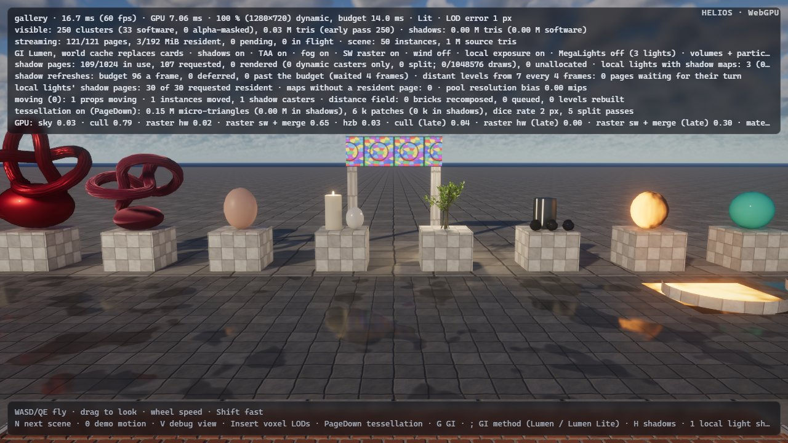
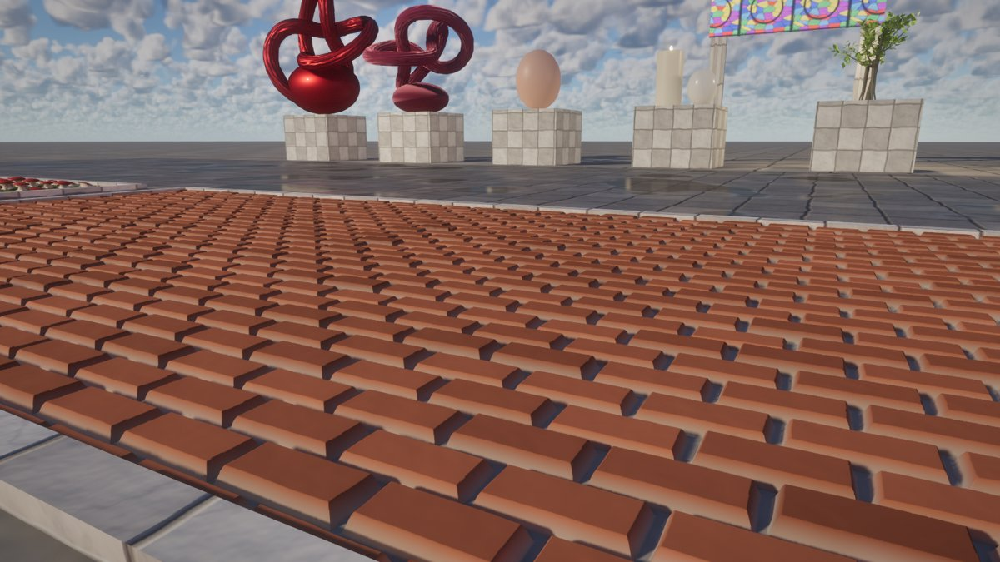

# Round 8 — browser performance: scene switches without an in-frame compile, fewer Firefox pipelines

Design note for two items of the round's third wave (`scene-switch-compile-stall`, backlog 231;
`firefox-pipeline-permutations`, backlog 230). The user-facing description is in
[`docs/architecture/browser.md`](../architecture/browser.md) (*Frames that wait for pipelines*, *Fewer
pipelines*), with a paragraph each in `tessellation.md` and `translucency.md`; the remaining gap is item 15 of
`docs/status.md`. Measurements on a Ryzen 5 7600X + RTX 3090 shared with other agents' builds and renders:
interleaved base (main 5e12868) / new runs, minima where GPU times are reported.

## 1. The scene-switch stall (backlog 231)

**Problem.** In Chromium, switching the valley to the gallery showed "Compiling GPU shaders… 35 s" with the
canvas held. Reproduced in headless Chromium (`heliosLoadScene('gallery')` after the valley reached full
quality): the bake took 0.6–1.0 s in the workers, then the canvas held **18.2–26.5 s** (three runs) while the GPU process
compiled 34 pipelines the frame had created — 8 + 4 tessellation dicing permutations of the gallery's displacing
graphs, the material resolve and 9 extended (graph / slab) resolves, 5 Lumen card captures of the new materials,
Substrate's slab lighting and the subsurface pair. Firefox: 33.5 s.

**Why.** Round 6 made every pipeline a queued `Lazy` value and the browser compile them in the background — in
Chromium in parallel, warmed through `create*PipelineAsync` — but only *before the first image*: a frame that
found a new core pipeline then stopped after its scene sync. After the first image "a newly needed core pipeline
(an editor change, a new scene) is compiled in the frame" (round 6's accepted limit): the frame dereferenced the
queued `Lazy`, which made it with wgpu's synchronous `createComputePipeline`, which Dawn compiles one at a time.
Worse, the features' readiness was decided *before* the sync: the valley's tessellation and GI groups were
ready, so the gallery's new dicing permutations and card captures (queued by the sync) were made synchronously
too. `prefetch_scene` (the stand-in of the platform round) runs only before the first image, and the switch path
passed no prefetch at all.

**UE reference.** UE compiles PSOs asynchronously and either waits at a loading screen (PSO precaching) or draws
with fallbacks; it never compiles a PSO synchronously in the middle of a frame by design.

**Design** (`renderer.rs`, `web.rs`, `pipelines.rs`).

* *A frame holds whenever its sync queued what it needs.* `render_frame` records which groups were ready when the
  frame's settings were chosen; after the scene sync (materials, textures, extended materials, the tessellator,
  Substrate's lighting) it stops if a core pipeline is pending or a group that was ready no longer is — at any
  frame, not only the first. The page keeps its last image (the old scene's) while the queue compiles; the next
  frame chooses its features again (the new tessellator's group is not ready: it renders undisplaced until the
  dicing is in, as the first image does). The status line shows the time held, the engine logs `frames held T s`.
* *Nothing is lost by holding.* The held frame's scene sync consumed the motion tracker's changes; the next frame
  marks its changes structural, so the shadow pages, Lumen and translucency rebuild for the new scene.
* *Pipelines made while recording wait instead of compiling.* Lumen's card capture of new materials (the captures
  stay pending, the cards lit without albedo until they are in; now in the GI group) and Lumen's displaced-variant
  pipeline. Lumen Lite is created before the hold (also when the frame itself chose it as its fallback, which
  previously created it the next frame and compiled it in that frame: 2 s in one measured switch). MegaLights' slab
  variant is created only once MegaLights is asked for (Firefox compiled it for the gallery while the classic loop
  shades).
* *Firefox's batch restarts.* Firefox compiles the background in batches between presented frames, doubling the
  batch while it compiles fast: grown to 32 on the valley's small pipelines, the gallery's first batch (its
  dicing and resolve permutations) held the canvas 18 s. A hold now restarts the batch at one.

**Measurements** (`heliosLoadScene` chain valley → gallery → forest → cathedral after the valley reached full
quality; *held*: the longest gap between presented frames during the switch; *shown*: call → first new frame).

| canvas held during the switch (s) | base | new |
|---|---|---|
| Chromium, valley → gallery (bake 0.6–2.5 s) | 26.5 / 22.8 / 18.2 | 5.7¹ / 4.1 / 3.4 / 2.7 |
| Chromium, gallery → forest | 3.7 / 2.1 | 0.7¹ / 1.0 / 2.6 |
| Chromium, forest → cathedral | 2.8 / 1.9 | 2.0¹ / 1.2 / 2.1 |
| Firefox, valley → gallery | 33.5 (+ 0.9) | 18.0² / 16.2 / 12.0 |
| Firefox, gallery → forest | 2.8 | 3.9² / 5.1 / 4.8 |
| Firefox, forest → cathedral | 3.0 | 1.8² / 5.0³ / 2.3 |

¹ the hold alone (before the Lumen Lite / card-capture / MegaLights fixes and the permutation changes). ² before
the batch restart: after the 16 s hold a background batch of 32 held the canvas another 18 s (shown 35.8 s).
³ a 5 s main-thread block of the page's builder in that run (machine load).

*Shown* (the call to the first frame of the new scene, the bake included): Chromium gallery 18.9–27.1 s → 3.3–6.4
s; Firefox gallery 35.0 s → 13.0 s. The longest main-thread block during a switch stays the page's builder
(0.3–0.9 s; none over 150 ms for the gallery). What the new scene compiles while held: Chromium the gallery's
10 resolve pipelines, 6 texture patterns, Substrate's lighting and subsurface in parallel; its 12 dicing
permutations, 5 card captures and the tessellation group join in the background over the next 0.3–2 s (the
gallery is shown undisplaced for that long). Firefox compiles the held set one at a time (12–16 s: ten graph /
slab resolves of 0.6–1.6 s each).

One trade-off of section 2's resolve change shows here: a scene without displacement after one with it (gallery →
forest) now compiles the plain resolve permutation for its shading models at the switch (Firefox 5 pipelines,
+2 s), which the base had compiled with the valley's first image.

**Alternatives.** *Compiling the new scene's pipelines during its bake* (the stand-in of the platform round, which
already does this before the first image): the stand-in's sync would have to run through the one GPU scene,
material and texture state the old scene is rendering from (and their version counters), so the old scene would
re-sync — a full upload and a cache invalidation — on its next frame; a second, side-effect-free analysis of what
pipelines a scene needs would duplicate the sync logic of six subsystems. With the switch's compile in parallel
it would save at most the bake's duration (0.6–1 s for the gallery); recorded as a next step. *Keeping the old
scene running during the compile* needs the same separation. *Skipping draws whose pipelines are missing*
(rejected in round 6: half-rendered frames corrupt temporal state).

## 2. Fewer pipelines for Firefox (backlog 230)

**Problem.** Firefox compiles one pipeline at a time (WGSL → naga → HLSL → DXC in its GPU process): the valley's
background set was 152 pipelines and 62 s of compiling in this session's base run (42.8 s in the platform round's
quieter one), led by AVBOIT's translucency shading (4 pipelines, 9.7 s), the material resolve's tessellation
permutation (5, 8.1 s), classic translucency shading (4, 7.6 s), the dicing (8 + 4, 12 s).

**Changes** (each measured; Firefox per-pipeline times from `?compile-batch=1&compile-log=1`, GPU times natively
on Vulkan and in Chromium through `heliosGpuPasses`, 1600×900, interleaved, minima):

* **The resolve's `TESSELLATION` permutation from the start** (`renderer.rs`). Where tessellation is asked for and
  the scene has displacing materials, the browser compiled the plain resolve permutation for the frames before the
  tessellator was in, then the displaced one in the background (5 pipelines on the valley, 10 on the gallery,
  0.6–1.6 s each). The displaced permutation renders undisplaced pixels exactly as the plain one does (`displaced`
  is per instance), so it is now the core one from the first image. GPU cost: none once tessellation is in (the
  same permutation as before); before that, the displaced permutation's registers (0.05–0.1 ms of resolve,
  `tessellation.md`) for the first seconds. Natively unchanged.
* **Dicing two grid levels per dispatch** (`tess.wgsl`, `vsm_tess.wgsl`, `tess_queue.wgsl`, `tessellation.rs`). A
  `LEVEL` override made a pipeline per grid level and raster pass: 8 for the main view, 4 for shadow pages, per
  displacing-graph permutation. `tess_prepare_dice` now writes one dispatch for levels 0 + 1 and one for 2 + 3;
  a workgroup finds its level from the lists' counts (`tess_dice_level`, through `workgroupUniformLoad`, so the
  barriers stay in uniform control flow), and a `GRID` override selects the path. The thread path's loops run to
  F = 2's bounds and skip what F = 1 lacks (unrolled, the grid stays in registers). *First tried: all four levels
  in one pipeline* — the graph-displaced terrace's software raster went 2.00 → 2.57 ms (4 + 4 interleaved runs,
  every run): the thread path's registers took the shared-memory path's occupancy. Kept apart:

| software raster, 1600×900 (min of 5 + 5 runs; terrace 5 + 5) | base (`LEVEL`: 8 + 4 pipelines) | all levels in one pipeline (rejected) | two levels per pipeline (4 + 2) |
|---|---|---|---|
| gallery terrace (graph displacement), raster sw + merge, native | 2.002 ms | 2.563 ms | 1.998 ms |
| — late pass / shadow-page tessellation | 0.096 / 0.052 ms | 0.075 / 0.040 ms | 0.083 / 0.045 ms |
| valley path (texture height), raster sw + merge, native | 1.071 ms | 1.209 ms | 1.053 ms |
| — late pass / shadow-page tessellation | 0.091 / 0.048 ms | 0.069 / 0.037 ms | 0.076 / 0.040 ms |
| gallery terrace in Chromium (`heliosGpuPasses`, `sp=100`, 3 + 3): raster / late / shadow pages | 4.79 / 0.43 / 0.257 ms | — | 4.87 / 0.34 / 0.211 ms |

  The main view's raster is unchanged within the noise (Chromium's +0.08 ms is offset by its late pass's −0.09 ms);
  the late pass and the shadow pages, where most levels' lists are empty, save their empty dispatches and the
  barriers between them. Images: 62.9 dB (terrace) and 60.9 dB (path) against the base, 0 % of pixels over 24/255
  (`webperf/2-terrace-dicing.jpg`). Firefox compiles the 4 main pipelines in 3.3 s and the 2 shadow ones in 1.2 s
  (base 8 in 5.4 s, 4 in 2.4 s); with a displacing graph (the gallery) the permutation has as many again.

* **Classic translucency only for refracting surfaces under AVBOIT** (`translucency.rs`). With AVBOIT the classic
  pass draws only refracting surfaces (water; glass with a texture, bump or roughness); the others are drawn
  order-independently. The classic shading models (and peel variants) of the rest were compiled anyway; now only
  the refracting surfaces' are queued while AVBOIT is on (the prefetch key includes AVBOIT: switching it off queues
  the rest, translucency coming back once they are in). No GPU change (no draw changes).
* **The underwater view on demand** (`Group::OnDemand`, `water.rs`). The full-screen underwater pipeline (a
  translucency shading model, 1.5–2 s in Firefox) was compiled for every scene with water; most views never go
  under. It is queued once the camera is within 10 m of a water body (above the surface or beside it), compiled
  last, and gates no feature; a frame under water before it is in skips the underwater fog. (The valley's default
  view stands within 10 m of the lake, so the valley still compiles it — its saving there is nil.)

**Firefox, the valley** (`?compile-batch=1&compile-log=1`, headed Firefox 155, two interleaved base / new pairs;
the first pair's new build still had the dicing in one pipeline):

| | pipelines | background compile (sum) | material resolve (bg) | dicing (main + shadow) | classic translucency | first image | full quality |
|---|---|---|---|---|---|---|---|
| base, pair 1 / 2 | 214 | 62.0 / 44.8 s | 5: 8.1 / 4.6 s | 12: 12.0 / 7.8 s | 4: 7.6 / 5.5 s | 16.0 / 11.6 s | 88.7 / 60.1 s |
| new, pair 1 (one dicing pipeline) | 197 | 47.4 s | — | 3: 5.1 s | 2: 4.1 s | 14.5 s | 65.1 s |
| new, pair 2 (final) | 200 | 38.5 s | — | 6: 4.5 s | 2: 2.7 s | 9.9 s | 51.2 s |

The first image is not slower (the core set compiles the displaced resolve permutation instead of the plain one:
same count). AVBOIT's four shading pipelines (7.0–10.8 s) are now the largest item. **The cathedral** has neither
tessellation nor water and only refracting glass: its set is unchanged (197 pipelines); first image 15.7 → 13.9 s,
full quality 54.5 → 44.2 s, background 33.2 → 27.8 s in one pair — the machine's noise.

**Not done.** *AVBOIT's front / back buckets* (4 pipelines, ≈ 10 s of the valley's Firefox compile, 2.4–2.7 s
each — the largest item left): they differ in the entry point (the back bucket's split depth behind the nearest
refracting layer) and the front's extra motion target. One pipeline would need the back pass to bind the motion
target too (writing alpha 0) and a per-pass flag in a new uniform binding of the shared translucency layout — a
render-target and bandwidth cost on every back-bucket fragment to measure against ≈ 5 s of Firefox compiling.
*Sharing glass and blend shading* (`SHADING` as a runtime value): the fragment shader would carry both models'
registers. Both recorded as next steps.

## Remaining limits

* A scene switch still shows a frozen frame while the new scene's core pipelines compile (Chromium 3–4 s in
  parallel, Firefox 12–16 s for the gallery: ten graph / slab resolve permutations one at a time); compiling them
  during the bake needs a side-effect-free "which pipelines does this scene need" pass (above).
* The held frame's scene changes are re-applied as structural: a hold during an editor drag rebuilds the
  instance-dependent caches once (natively nothing ever holds).
* Firefox's set is still ~38–47 s of compiling for the valley (AVBOIT's buckets the largest part), on every visit.
* A displaced scene no longer compiles the plain resolve permutation; switching to a scene without displacement
  compiles it then (Firefox +2 s on gallery → forest).

