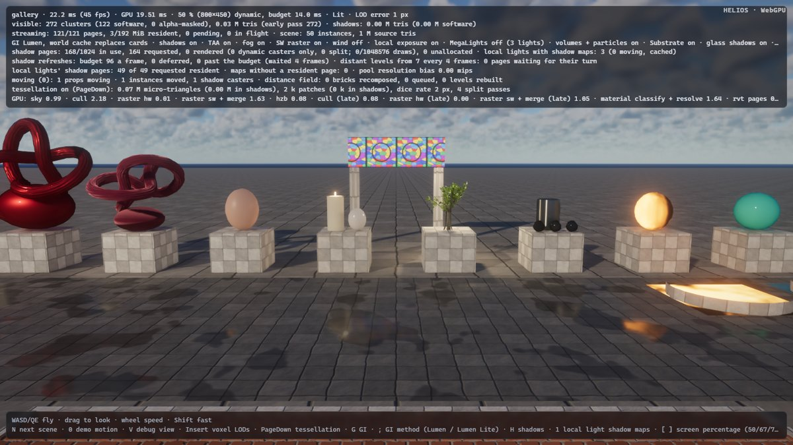
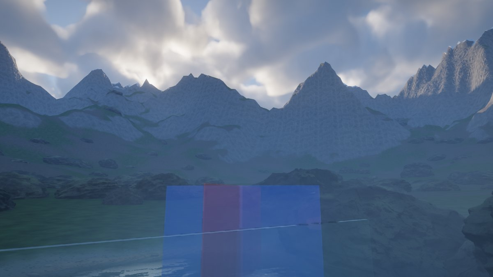

# Round 8 — browser performance, second pass: AVBOIT's buckets in one pipeline, the next scene compiled during its bake

Design note for two items of the round's third wave (`avboit-variant-merge`, backlog 233;
`switch-prefetch-during-bake`, backlog 234), the "next steps" of `docs/round8/webperf.md`. The user-facing
description is in [`docs/architecture/browser.md`](../architecture/browser.md) (*Compiling the next scene during its
bake*, *Fewer pipelines*) and `docs/architecture/translucency.md`; the remaining gap is item 15 of `docs/status.md`.
Measurements on a Ryzen 5 7600X + RTX 3090 shared with other agents' builds and renders: interleaved base (main
d0b9314) / new runs, minima where GPU times are reported.

## 1. AVBOIT's front and back buckets in one pipeline (backlog 233)

**Problem.** AVBOIT shades its order-independent surfaces (non-refracting glass, blended surfaces) twice: the
*front* bucket — the fragments at or in front of the nearest refracting layer, weighted by everything in front of
them, owning the pixel's motion where mostly opaque — and the *back* bucket behind it, weighted only by what lies
between the split and the fragment (`docs/round8/translucency.md`). Each was its own entry point (`fs_oit_front`,
`fs_oit_back`) and pipeline, per shading model (glass, blend): four pipelines of the full translucency shading, the
largest item left in Firefox's compile (1.6–2.7 s each; it compiles one pipeline at a time).

**Design** (`translucency.wgsl` `fs_oit`, `translucency.rs` `oit_pipeline`). The two passes already bind different
slots of the layer-range uniform (binding 106): the front pass `NEAREST {far: 0, near: −1}`, the back pass
`BEHIND_NEAREST {far: −1, near: 0}`. So the range *is* the bucket: `fs_oit` takes the split depth from layer
`near` when `near ≥ 0` (a uniform branch) and weights by `T(d) / T(split)` there, by `T(d)` otherwise. The motion
target was the other difference (a pipeline's targets must match the pass's attachments): the back pass now binds it
too and writes motion weight 0 (`SrcAlpha, OneMinusSrcAlpha` blending of the RG channels: the target keeps its
value). Two pipelines instead of four; **no new binding** — the task's suggested new uniform in the shared
translucency layout (18 sampled textures, AVBOIT 19, device minimum 20) was not needed.

**Alternatives.** A new per-pass uniform or dynamic offset (a binding in the shared layout for what the range already
says); a per-draw value (instance data is shared with the classic pass); keeping the back pass without the motion
target through a second render pass layout (two pipelines again).

**Cost.** The back pass's fragments read and write one more rgba16f target (blending with weight 0). Native Vulkan,
1600×900, `--detail medium`, 4 + 4 interleaved runs, minima (GPU ms):

| view | translucency avboit (front) | behind refraction (back) | classic translucency | GPU frame |
|---|---|---|---|---|
| valley lake, crossing panels (`--eye -2.8,3.2,27 --at -1.5,2.6,30.6`) | 0.477 → 0.460 | 0.047 → 0.046 | 0.208 → 0.208 | 5.73 → 5.62 |
| cathedral aisle screens (`--eye 14,1.7,10.3 --at 2.5,2.5,10.5`) | 0.135 → 0.133 | 0.071 → 0.071 | 0.238 → 0.238 | 5.77 → 5.75 |
| cathedral initial view (motes only) | — | — | 0.264 → 0.275 | 6.38 → 6.46 |

Chromium (`heliosGpuPasses`, `sp=100`, 2 + 2 interleaved, minima): lake 0.474 / 0.0041 ms → 0.474 / 0.0092 ms
(front / back: the back pass +0.005 ms — its few fragments, now with a third target), aisle 0.1495 / 0.0133 →
0.1475 / 0.0123 ms. So the GPU time is unchanged within the noise; the cathedral's initial view draws no
order-independent surface (its difference is the motes' noise). Images against the base (native, same frame):
lake 57.2 dB, aisle 63.9 dB, cathedral 58.7 dB, no pixel over 24/255 but in the cathedral's motes (0.001 %) —
the run-to-run noise of these views.

**Firefox** (`?compile-batch=1&compile-log=1`, the valley, headed Firefox 155): AVBOIT's shading went from four
pipelines (1.60 + 1.67 + 1.65 + 1.73 = 6.65 s) to two (2.37 + 1.63 = 4.0 s and 1.88 + 2.07 = 3.95 s in two runs);
the set from 201 to 199 pipelines, the background compile 36.7 → 32.0 / 31.8 s, full quality 50.6 → 43.6 / 44.2 s
(the first image, 11.2 → 8.6 / 9.9 s, doesn't include AVBOIT: noise). A second base run is missing: its Firefox
window was throttled by the shared desktop (31 batches in 92 s) and the run was discarded.

## 2. Compiling the next scene during its bake (backlog 234)

**Problem.** A scene switch (`heliosLoadScene`) preprocesses the new scene's meshes on the bake workers while the
old scene keeps rendering; then the new scene's first frame finds its pipelines (`webperf`: the frame holds while
they compile). The gallery's ten graph / slab resolves, six texture patterns, Substrate's slab lighting and the
subsurface pair held the canvas 2.5–2.8 s in Chromium and 10.6 s in Firefox; the forest and the cathedral 1.2–2.2 s
(Chromium) and 2.3–4.9 s (Firefox). The platform round's stand-in (`prefetch_scene`) queues such pipelines during the
bake before the first image, but by *syncing* the stand-in through the renderer — the one GPU scene, material and
texture state the old scene renders from — which a switch can't do.

**UE reference.** UE precaches PSOs from the content about to load (PSO precaching collects the pipeline states a
level's materials and meshes will need when they load, and compiles them asynchronously before they are drawn).

**Design** (`renderer.rs` `prefetch_next_scene`, `pipelines.rs`, `web.rs`).

* *What a scene needs, from its description.* `Renderer::prefetch_next_scene(stand_in)` runs the frame's own
  decisions on the stand-in without its side effects: the resolve's shading models and `UV_EXTENSIONS` flag
  (`gpu_scene::scene_resolve_needs`, the upload's own `resolve_needs` on the materials), skinning, the tessellation
  permutation (`displaceable`, as the browser's first frame chooses it), the extended slots
  (`ExtendedMaterials::plan`: `rebuild`'s slot assignment split into a pure `assign` and its uploads) and whether
  the slab lighting / subsurface passes are needed, the texture patterns (`TextureLibrary::prefetch`), the skinned and
  alpha-masked culling paths (`alpha_mask::scene_has_masks`), the dicing permutation of its displacing graphs
  (`Tessellation::prefetch_graphs`: created next to the current scene's, which stays selected), Lumen's card
  captures of its visible instances' materials (`CardCache::prefetch_captures`), translucency and the volumes and
  particles (their existing `prefetch(scene)`). `MaterialPass::prefetch` creates the resolve pipelines without
  changing the frame's selection; the pipelines land in the same maps the frame looks them up in, so the new scene's
  first sync finds them.
* *Queued ahead.* Such pipelines must compile now but must not change what the old scene's frames do: a queued
  core pipeline holds the frame, a queued group pipeline switches its feature off. `pipelines::ahead(f)` marks what
  `f` queues (and what their constructors queue); `ready` and `waiting` skip marked entries, the serial compiler
  makes them in its background batches (not with the core set, which would hold the old scene). Chromium warms them
  in parallel as any other. `pipelines::claim_ahead()`, called by `heliosLoadScene` as it installs the scene, makes
  them ordinary entries of their groups: the first frame holds only for the core ones still compiling, a feature
  waits for its group's. A marked pipeline the old scene asks for (`prefetch` outside `ahead`) is claimed at once.
* *Firefox's batch* restarts at one pipeline when the prefetch is queued (as after a hold).

**Alternatives.** *Syncing the stand-in into a second renderer state* (a throwaway GPU scene, texture library,
extended materials): allocations and uploads of a whole scene to throw away, and the pipelines live in the
per-pass caches anyway. *Holding the old scene during the bake* (queuing normally): Chromium would compile the same
set, but the old scene would freeze for the bake too. *A dedicated group* for the next scene: the pipelines'
groups decide which feature they gate once claimed, so the mark is a flag next to the group, not a group.

**Measurements** (`heliosLoadScene` chain valley → gallery → forest → cathedral → valley, each after the previous
scene reached full quality; *held*: the engine's `frames held`; *gap*: the longest gap between presented frames from
the call to the new scene's first frame; *bake gap*: the longest during the bake, the old scene still rendering;
*shown*: call → the new scene's first frame; Chromium 2 + 2, Firefox 2 + 2 interleaved runs; Firefox's compile speed swings 2× between runs on this shared
machine):

| | held (s), base → new | gap (s) | bake gap (s) | shown (s) |
|---|---|---|---|---|
| Chromium, valley → gallery | 2.80 / 2.54 → 1.32 / 1.47 | 2.82 / 2.55 → 1.35 / 1.22 | 0.04 / 0.03 → 0.55 / 0.49 | 3.47 / 3.14 → 2.94 / 2.55 |
| Chromium, gallery → forest | 2.20 / 1.45 → 0.35 / 0.35 | 2.21 / 1.48 → 0.39 / 0.38 | 0.34 / 0.27 → 0.31 / 0.33 | 5.52 / 3.26 → 2.64 / 2.61 |
| Chromium, forest → cathedral | 1.77 / 1.17 → 0 / 0 | 1.29 / 0.86 → 0.73 / 0.57 | 0.71 / 0.63 → 0.73 / 0.57 | 4.36 / 3.39 → 8.23¹ / 2.89 |
| Chromium, cathedral → valley | 0 / 0 → 0 / 0 | 0.29 / 0.26 → 0.24 / 0.26 | — | 2.37 / 1.85 → 1.89 / 1.77 |
| Firefox, valley → gallery | 10.63 / 20.48 → 8.82 / 14.30 | 10.64 / –² → 9.95 / 18.26 | 0.03 / 0.08 → 0.30 / 1.23 | 11.29 / 21.86 → 10.48 / 19.41 |
| Firefox, gallery → forest | 4.93 / 8.03 → 1.40 / 1.32 | 5.38 / 7.84 → 3.96 / 4.20 | 0.30 / 0.94 → 0.93 / 0.98 | 7.40 / 13.29 → 5.34 / 5.65 |
| Firefox, forest → cathedral | 2.25 / 0.02 → 0.17 / 0.13 | 2.54 / 2.63 → 1.84 / 2.04 | 0.64 / 0.65 → 1.52 / 1.69 | 5.52 / 4.75 → 2.78 / 2.99 |
| Firefox, cathedral → valley | 0 / 0 → 0 / 0 | 0.60 / 0.27 → 0.19 / 0.24 | — | 2.73 / 1.97 → 1.71 / 1.97 |

¹ an 8 s bake (machine load). ² the page's frame tracker stalled in that run (the engine's hold is measured).

So in Chromium the gallery's hold halves (what is left is the part of its 34 pipelines' parallel compile that
outlasts a 1.3–1.6 s bake), the forest's goes from 1.5–2.2 s to 0.35 s (its foliage's voxel raster, which only
the preprocessed meshes reveal, and the resolve permutations not yet in), the cathedral's and the valley's to none.
The price is the old scene's last frames during the bake: the page's thread now builds the stand-in's modules and
starts the compiles there (a 0.5 s gap on the gallery, 0.04 s before) — work the held frame did before. In Firefox
the serial compiler makes the ahead pipelines one batch per presented frame, so the old scene presents a frame per
compile during the bake (4 frames instead of 37–82): the hold shrinks by about the bake's length (the gallery's 1 s
bake covers one or two of its 1–1.6 s resolves; the forest's and the cathedral's longer bakes most of their sets),
and the longest gap with it, minus the compile batch that runs across the bake's end.

**Pipelines found after the bake** (the pipeline count when `heliosLoadScene` resolves → at the first frame): gallery
232 → 232 (base 201 → 231: all of them; 33 new pipelines against the base's 30 — three card captures too many, below), forest 246 → 250 (the voxel raster and its late variant: whether a mesh
gets voxel LODs is a bake option the stand-in's empty meshes don't carry), cathedral 264 → 264, valley none.

## Remaining limits

* A switch still holds the canvas for the part of the new scene's compile its bake doesn't cover: Chromium ≈ 1.3–1.5 s
  for the gallery (34 pipelines in parallel), Firefox 9–14 s (its ten resolves, one at a time). Firefox gains at most
  the bake's length, and the old scene presents one frame per compile batch during it.
* Pipelines of content only the preprocessed meshes reveal — voxel LODs (the forest's foliage) — and the lean
  (non-deforming) culling path, which depends on the wind state, are still found by the new scene's first frame;
  the card captures are queued for every visible instance's material, but which meshes get cards depends on their
  distance fields (a bake result): the gallery compiles 8 capture pipelines instead of its 5 (≈ 1 s more of
  Firefox's background compile, after the hold; the GI group gates no hold).
* The stand-in is built on the page (the scene's builder without its bakes: 0.03–0.9 s).
* AVBOIT's glass and blend shading are still separate pipelines (`SHADING` as a runtime value would carry both
  models' registers); the classic translucency models likewise.

